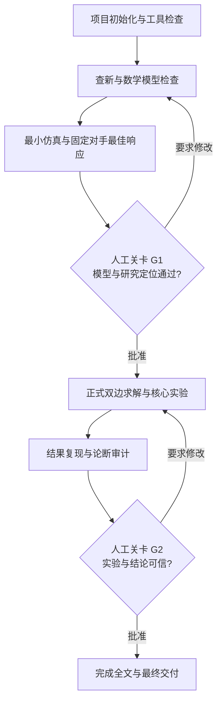

# 06 · 72 小时冲刺时序与强制人工审查

**计时起点**：Work 开始读取项目包、真正执行 P0 的时间 T0；不同于 ZIP 制作时间。三个“天”是 T0 后的 0–24 / 24–48 / 48–72 小时计划窗口，只有环境和用户审批及时可用时才可能完成。不得承诺实际计时自动继续或自行推定用户批准。

## 阶段依赖

## Day 1（T0~T0+24h）

- P0：确认文件、环境与真实执行能力，运行 `python -m pytest -q` 验证数值骨架。
- P1：强重合论文的 DOI 与内容核查、差异矩阵、理论证明与成本参数/单位审查。
- P2：至少一个 n=4,K=4 单方最优响应可行结果；检查优化器初始值、约束和积分一致性。
- **G1 提交**：`reviews/G1_submission.md`，附模型 v2、具体创新定位、最相近三篇以上论文差异、证明核查表、最小计算实验、剩余风险和建议路线 A/B。

### G1 人工检查 —— 必须获得用户明确回复

审核者：用户。建议操作：查看 G1 文件中 5 个问题并回复 `批准 G1，按路线 A 继续` 或 `批准 G1，采用路线 B` 或 `G1 不通过：<修改要求>`。

通过标准（用户判断）：①研究问题和贡献可辩护；②模型变量、控制边和预算定义清晰；③伴随/KKT 的来源节点索引与方向正确；④最小计算可以真实执行，失败风险充分暴露；⑤算法路线与论文表述一致。

**禁止越关**：无批准前，不启动依赖模型冻结的全套正式实验，不把候选创新写成定论。允许继续原有单元测试、文献资料整理和不含结果的引言草稿。

## Day 2（T0+24h~T0+48h；以 G1 实际批准为前提）

- P3：n=6,K=6，A/B/C 三场景，至少 3 种种子；比较预算和各防御基线。记录 fixed/adaptive attack 两种评估、成本分项和单方改善量。
- P4：更细积分复现；可行性与优化器多初值审查，确认哪些差异稳健、哪些差异未出现。
- **G2 提交**：`reviews/G2_submission.md`，附主结果路径、实验协议一致性表、按场景逐项结论、方法标签建议和可批准的摘要表述。

### G2 人工检查 —— 必须获得用户明确回复

建议回复：`批准 G2，允许使用结果清单中已核实的结论` 或 `G2 不通过：<需补实验/修改的事项>`。

通过标准：①每个主图都有 CSV / 参数 / 命令；②基线预算和攻击评估公平；③所有 gap 的含义、数值范围、优化器质量记录清晰；④新方法是否真正优于强基线有可靠证据；⑤论文哪些结论可写、哪些不能写已逐条列明。

**禁止越关**：未批准不得把数值提升写入最终摘要/结论，不得提交标注“已完成”的最终初稿；可以提前编写不依赖审批结果的数学、相关研究与方法段落。

## Day 3（T0+48h~T0+72h；以 G2 实际批准为前提）

- P5：完成摘要、实验讨论、结论、参考文献与论文可编辑版；生成 `paper/evidence_map.md`、`reports/final_audit.md`、`reports/reproduce.md`。
- 重新从 clean 目录/命令复现至少主实验和所有图；核查每张图的源 CSV、随机种子、参数、版本。
- 输出给用户的 1 页审稿要点：论文能证明的、仅数值发现的、待导师审查的、下一步投稿需要补的内容。

## 止损机制

- 单方最优响应无法可信运行：立即创建 `reports/blocker.md`、在 G1 推荐缩小计算规模；不能跳过认证继续跑大数据。
- 双边迭代不能获得可信的小 gap：G2 提交“路线 B：对抗响应驱动的动态优化”，如实更新题目与摘要，不使用“Nash 数值解”说法。
- 文献高度重合：G1 决策是否继续做决策规律方面的有限贡献研究；不得通过扩模型掩饰欠缺创新。
- 用户审批迟到：停止等待相关下游步骤，记录实际延期；72 小时目标可因此顺延而不是默认通过。
