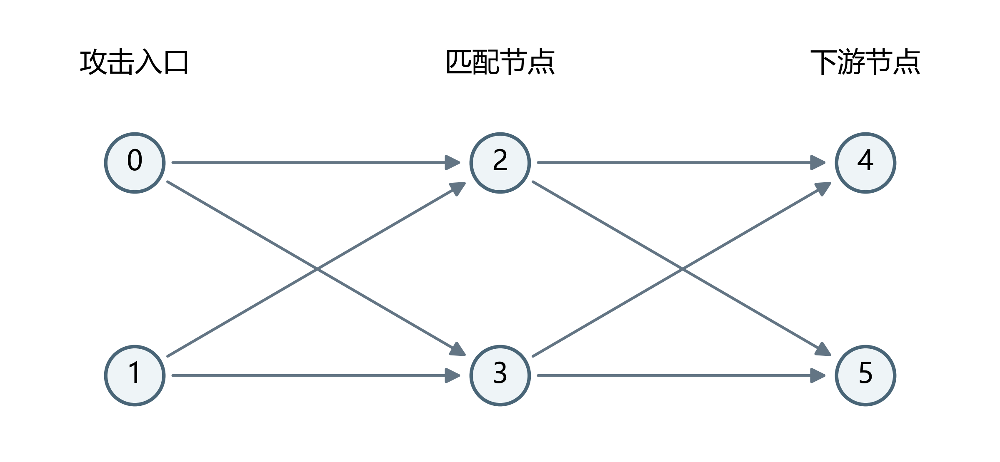
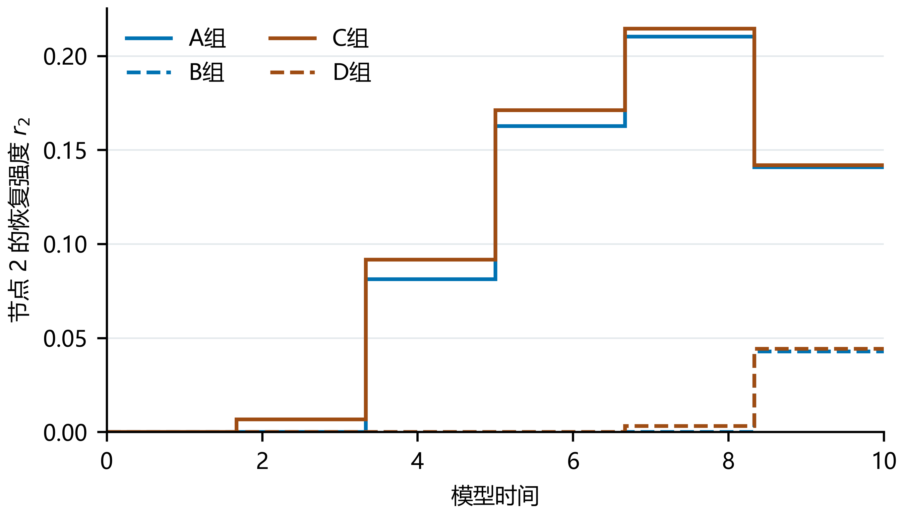
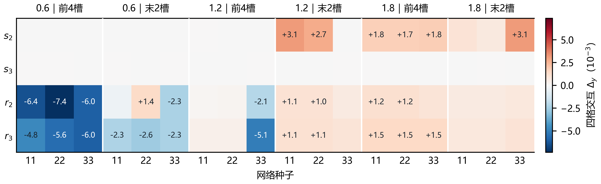
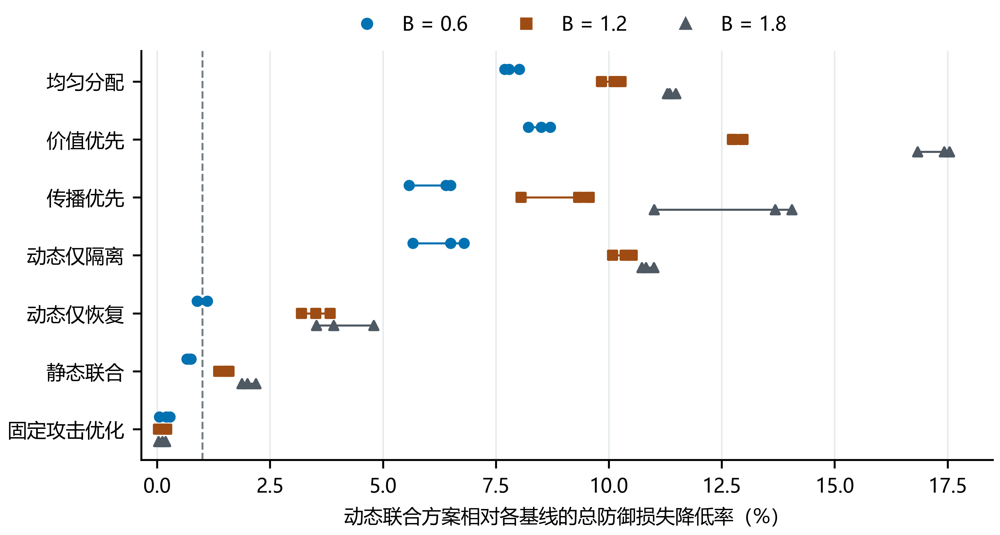
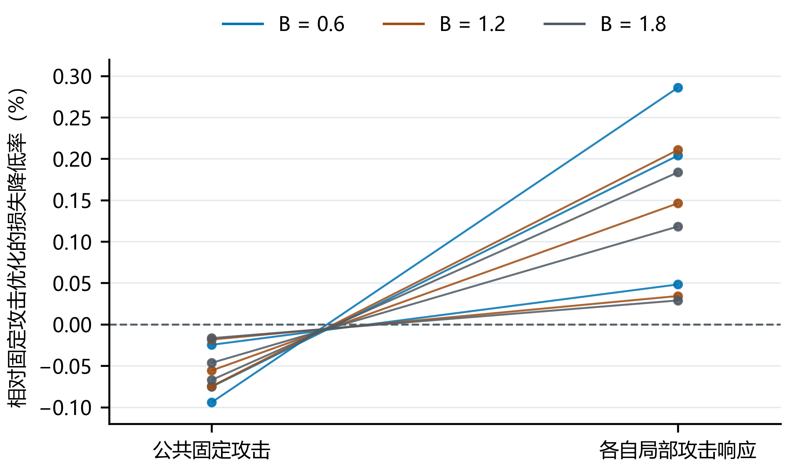

# 5 实验结果与讨论

## 5.1 仿真网络与参数设置

本文设置两组主要仿真实验。第一组改变高价值的位置与出边传播率之和的分布，观察防御控制如何重新分配。第二组固定这两个因素，改变防御方案的动作范围、时间安排或求解时采用的攻击条件，以总防御损失评价不同方案。

两组实验均采用图1所示的六节点合成网络。攻击者只能直接攻击节点0和1，每个入口均连接节点2和3。节点2和3又各自连接节点4和5。两个匹配节点初始均未受损，距入口均为一条边。同一入口到两个匹配节点的边权相等，使二者具有相同的入口暴露。

**图1　六节点匹配传播网络。** 箭头表示传播方向。两个入口各自连接两个匹配节点，两个匹配节点各自连接两个下游节点。

**表1　两组主要仿真的共同参数。**

| 参数                             | 取值                                                                                           |
| ------------------------------ | -------------------------------------------------------------------------------------------- |
| 初始受损比例 $x_0$                   | $(0.10,0,0,0,0,0)$                                                                           |
| 时域与控制时段                        | $T=10$，划分为 $K=6$ 个等长控制时段，每段长度为 $T/K$，各时段内控制量保持常值                                             |
| 攻击与防御资源上限                      | $A=0.8$，$B\in\{0.6,1.2,1.8\}$，各资源消耗系数为1                                                      |
| 入口攻击效率 $\alpha_i$              | 节点0、1均为0.25，其余为0                                                                             |
| 隔离有效性与恢复参数                     | $\varepsilon_i=1$，$\delta_i=0.10$，$\gamma_i=0.30$                                            |
| 收益与成本参数                        | $g_i=1$，$h_i=0.05$，$c_i^s=c_i^r=c_i^a=1$，$\omega_i=\nu_i=0$                                  |
| 入口边权 $(\beta_{02},\beta_{12})$ | 第1组（种子11）$(0.050286,0.079942)$，第2组（种子22）$(0.069308,0.055944)$，第3组（种子33）$(0.075491,0.085479)$ |

实验采用随机种子11、22和33生成表1中的三组入口边权，用于考察配置交互对入口传播条件的敏感性。每组均满足 $\beta_{03}=\beta_{02}$、$\beta_{13}=\beta_{12}$。仿真参数按模型设定，未使用实际环境数据标定。

## 5.2 价值位置与传播条件的四组对照

### 5.2.1 对照组与评价指标

给定一组入口边权和一个防御资源上限后，按表2交叉改变两个因素。当两节点的出边传播率之和相等时，比较高价值位于节点2或节点3的两种配置（A、B组）。当两节点的出边传播率之和不等时，作相同的比较（C、D组）。其余节点的直接价值均为1，因此四组的全网总价值均为9。节点2和3的出边传播率合计为0.32。其他参数按表1固定，双方计划在每组中分别求解。三组入口边权、三个防御资源上限和四种因素组合共构成36个配置。

**表2　价值位置与出边传播率之和的对照设置。**

| 组别  | 传播条件            | 节点2到每个下游的边权 | 节点3到每个下游的边权 | $(q_2,q_3)$ |
| --- | --------------- | ----------: | ----------: | ----------- |
| A   | 出边传播率之和相等，高价值在2 |        0.08 |        0.08 | $(4,1)$     |
| B   | 出边传播率之和相等，高价值在3 |        0.08 |        0.08 | $(1,4)$     |
| C   | 出边传播率之和不等，高价值在2 |        0.12 |        0.04 | $(4,1)$     |
| D   | 出边传播率之和不等，高价值在3 |        0.12 |        0.04 | $(1,4)$     |

以节点2、3的隔离和恢复强度为观察量，分别计算前四个控制时段和最后两个控制时段的平均值。记 $y_{\mathrm A},y_{\mathrm B},y_{\mathrm C},y_{\mathrm D}$ 为给定动作、节点和时间窗在四组中的平均控制强度。先求两种传播条件下价值位置改变造成的差值，再计算四格交互

$$
\Delta_y=(y_{\mathrm D}-y_{\mathrm C})-(y_{\mathrm B}-y_{\mathrm A}).
$$

当 $\Delta_y<0$ 时，价值由节点2移至节点3所引起的控制变化在两节点的出边传播率之和不等时更偏向负方向。实验以 $|\Delta_y|>0.001$ 作为控制量的数值分辨门槛。

### 5.2.2 控制轨迹与配置交互

图2给出采用第1组入口边权且 $B=0.6$ 时节点2的恢复计划。将高价值从节点2移至节点3后，节点2在六个控制时段内的平均恢复强度在A、B组之间由0.09920降至0.00715，在C、D组之间由0.10437降至0.00792。两次变化之差对应 $\Delta_{r_2}\approx-0.00440$。图3进一步比较三个防御资源上限下的前四个控制时段与最后两个控制时段，显示交互的方向和时段随防御资源上限与入口边权变化。

**图2　第1组入口边权、$B=0.6$ 时节点2的恢复计划。** A至D组对应表2，阶梯表示每个控制时段内采用常值投入。

**图3　不同防御资源上限、时段与入口边权下的四格交互。** 图上方标出防御资源上限 $B$ 与所比较的时段，图下方的随机种子编号对应表1中的三组入口边权。色值为 $10^3\Delta_y$，仅对超过0.001控制量分辨门槛的单元标注数值。

防御资源上限为 $B=0.6$ 时，三组入口边权下前四个控制时段的节点2恢复交互为 $-0.007356$ 至 $-0.006017$，节点3为 $-0.006030$ 至 $-0.004761$，绝对值均超过预设的0.001控制量分辨率。这12个配置在前四个控制时段的防御资源用量均达到上限，交互主要体现为恢复投入的重新分配。节点2和3的隔离投入接近零，但入口节点仍配置隔离资源，说明比较节点的动作选择需要结合六节点的全网分配解释。

防御资源上限为 $B=1.2$ 时，交互出现的时段随入口边权变化。第1、2组入口边权下，可分辨的交互集中在最后两个控制时段。第3组入口边权下，恢复交互出现在前四个控制时段。

防御资源上限为 $B=1.8$ 时，三组入口边权下前四个控制时段的节点2隔离交互为0.001745–0.001798，节点3恢复交互为0.001457–0.001480，两类控制均呈现方向一致的可分辨交互。此时，12个配置中有11个在前四个控制时段均有防御资源余量，另一个配置仅在其中一个时段达到上限。配置交互在资源有余量时仍可出现。结合式（2）和式（5），解释防御配置还需考虑状态演化、传播后果和行动成本。

## 5.3 防御方案对照及损失比较

### 5.3.1 对照方案与评价口径

方案比较采用表2的D组，其中节点2的出边传播率之和较大，节点3的直接价值较高。三组入口边权与三个防御资源上限组成九个配置。表3以动态联合为参照，逐项给出各方案的动作、时间安排及求解条件。每个配对共用网络、初始状态、资源上限、成本参数和损失函数。资源用量由各方案的规则或求解结果决定。

**表3　防御方案及其对照要素。**

| 方案 | 防御动作及时间安排 | 计划制定方式与对照要素 |
|---|---|---|
| 动态联合 | 隔离与恢复，按时段可变 | 双方交替求局部响应，作为参照 |
| 动态仅恢复 | 恢复按时段可变，$s=0$ | 双方交替求局部响应，用于评价加入隔离的增量 |
| 动态仅隔离 | 隔离按时段可变，$r=0$ | 双方交替求局部响应，用于评价加入恢复的增量 |
| 静态联合 | 隔离与恢复，各时段相同 | 双方交替求局部响应，攻击仍可按时段变化，用于比较防御的时间安排 |
| 固定攻击优化 | 隔离与恢复，按时段可变 | 固定入口等分攻击，求防御的局部响应，用于比较制定计划时考虑攻击调整的作用 |
| 均匀分配 | 隔离与恢复，各时段相同 | 两动作各分一半防御资源，各自在节点间等分 |
| 价值优先 | 隔离与恢复，各时段相同 | 两动作各分一半防御资源，各自按 $q_i$ 的相对大小分配 |
| 传播优先 | 隔离与恢复，各时段相同 | 两动作各分一半防御资源，各自按 $d_i^{\mathrm{out}}$ 的相对大小分配 |

计划生成后锁定防御控制，并分别评价两种攻击。**公共固定攻击**在每槽给两个入口各分配0.4的攻击强度，所有防御计划面对同一攻击。**各自局部攻击响应**对每套防御固定其全时域计划，以最大化 $J_A$ 为目标，用同一多初值程序搜索局部攻击响应。后者允许攻击计划因防御而异。

以式（5）的总防御损失 $J_D$ 为评价量。在同一配置与同一评价口径内，动态联合方案相对基线的损失降低率为

$$
\eta=\frac{J_D^{\mathrm{baseline}}-J_D^{\mathrm{joint}}}
{J_D^{\mathrm{baseline}}}\times100\%.
$$

$\eta>0$ 表示动态联合方案损失较低。报告的范围为三组入口边权对应结果的最小值至最大值。预登记的1%是用于描述降幅的工程阈值。原模块化网络中的业务成本案例在5.4节单独报告。

### 5.3.2 联合动作与时间分配的损失降低

在九个匹配配置中，动态联合方案相对均匀分配、价值优先和传播优先分别降低总防御损失7.69%–11.48%、8.22%–17.54%和5.58%–14.05%。这些结果说明，结合状态演化与成本求得的配置，在本组实验中优于所采用的固定份额规则。优化方案允许保留未使用的防御资源，因此相对启发式的改善也包含减少不必要投入的作用，不能全部归于攻击策略调整。

图4显示各自局部攻击响应下的全部七项配对比较。动态联合相对动态仅隔离的损失降低率为5.665%–11.000%。表4进一步列出动态仅恢复、静态联合和固定攻击优化的结果，便于比较幅度较小的差异。

**图4　各自局部攻击响应下动态联合方案相对七种基线的损失降低率。** 每种基线在每个防御资源上限下显示三组配对结果，每个点对应一组入口边权，横线连接最小值与最大值。竖虚线为1%描述阈值。

**表4　各自局部攻击响应下三项主要对照的损失降低率（%，三组入口边权下的取值范围）。**

| 防御资源上限 $B$ | 动态仅恢复 | 静态联合 | 固定攻击优化 |
|---|---:|---:|---:|
| 0.6 | 0.887–1.112 | 0.661–0.752 | 0.048–0.286 |
| 1.2 | 3.199–3.834 | 1.363–1.590 | 0.034–0.211 |
| 1.8 | 3.525–4.796 | 1.875–2.190 | 0.029–0.184 |

加入来源隔离后，动态联合方案在九个配置中均比动态仅恢复具有更低的总防御损失，其中七个配置的降幅达到1%。表4显示，$B=1.2$ 和 $B=1.8$ 时的降幅均大于 $B=0.6$ 时的降幅。在本组配置中，允许两类动作共同求解所带来的增量随防御资源上限而变。

允许防御按时段变化后，动态联合方案相对静态联合在九个配置中均降低总防御损失。$B=0.6$ 时的三个降幅均不足1%，$B=1.2$ 和 $B=1.8$ 时的六个降幅均超过1%。两种方案分别接受针对自身防御的局部攻击响应，该结果反映防御时间安排与攻击调整共同作用后的最终表现。

## 5.4 攻击响应与方案收益边界

制定防御计划时考虑攻击调整，相对固定攻击优化方案带来0.029%–0.286%的额外总防御损失降低，九个匹配配置均低于1%的描述阈值。表4显示，同一批配置下，加入来源隔离及允许防御按时段变化对应的损失降低幅度更大。

图5显示，同一对防御计划在两种攻击口径下给出相反的排序。在公共固定攻击下，动态联合方案的总防御损失高0.017%–0.094%。当攻击者分别对两种防御作出局部响应时，九个配对的损失降低率均转为正值。

**图5　动态联合相对固定攻击优化的损失降低率。** 每条连线对应一组入口边权与一个防御资源上限的组合，连接同一对防御计划在两种攻击评价下的结果。虚线表示损失相等。

原模块化网络中的业务成本案例进一步限定了联合动作的收益范围。在该案例中，随机种子为33，防御资源上限为 $B=0.6$。联合方案的总防御损失为12.437518，动态仅恢复为12.436854，联合方案高约0.00534%。此前对同一案例的交叉评价显示，在两套保存攻击计划中的任一套下，联合防御的损失均较低；但分别采用各自响应攻击后，联合方案的损失略高。该结果与攻击调整抵消直接防御收益的解释一致。

固定同一攻击时，扩大防御可行集合可使防御者单方最优响应的最小损失不增；本实验比较的则是不同防御限制下形成的攻防响应策略对，而且采用局部求解。因此，扩大防御动作集合本身不保证这些策略对的防御损失逐例下降。上述反例保留了这一收益边界。

## 5.5 数值核验与适用范围

小规模核验采用三节点、两个控制时段的实例，在两个防御资源上限和两档动作网格下构造四张完整收益表，共覆盖386397个策略对。每张表在 $10^{-8}$ 的数值容差下均识别出一个纯策略均衡。对局部连续控制候选，穷尽相应有限菜单中的单方偏离也未发现目标改善。粗细动作网格所得均衡成本不同，说明改变动作离散化会改变可选策略及结果；上述均衡识别针对各自的有限数值游戏。

补充实验的128次局部求解、32组三初值检查及40个最终局部候选检查均通过预设门槛，2404次记录的优化调用全部返回成功。160条新增评价重新积分的最大差为 $7.11\times10^{-15}$；另对20组随机策略对使用独立积分器核验，最大差为 $2.30\times10^{-9}$。原36个机制配置的交互差值在多初值与积分精化下保持稳定，最大跨度为 $1.87\times10^{-6}$，低于0.001的控制量分辨率。这些检查支持已报告计算结果的数值稳定性。

六节点结果属于分段开环策略中的交替局部响应候选，局部搜索未提供连续控制域中最大单方改善的上界，小规模有限菜单核验也不构成连续时间均衡证明。积分精化检验的是既定控制时段下的状态与目标计算精度，不等同于控制时段数 $K$ 的精化，更不验证 Markov 反馈策略。本文识别的配置交互与收益范围适用于所列合成网络、参数及六个控制时段的设定。零终端权重进一步限定了末期配置的解释。其防御决策含义在于，将直接价值与传播条件共同纳入资源配置，并分别评价联合动作、时间分配和攻击响应的收益，避免用单一节点指标或单一攻击口径概括全部配置。
