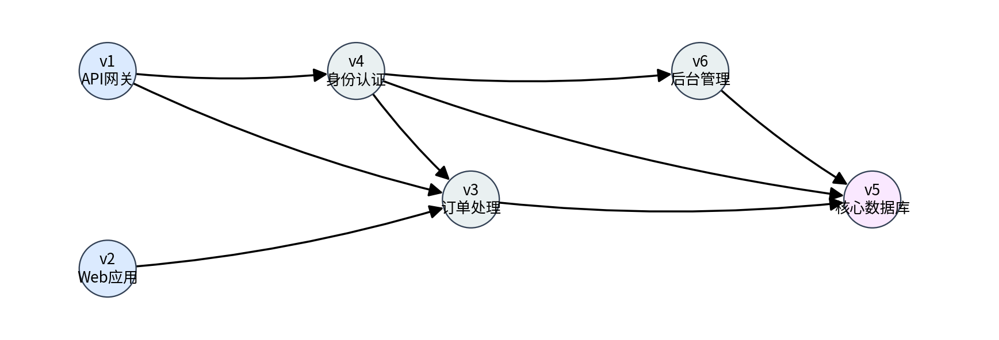
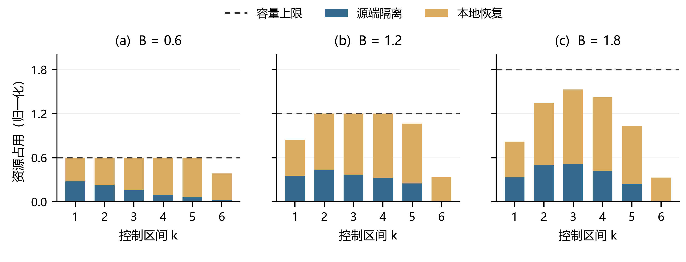
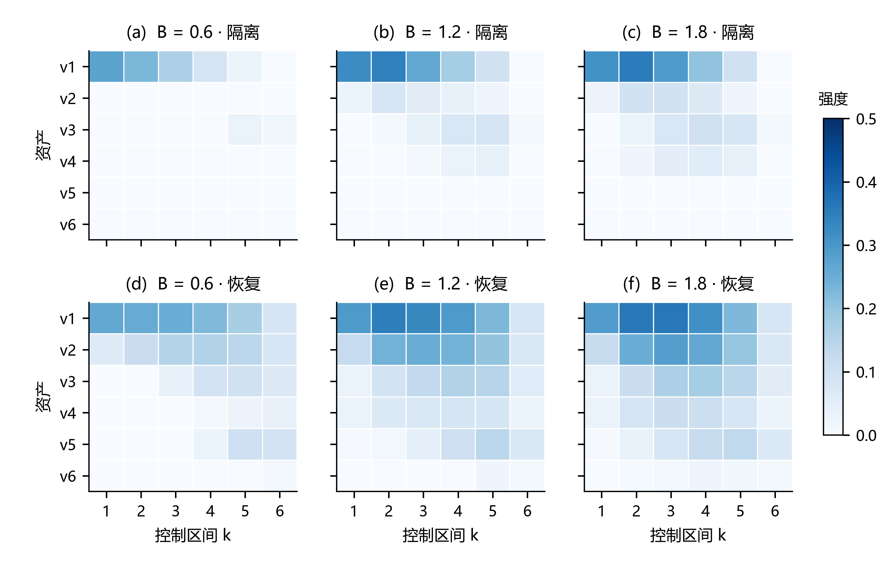

%% 文档标题 基于非零和微分博弈的有限资源多资产网络防御决策方法

%% 摘要 **摘要：** 针对多资产网络中攻击跨资产传播、隔离与恢复争夺有限资源的问题，建立以资产受损比例为状态的非零和开环微分博弈模型。采用分段常值控制参数化与交替数值最佳响应，形成动态防御行动求解流程（ABR-DAD），输出逐资产、逐时段的隔离与恢复投入，并检验单方偏离、容量可行性和积分精度。六资产仿真环境中，三种防御容量对应不同的时序配置；等容量防御扰动引起可区分于经验求解波动的双向策略响应。与固定攻击规划方案各自对应的攻击响应组合相比，博弈方案综合损失降低0.0058%–0.0158%；共同预设攻击下的排序则反转。结果支持所设参数与分段控制类中的可计算防御规划及策略相互依赖性，性能收益具有攻击条件依赖性。

%% 关键词 **关键词：** 网络防御决策；非零和微分博弈；交替最佳响应；攻击传播；资源配置

# 1 引言

多资产网络可由API网关、业务应用、身份认证、业务处理和核心数据库等关联服务组成。当攻击者利用漏洞或失陷凭证进入部分服务后，攻击可能沿具备利用条件的访问关系向其他资产传播。此时，资产的防御优先级既与自身受损损失有关，也与其对下游资产的传播影响有关。防御者可以隔离受损来源以削弱外传，也可以恢复受损实例以降低本地受损比例；两类行动具有不同的作用机制、业务代价和资源占用。因而，有限容量下的防御决策需要同时确定防御对象、行动类型、投入强度和实施时段。此外，攻击者可按照自身收益目标调整攻击计划，使防御行动与攻击策略形成相互依赖的动态决策关系。

围绕网络传播与安全资源分配，已有研究从传播结构与攻防决策两个方面展开。Preciado等[@Preciado2014]研究有向网络中防护资源对传播过程的控制；Al-Eiadeh和Abdallah[@AlEiadeh2025]利用攻击图描述互依系统的攻击关联，并结合PageRank设计防御资源分配方法。Paarporn和Xu[@Paarporn2024]分析预防性与反应性防御的资源权衡；Chen等[@Chen2025]进一步研究防护与恢复资源分配及节点优先级对网络鲁棒性的影响。面向云平台，Li等[@Li2023Cloud]采用随机博弈描述攻防决策。上述工作表明，网络结构、资产重要性和行动成本会影响资源分配，但各研究的状态定义、策略机制及优化目标不尽相同。

在连续时间网络攻防决策方面，Tian等[@Tian2025]研究云环境恶意软件传播控制中的非零和攻防博弈；Zhang等分别将微分博弈用于无标度网络实时防御[@Zhang2023ScaleFree]和复杂网络势微分博弈防御[@Zhang2023Potential]。孙鹏宇等[@Sun2022]研究结合攻防行动与时机的时间微分博弈；胡春娇等[@Hu2023]研究Markov微分博弈下的移动目标防御；Lou等[@Lou2026]讨论不完全信息下的协同防御。这些研究已涉及传播控制、双类防御资源配置和动态攻防博弈。Paarporn和Xu[@Paarporn2024]考察攻击前预防与受损后恢复的两阶段资源竞争；Tian等[@Tian2025]以节点感染及意识状态演化建立开环攻防模型。本文采用资产实例组的聚合受损比例，将削弱来源外传的隔离与降低本地受损的恢复作为同时争用瞬时容量的两类控制，研究其跨资产、跨时段配置。本文的工作是给出这组机制下可复核的建模与求解流程，并通过完整行动输出、固定对手响应扰动和共同攻击交叉评价，分别检验计划可行性、策略相互依赖性与收益边界。ABR-DAD沿用交替响应和约束优化工具，不赋予其未经证明的全局收敛性质。

# 2 网络攻防非零和微分博弈模型

## 2.1 网络状态与防御机制

将多资产网络表示为有向加权图$\mathcal G=(V,E)$，其中$V=\lbrace v_1,\ldots,v_n\rbrace$为逻辑资产集合，$E$为满足实际利用条件的攻击传播边。记$\beta_{ji}\ge0$为来源资产$j$至目标资产$i$的有效传播率，不存在边时取零，且$\beta_{ii}=0$。设$x_i(t)\in[0,1]$为资产$i$所属工作负载实例组在时刻$t$的受损比例，该变量是同类工作负载实例的聚合受损程度，用于描述网络状态。

攻击者仅对入口索引集合$I_A\subseteq\lbrace 1,\ldots,n\rbrace$配置入口攻击强度$a_i(t)$，非入口资产取$a_i(t)=0$。防御者设置源端隔离$s_i(t)$和本地恢复$r_i(t)$。三种控制均为$[0,1]$内的归一化强度。先定义资产$i$在时刻$t$受到的总受损压力：

$$\lambda_i=\alpha_i a_i+\sum_{j\ne i}\beta_{ji}(1-\varepsilon_j s_j)x_j$$ {#eq-1}

资产受损状态遵循：

$$\dot x_i=(1-x_i)\lambda_i-(\delta_i+\gamma_i r_i)x_i$$ {#eq-2}

其中$\alpha_i$为入口直接攻击效率（对非入口资产取零），$\varepsilon_j$为来源隔离效率，$\delta_i$为基础恢复率，$\gamma_i$为恢复投入效率，初态为$x_i(0)=x_{i0}$。式（1）中$s_j$仅降低来源$j$的出向传播；式（2）中$r_i$直接降低资产$i$的受损比例，并通过状态演化间接抑制之后的传播。对非负有限参数、$0\le\varepsilon_j s_j\le1$与可测有界控制，状态集合$[0,1]^n$正不变；给定初态与控制计划后，状态系统在有限时域内具有唯一轨迹；在$x_i=0$和$x_i=1$的边界，导数分别非负和非正；状态方程关于状态局部Lipschitz。上述性质为双方目标函数的数值评价提供确定的状态映射。

## 2.2 非零和开环微分博弈定义

上述网络状态方程给出了攻防控制影响资产受损状态的动态机制。为将这一机制转化为双方独立目标下的资源配置问题，定义完全信息、两方非合作的非零和开环微分博弈。

**定义1（多资产网络攻防微分博弈）** 将博弈表示为六元组：

$$\Gamma=(\mathcal N,\mathcal T,\mathcal P,x,f,\mathcal J).$$

其中，$\mathcal N=\lbrace N_D,N_A\rbrace$为防御者和攻击者的参与者集合；$\mathcal T=[0,T]$为有限规划时域；$\mathcal P=(\mathcal U,\mathcal A)$为双方可行的开环控制计划集合，$\mathcal U$和$\mathcal A$分别对应防御者与攻击者；$x(t)\in[0,1]^n$为网络状态；$f$为式（1）—（2）所定义的状态转移函数，满足$\dot x(t)=f(t,x(t),u(t),a(t))$；$\mathcal J=(J_D,J_A)$为双方目标函数集合，其具体形式及资源约束见2.3节。

可行集$\mathcal U$与$\mathcal A$由满足式（9）—（10）及控制边界的可测有界时间函数构成，约束几乎处处成立，初态属于$[0,1]^n$。在完全信息设定下，双方共知拓扑、初态、目标参数和约束，并于规划时刻选择整个时域的开环控制计划。防御者最小化综合损失，攻击者最大化净收益；双方通过共同的状态轨迹相互作用，形成非零和动态博弈。模型中隔离作用于来源资产的出向传播，恢复作用于本地受损状态，两类行动在收益与容量约束中联合配置。

## 2.3 攻防目标与资源约束

防御者最小化资产受损损失、隔离业务影响及控制成本之和。将瞬时综合损失分成两项表示：

$$\ell_D=\sum_{i=1}^n(q_ix_i+h_is_i)+C_D,$$ {#eq-3}

$$C_D=\frac12\sum_{i=1}^n(c_i^s s_i^2+c_i^r r_i^2)$$ {#eq-4}

攻击者最大化资产受损收益扣除攻击成本后的净收益：

$$\ell_A=\sum_{i=1}^n g_ix_i-C_A,$$ {#eq-5}

$$C_A=\frac12\sum_{i=1}^n c_i^a a_i^2$$ {#eq-6}

在有限规划时域$[0,T]$上，双方目标为：

$$J_D(u,a)=\int_0^T\ell_D\,\mathrm dt+\omega^\top x(T),$$ {#eq-7}

$$J_A(u,a)=\int_0^T\ell_A\,\mathrm dt+\nu^\top x(T)$$ {#eq-8}

其中$u=(s,r)$，$q_i,g_i$分别为防御损失与攻击收益权重，$h_i$为隔离业务影响系数，$c_i^s,c_i^r,c_i^a$为正的二次成本系数，$\omega,\nu$为终端状态权重。双方分别求解$\min J_D$与$\max J_A$，并具有各自的状态收益权重和行动成本，满足非零和博弈的目标结构$J_A\neq -J_D$。

设$B$和$A$分别为防御者与攻击者的瞬时资源容量。每一时刻满足：

$$\sum_i(b_i^s s_i+b_i^r r_i)\le B,$$ {#eq-9}

$$\sum_{i\in I_A}d_i^a a_i\le A$$ {#eq-10}

同时有$0\le a_i,s_i,r_i\le1$（非入口资产$a_i=0$），其中$b_i^s,b_i^r,d_i^a$为单位控制强度的容量占用系数。式（9）—（10）约束每一时刻同时投入的资源，式（4）和式（6）描述随时间累计的控制成本。模型统一采用相对单位。时间采用未标定的模型时间，传播与恢复参数按该时间单位计率；成本与资源占用未经货币或设备数量标定。控制强度对应规划层面的配置，具体执行仍需与网络中的访问限制、清理或重建操作建立映射。

## 2.4 开环均衡判据与防御决策目标

依据定义1，攻防双方在相同信息条件下分别优化整个规划时域内的控制计划。以动态非合作博弈理论[@Basar1999]为依据，**定义2（开环纳什均衡）**：对于可行策略对$(u^\star,a^\star)\in\mathcal U\times\mathcal A$，若双方在固定对手计划时均达到各自最优响应，则满足：

$$J_D(u^\star,a^\star)\le J_D(v,a^\star),\quad v\in\mathcal U,$$ {#eq-11}

$$J_A(u^\star,a^\star)\ge J_A(u^\star,b),\quad b\in\mathcal A$$ {#eq-12}

式（11）—（12）是双方开环策略相互最佳响应的理论判据。本文以该判据作为数值求解的理论参照，将连续控制参数化为有限维计划，输出具有明确资产位置、控制区间和投入强度的防御行动，并通过固定对手的数值偏离检验、资源可行性和积分复核评价计算结果。

# 3 基于交替最佳响应的动态防御行动求解方法

## 3.1 分段常值控制与数值最佳响应

利用控制参数化方法[@Betts2010]，将$[0,T]$均分为$K$个区间，每区间长度$\Delta t=T/K$。令$k=1,\ldots,K$，记$t_k=k\Delta t$，第$k$区间为$[t_{k-1},t_k)$（末段包含$T$）。在该区间内，$a_{i,k}$、$s_{i,k}$与$r_{i,k}$保持常值，状态$x(t)$仍按照式（2）连续演化。将防御与攻击决策变量分别记为$z_D=\lbrace s_{i,k},r_{i,k}\rbrace$和$z_A=\lbrace a_{i,k}\mid i\in I_A\rbrace$，相应有限维可行域为$U_K,A_K$。在六资产、六控制区间和两个入口条件下，双方分别具有72个防御控制分量和12个攻击控制分量。

固定对手的控制计划，双方在受限策略类中的理论最佳响应分别为：

$$BR_D(z_A)=\operatorname{argmin}_{v\in U_K}J_D(v,z_A),$$ {#eq-13}

$$BR_A(z_D)=\operatorname{argmax}_{b\in A_K}J_A(z_D,b)$$ {#eq-14}

每一次目标函数计算均先以四阶Runge–Kutta（RK4）方法积分状态轨迹及累计目标[@Hairer1993]，再以序列最小二乘规划（SLSQP）处理控制边界和线性容量约束[@Nocedal2006; @Kraft1988]。本文用SLSQP计算局部数值响应。记该过程为$\operatorname{LBR}_D$与$\operatorname{LBR}_A$，攻击方以$-J_A$为最小化目标；仅接受有限、可行且不劣于当前计划的候选，优化器退出状态另行记录。交替循环与最终复核的初始化设置见算法1。式（13）—（14）作为理论最佳响应定义，实际算法输出为经上述检验的数值控制计划。

## 3.2 ABR-DAD动态防御行动算法

本文采用交替最佳响应组织动态防御行动求解流程（Alternating Best Response for Dynamic Defense Action Decision，ABR-DAD）。最佳响应原则来自动态非合作博弈[@Basar1999]；文献[@Caruso2020]研究了带特定调整的响应迭代，本文采用的无阻尼顺序更新不继承其收敛保证。令$m$表示离线求解迭代编号，$k$表示实际控制区间编号，RK4子步长为$\Delta t/H$。每轮$m$均评价完整时域$[0,T]$，并不将物理时间推进一个控制区间。

**算法1  ABR-DAD动态防御行动求解伪代码**

**输入：** 模型参数与初态，$T,K$，双方容量，随机种子，最大更新次数$M=40$及第3.3节的验收阈值。

**输出：** 分段控制计划$(z_D,z_A)$、行动表$D_{i,k}$和数值验收状态。

| 行 | 伪代码 |
|:--:|:---------------------------------------------|
| 1 | 生成均匀、零、随机三组可行初始计划；预先指定均匀路径为主路径。 |
| 2 | **for** 每条初始化路径 $p$ **do** |
| 3 | 令 $(z_D,z_A)$ 等于该路径初值，$\mathrm{pass}_p\leftarrow\mathrm{false}$。 |
| 4 | **for** $m=0,\ldots,M$ **do** |
| 5 | 固定同一当前策略对，分别求 $\tilde z_D=\operatorname{LBR}_D(z_A;z_D)$ 和 $\tilde z_A=\operatorname{LBR}_A(z_D;z_A)$。 |
| 6 | 计算双边已发现改善、当前点投影残差及响应距离；内部响应从当前点启动。 |
| 7 | **if** 路径停止条件全部满足 **then** $\mathrm{pass}_p\leftarrow\mathrm{true}$；**break**。 |
| 8 | **if** $m=M$ **then break**，保留未通过标记。 |
| 9 | 更新 $z_D\leftarrow\tilde z_D$；固定新防御重新求 $z_A\leftarrow\operatorname{LBR}_A(z_D;z_A)$。 |
| 10 | **end for**；保存该路径计划及 $\mathrm{pass}_p$。 |
| 11 | **end for**；取预定主路径，检查三路径停止状态和控制差。 |
| 12 | 固定主路径完整策略对，在 $H=48,96$ 下分别从当前、零、随机初值复核双边偏离。 |
| 13 | 保持输出控制不变，在 $H=48,96,192$ 下复算状态与目标；核验控制边界和逐槽容量。 |
| 14 | **if** 第3.3节全部验收条件通过 **then return** 主路径行动表与“通过”。 |
| 15 | **else return** 当前候选、未通过项及“未通过”；不得将迭代上限当作通过条件。 |

算法第5行对同一个尚未更新的策略对检查双方，检查后才在第9行依次更新防御和攻击。三条完整路径用于检查初始化依赖性；第12行的多起点搜索用于复核主路径，二者不同。最终输出为规划时刻计算的开环计划，不是执行过程中按新观测状态实时调整的反馈策略。

对资产$i$、区间$k$，算法给出的防御行动与资源占用为：

$$D_{i,k}=(s_{i,k},r_{i,k}),$$ {#eq-15}

$$R_{i,k}=b_i^s s_{i,k}+b_i^r r_{i,k}$$ {#eq-16}

式（15）—（16）直接回答在何处、何时分别实施多大强度的隔离和恢复，同时保证$\sum_i R_{i,k}\le B$。执行仿真时仅按控制区间$k$切换已保存的行动强度；离线迭代编号$m$不参与执行时钟。

## 3.3 最佳响应数值检验

为了与式（11）—（12）建立联系，固定最终对手计划，从有限候选控制集$\mathcal C_D\subseteq U_K$和$\mathcal C_A\subseteq A_K$搜索能够进一步改善各自目标的策略，并计算：

$$\widehat\Delta_D=J_D(z_D,z_A)-\min_{v\in\mathcal C_D}J_D(v,z_A),$$ {#eq-17}

$$\widehat\Delta_A=\max_{b\in\mathcal C_A}J_A(z_D,b)-J_A(z_D,z_A)$$ {#eq-18}

候选集均包含当前计划，因而$\widehat\Delta_D,\widehat\Delta_A\ge0$。它们表征已检查候选集合内的单方改善量，并构成相应有限维全局偏离改善量的下界。结合归一化改善量、投影驻点残差、控制响应距离、资源约束和积分精度，本文对最终结果采用“通过预设数值响应检验的攻防控制计划”的规范表述。数值检验的对象与结论均限定于当前模型参数、控制离散精度及优化搜索设置。

归一化已发现改善为$e_D=\widehat\Delta_D/(1+|J_D|)$、$e_A=\widehat\Delta_A/(1+|J_A|)$。令$F_D=J_D$、$F_A=-J_A$，$Z_D=U_K$、$Z_A=A_K$，当前点投影残差定义为$\rho_p=\|z_p-\Pi_{Z_p}(z_p-\nabla_{z_p}F_p)\|_\infty$，其中$\Pi$为欧氏投影。响应距离为双方当前计划与相应候选响应之差的最大无穷范数。路径停止要求$\max(e_D,e_A)\le10^{-7}$、$\max(\rho_D,\rho_A)\le10^{-4}$、响应距离$\le10^{-3}$且该次响应优化均正常退出。

最终验收还要求三条路径均通过、另外两条路径与主路径的控制差不超过$10^{-3}$、全部登记优化调用成功，以及控制边界和逐槽容量违反不超过$10^{-10}$。多起点复核沿用上述改善、残差与距离阈值；固定控制加密积分的共同时间点状态、目标及成本分项差不超过$10^{-6}$。这些量用于判断局部数值结果的可复核性，不是未知全局偏离量的上界。

# 4 仿真实验与防御行动分析

## 4.1 多资产网络仿真环境与实验设置

构建六资产非对称有向攻击传播网络，如图1所示：$v_1$为API网关，$v_2$为Web应用，$v_3$为订单处理，$v_4$为身份认证，$v_5$为核心数据库，$v_6$为后台管理。$v_1$和$v_2$是直接攻击入口；$v_4$具有多条出向传播边，$v_5$具有较高损失权重但无出向传播。有效传播边与传播率为：$1\to3:0.08$、$1\to4:0.09$、$2\to3:0.10$、$4\to3:0.11$、$4\to5:0.07$、$4\to6:0.12$、$3\to5:0.10$及$6\to5:0.05$。该仿真环境的拓扑、传播率、价值和成本参数均为预先设定的模型输入，未由实际网络测量标定。服务名称用于说明资产作用，传播边表示预设可利用条件，不等同于一般业务调用关系。

{width=15cm}

%% 图片题注 **图1  六资产非对称有向攻击传播网络。** 箭头表示有效攻击传播方向，$v_1,v_2$为入口，$v_5$为高价值资产。

%% 表格题注 **表1  主要仿真参数**

| 类别 | 参数 |
|:---|:---|
| 网络与规划时域 | $n=6$，$T=10$，$K=6$，$\Delta t=5/3$ |
| 初态与攻击容量 | $x(0)=(0.1,0,0,0,0,0)$，$A=0.8$ |
| 防御容量 | $B\in\lbrace 0.6,1.2,1.8\rbrace$；主分析取$B=1.2$ |
| 直接攻击与传播抑制 | $\alpha_1=\alpha_2=0.25$，其余$\alpha_i=0$；$\varepsilon_i=1$ |
| 恢复与价值权重 | $\delta_i=0.1$，$\gamma_i=0.3$；$q=(1,1,1,1,4,1)$，$g_i=1$ |
| 成本、容量与终端权重 | $h_i=0.05$，$c_i^s=c_i^r=c_i^a=1$，$b_i^s=b_i^r=d_i^a=1$，$\omega=\nu=0$ |

数值求解使用Python 3.11.7、NumPy 1.26.4和SciPy 1.11.4。SLSQP设置为最多300次迭代、目标容差$10^{-10}$；状态积分每槽$H=48$步。均匀、零、随机三条完整路径分别运行，固定采用均匀路径的输出。容量$B=1.2,0.6,1.8$的主种子依次为20261114、20262114和20263114，随机性仅用于优化初值，不代表随机网络重复。完整参数、控制、数值核验与复算命令见补充材料。

对照方案包括：**G（攻防博弈）**，通过ABR-DAD交替求得$(u_G,a_G)$；**F（固定攻击规划）**，先在预设攻击$a_0=(0.4,0.4,0,0,0,0)$下计算防御计划$u_F$，执行评价时再固定该计划并重新计算攻击者收益驱动的数值响应$a_{BR,F}$。两组评价对象分别为$(u_G,a_G)$和$(u_F,a_{BR,F})$，分别反映两类规划方法与各自攻击响应构成的策略组合表现。为辨识防御配置差异，实验在$a_0$、$a_G$和$a_{BR,F}$三种共同攻击轨迹下交叉评价两组防御计划。攻击响应均以提高$J_A$为目标，并非以最大化$J_D$生成最坏情形。

## 4.2 逐资产、逐时段的防御行动输出

图2给出$B=0.6,1.2,1.8$三种容量下G的逐时段资源占用，并分解为隔离和恢复。$B=0.6$时前五个区间用满容量，第6区间降至0.386190；$B=1.2$时第2—4区间用满容量；$B=1.8$时六个区间均存在松弛，最大总占用为1.529787。主容量下六槽总占用依次为0.843705、1.200000、1.200000、1.200000、1.065570和0.337751。增加可用容量并不意味着每个时段都会增加投入，具体计划同时受状态收益、业务影响和控制成本影响。

{width=17cm}

%% 图片题注 **图2  三种防御容量下G的分时段资源占用。** 堆叠柱为隔离与恢复容量之和，虚线为对应瞬时容量上限。第$k$区间为$[(k-1)5/3,k5/3)$，最后区间包含$T=10$。三组为同一网络的容量条件，不是统计重复。

{width=17cm}

%% 图片题注 **图3  三种防御容量下G的完整行动配置。** 上排为源端隔离$s_{i,k}$，下排为本地恢复$r_{i,k}$；列对应容量0.6、1.2和1.8，横轴为控制区间，纵轴为资产。六幅图使用同一色标，显示全部108组资产—区间配置。

末段资源减少与有限时域和本例零终端权重有关，不能直接外推为持续运行网络的末期减防规则。图2刻画行动总量，图3进一步展示资源的资产位置及行动类型。

为展示防御动作本身，表2列出保存控制计划中具有代表性的资产—时段配置。完整输出包含每个资产、每个控制区间的$s_{i,k}$和$r_{i,k}$，由式（15）—（16）转化为规划层面的防御行动及其容量占用。

%% 表格题注 **表2  主容量下G的代表性防御行动（归一化强度）**

| 资产编号 | 区间$k$ | 源端隔离$s_{i,k}$ | 本地恢复$r_{i,k}$ |
|:---:|:---:|---:|---:|
| $v_1$ | 1 | 0.323232 | 0.294892 |
| $v_1$ | 2 | 0.345588 | 0.348708 |
| $v_4$ | 2 | 0.000951 | 0.067163 |
| $v_4$ | 5 | 0.042531 | 0.083404 |
| $v_5$ | 1 | 0（数值零） | 0.004480 |
| $v_5$ | 5 | 0（数值零） | 0.139747 |

%% 表注 注：数值保留六位小数。完整三容量G/F控制共216组资产—区间记录，随补充材料提供；资源合计使用未舍入值计算。

API网关既是初始受损的攻击入口，又连接订单处理和身份认证，因此前期同时获得较高隔离与恢复投入。身份认证具有较多出向传播关联，但在受损程度较低的早期仅得到很小的隔离投入；随着状态演化，第5区间的隔离和恢复同时提高。核心数据库受损代价较高，且没有出向传播边；由于本文的$s_i$仅削弱出向传播，数据库主要接受本地恢复投入。这些配置与受损状态、资产价值、传播位置、行动机制和资源成本的共同作用一致；本例没有通过逐因素消融分别量化各因素的独立贡献。 数据库隔离为零对应本文的“源端出向传播抑制”定义；现实中的入向访问控制属于另一类防御机制。

## 4.3 攻防策略响应及防御效果

为了直接检验攻防策略相互依赖性，以$B=1.2$下G的保存计划为基准，只在第2—4区间将两个入口资产之间的恢复投入作正、反向等容量转移，正向扰动在$k=2,3,4$令$r^+_{1,k}=r^G_{1,k}-0.05$、$r^+_{2,k}=r^G_{2,k}+0.05$；反向扰动的加减号对调。其余控制、容量、拓扑和模型参数不变。固定调整后的防御计划求攻击方数值响应，再固定新的攻击计划求防御方响应，构成“防御变化—攻击响应—防御再配置”的两段响应计算。主要结果见表3。

%% 表格题注 **表3  等容量防御扰动引起的双方数值响应**

| 扰动方向 | 攻击控制最大变化 | 防御控制最大变化 | 攻方已发现收益改善 | 防方已发现损失改善 |
|:---|---:|---:|---:|---:|
| 正向 | 0.017119 | 0.010224 | 0.001640 | 0.000456 |
| 反向 | 0.017168 | 0.010172 | 0.001648 | 0.000454 |

%% 表注 注：攻击控制变化相对重新求得的基准攻击响应$a_{BR}(u_G)$，防御控制变化相对原$u_G$，均取最大绝对分量差。攻方改善为$J_A(u^\pm,a_{BR}(u^\pm))-J_A(u^\pm,a_G)$；防方改善为$J_D(u_G,a_{BR}(u^\pm))-J_D(u_{BR},a_{BR}(u^\pm))$，其中$u_{BR}$为新攻击下的防御响应。两项分别固定对手计划。

正反扰动产生的攻击响应之间最大分量差为0.034287，进一步的防御响应之间最大分量差为0.020395，对应保存审计记录中两侧经验求解波动之和分别为$1.0250\times10^{-5}$和$4.4114\times10^{-6}$，响应距离高于这些经验尺度。该尺度来自多初值及积分网格复核的数值差异，不是严格误差上界或统计置信区间。因此，在所检验的分段常值策略类中，攻防双方的数值控制确实随对手计划变化。防御计划第2—4区间的调整引起第1区间入口攻击计划变化，反映了已知完整对手计划时的离线全时域优化；它不表示攻击者在实际第1区间观测到了未来行动。

## 4.4 策略组合与共同攻击比较

比较G与F在各自攻击响应下的综合防御损失，结果见表4。该指标包含加权受损损失、隔离业务影响和防御行动成本，越小越好。

%% 表格题注 **表4  两组攻防策略组合的累计综合防御损失**

| 防御容量$B$ | G策略组合 | F策略组合 | F−G | 相对F降幅（%） |
|:---:|---:|---:|---:|---:|
| 0.6 | 9.620103 | 9.621622 | 0.001519 | 0.015793 |
| 1.2 | 9.326647 | 9.327376 | 0.000729 | 0.007820 |
| 1.8 | 9.310823 | 9.311360 | 0.000537 | 0.005767 |

表4的相对降幅以F组合损失为分母，约为0.0058%–0.0158%。主容量下，G与F组合的加权受损损失分别为8.176990和8.189698，业务影响及两类行动成本之和分别为1.149657和1.137678；较低受损损失被较高防御开销部分抵消，净差额为0.000729。G的网关和数据库期末受损比例分别为0.306413和0.100448，F组合对应为0.307806和0.100673；但Web应用的G值0.297109高于F值0.295723，配置中存在资产间权衡。

由于表4同时改变了攻防双方计划，其差额不能全部归因于防御计划自身。表5因此完整列出三种共同攻击输入下的交叉评价。

%% 表格题注 **表5  三容量下共同攻击输入的G/F综合损失**

| 防御容量$B$ | 共同攻击 | G防御计划 | F防御计划 | F−G |
|:---:|:---:|---:|---:|---:|
| 0.6 | $a_0$ | 9.760493 | 9.759868 | -0.000625 |
| 0.6 | $a_G$ | 9.620103 | 9.620736 | +0.000633 |
| 0.6 | $a_{BR,F}$ | 9.620834 | 9.621622 | +0.000788 |
| 1.2 | $a_0$ | 9.467228 | 9.466796 | -0.000432 |
| 1.2 | $a_G$ | 9.326647 | 9.327081 | +0.000434 |
| 1.2 | $a_{BR,F}$ | 9.326860 | 9.327376 | +0.000516 |
| 1.8 | $a_0$ | 9.449465 | 9.449058 | -0.000407 |
| 1.8 | $a_G$ | 9.310823 | 9.311232 | +0.000409 |
| 1.8 | $a_{BR,F}$ | 9.310880 | 9.311360 | +0.000480 |

%% 表注 注：F−G为正表示同一攻击下G损失较低，为负表示F较低；各行使用相同模型、初态、容量和攻击计划。

在共同$a_G$和$a_{BR,F}$下，三个容量的G损失均略低；在共同预设攻击$a_0$下，F均略优，主容量下G高出0.000432。F针对$a_0$规划，因此该方向变化与其设计一致。这组完整比较说明，当前收益排序取决于评价攻击。攻击者优化自身净收益$J_A$，也不保证其数值响应必然带来最大的防御综合损失$J_D$。

## 4.5 数值核验与适用范围

本文三容量静态计算的45行响应审计记录中，最大归一化已发现改善为$1.24\times10^{-9}$，最大当前点投影残差为$9.44\times10^{-5}$，最大响应距离为$5.37\times10^{-5}$；三路径与主路径的最大控制差为$4.01\times10^{-5}$。285次登记优化调用均正常退出，返回候选的最大约束违反为$5.77\times10^{-15}$，均满足第3.3节所列门槛。这些汇总覆盖本文的静态路径和复核调用，不包含其他滚动实验。

对表5全部18组固定控制重新积分，$H=48$与$H=192$的共同时间点状态及累计目标、分项差最大为$6.73\times10^{-11}$。表3的敏感性结果单独核对，其保存审计汇总给出的最大投影残差为$8.31\times10^{-6}$；基于保存的逐槽响应复算收益与损失，均与表3在报告精度内一致。敏感性包未包含逐次优化日志，该项核验针对保存结果与固定控制复算，不是独立重新优化。

上述证据支持当前仿真环境中可行且局部响应一致的控制计划。固定控制积分细化只检验轨迹与目标计算精度，不能代替控制区间数$K$的细化或连续策略全局偏离检验。本文的性能比较限于单一六资产拓扑、固定模型参数和三种容量；尚未建立同等信息强基线下的普遍优势，也未给出大规模计算性能或实际网络部署证据。进一步推广需要参数标定、多拓扑评价和匹配信息条件的基线检验。

# 5 结论

本文建立了入口攻击、跨资产传播、源端隔离与本地恢复耦合的非零和开环微分博弈模型，并给出分段控制、交替数值响应和分层验收组成的ABR-DAD求解流程。六资产仿真环境中，三容量的完整行动输出显示了资源使用随资产位置、行动类型及控制区间变化的配置特征；等容量扰动验证了所检验计划附近的双向数值响应。各自攻击响应下G组合损失略低，但共同预设攻击下F略优，收益排序具有攻击条件依赖性。本文结果为有限规模多资产网络提供可复核的离线防御规划实例，其适用范围限于给定模型、参数和分段策略类。

%% 参考文献标题 参考文献
