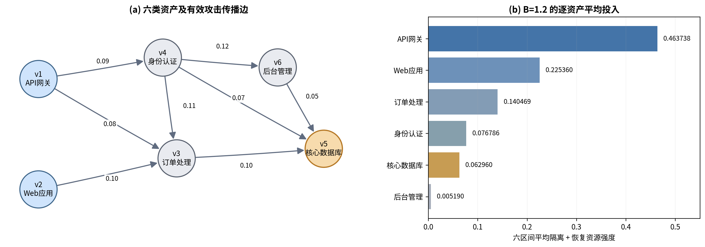
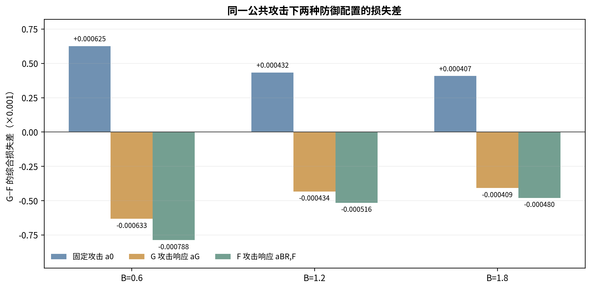
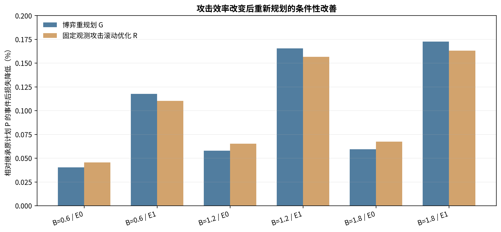

# 第四章 仿真实验与防御决策分析

## 4.1 仿真环境、网络场景与评价协议

为检验第三章ABR-DAD算法能否输出具有明确位置、时序和资源占用的防御行动，并分析攻击者响应对防御方案评价的影响，本文在固定的六资产非对称有向网络中开展确定性数值仿真。资产分别为API网关$v_1$、Web应用$v_2$、订单处理$v_3$、身份认证$v_4$、核心数据库$v_5$及后台管理$v_6$。$v_1,v_2$可直接接受外部攻击；$v_4$的加权出向传播强度为0.30；$v_5$的业务价值权重为4，且无出向传播边。该网络用于构造可解释的云平台安全情景，节点及边权均为固定模型输入，**不是从真实企业网络测量得到的攻击转移概率**。

**表4-1 六资产非对称网络的有效传播边**

| 来源资产 | 目标资产 | 传播率$\beta$ | 情景假设 |
|---|---|---:|---|
| API网关$v_1$ | 订单处理$v_3$ | 0.08 | 网关凭证可被滥用且订单接口存在可利用弱点 |
| API网关$v_1$ | 身份认证$v_4$ | 0.09 | 网关具有认证调用路径且认证接口存在弱点 |
| Web应用$v_2$ | 订单处理$v_3$ | 0.10 | 内部订单服务存在可利用访问路径 |
| 身份认证$v_4$ | 订单处理$v_3$ | 0.11 | 认证凭证可被用于越权调用 |
| 身份认证$v_4$ | 核心数据库$v_5$ | 0.07 | 授权边界失效导致数据库凭证被滥用 |
| 身份认证$v_4$ | 后台管理$v_6$ | 0.12 | 认证令牌可被用于后台授权路径 |
| 订单处理$v_3$ | 核心数据库$v_5$ | 0.10 | 订单服务凭证被窃取且存在可利用弱点 |
| 后台管理$v_6$ | 核心数据库$v_5$ | 0.05 | 数据库管理访问权限可被滥用 |

**表4-2 主要模型与求解参数**

| 参数 | 设置 | 说明 |
|---|---|---|
| 资产数$n$、时域$T$、控制区间$K$ | 6、10、6 | 单区间长度为$5/3$个模型时间单位 |
| 攻击容量$A$ | 0.8 | 两个直接入口竞争共享攻击容量 |
| 防御容量$B$ | 0.6、1.2、1.8 | 分别代表低、中、高容量情景；主展示$B=1.2$ |
| 直接攻击效率$\alpha$ | 入口0.25，其余0 | 仅$v_1,v_2$接受直接攻击 |
| 恢复率$\delta$与恢复效率$\gamma$ | 0.1、0.3 | 对所有资产采用相同值 |
| 隔离效率$\varepsilon$ | 1 | 源端隔离对其出向传播发挥作用 |
| 业务价值权重$q$ | $q_5=4$、其余为1 | 高价值数据库与其他资产形成异质性 |
| 攻击收益权重$g$ | 全部为1 | 不等同于防御者的价值评价 |
| 业务中断系数$h$ | 0.05 | 所有资产一致 |
| 二次行动成本、单位容量系数 | 全部为1 | 归一化投入与约束 |
| 终端权重$\omega,\nu$ | 全部为0 | 不额外设置终端损失 |
| 初始状态$x(0)$ | $(0.1,0,0,0,0,0)$ | 仅API网关初始10%受损 |
| 数值方法 | RK4、SLSQP、交替响应 | 每区间48个RK4子步，后续做积分细化复核 |

实验数据沿用D7已保存的六资产新拓扑模型与输出，第四章仅进行结构化整理和算术核对。D7记录的软件环境为Python 3.11.7、NumPy 1.26.4、SciPy 1.11.4。模型时间、行动强度和成本均为相对单位，不对应真实秒数、平台命令数量或货币开销。由于三个容量共用同一个合成网络，不能将其当作三个独立的真实网络样本进行统计显著性推断。

为评价攻防战略响应，定义两种离线防御方案：博弈求解方案$G$由第三章ABR-DAD同时更新攻防双方策略，得到防御控制$u_G$及模型攻击响应$a_G$；固定攻击优化方案$F$在预先设置的攻击$a_0=(0.4,0.4,0,0,0,0)$下仅优化防御控制$u_F$。为避免比较中攻击输入不同导致的混淆，求解完成后分别冻结$u_G$和$u_F$，在共同的$a_0$、$a_G$及固定$u_F$后重新求得的攻击响应$a_{BR,F}$下进行交叉评价。比较指标为第二章的累计综合防御损失$J_D$，数值越小表示防御方案在该共同攻击下越优。

**图4-1 六资产有向传播网络与主容量下的平均防御资源。** 左图为预设传播率；右图为$B=1.2$下六区间平均$s_i+r_i$。网络边表达有效攻击传播条件，并非普通调用流量。防御资源柱值来自已保存控制的时间平均统计。

## 4.2 防御行动的时空配置及网络含义

在$B=1.2$、$T=10$和$K=6$条件下，算法输出72个防御控制分量与12个入口攻击控制分量，每个资产在每个控制区间分别具有隔离强度$s_{i,k}$与恢复强度$r_{i,k}$。六个区间的防御容量实际使用依次为0.843705、1.200000、1.200000、1.200000、1.065570和0.337751，均未超过容量上限，区间平均使用为0.974504。该结果表明算法输出并非对所有区间强制用满预算，而是综合状态收益与防御成本确定行动强度。

**表4-3 典型资产的防御动作与状态（$B=1.2$）**

| 资产及区间 | 该区间起点受损比例 | 隔离强度$s$ | 恢复强度$r$ | 防御决策含义 |
|---|---:|---:|---:|---|
| API网关，第1区间 | 0.100000 | 0.323232 | 0.294892 | 同时降低入口传播源强度和受损比例 |
| API网关，第2区间 | 0.194672 | 0.345588 | 0.348708 | 面对持续入口攻击仍保持较高投入 |
| 身份认证，第2区间 | 0.014047 | 0.000951 | — | 潜在传播强，但初期受损较低 |
| 身份认证，第5区间 | 0.073640 | 0.042531 | 0.083404 | 随受损积累增加抑制及恢复 |
| 核心数据库，第1区间 | — | 0（数值） | 0.004480 | 高价值但早期受损较低 |
| 核心数据库，第5区间 | — | 0（数值） | 0.139747 | 主要通过恢复降低本地受损 |

注：“—”表示当前汇总资料中未列出该数值，不能当作零；数据库源端隔离为模型结构下的理论零，已存控制表现为数值零。该表仅列展示例，不代替72个控制量的完整导出。

API网关最初已有10%实例受损，且分别存在通向订单处理和身份认证的出向传播边。因此，早期恢复既降低网关自身受损比例，也间接降低向下游的传播来源；隔离直接抑制其出向传播率。这解释了前两个区间网关获得较高隔离和恢复投入。身份认证的加权出向强度为0.30，虽然高于其他资产，但在第二控制区间起点的受损比例仅为0.014047，传播控制的实际边际作用仍然受来源受损状态与业务中断成本限制。至第五区间其受损比例和对应防御投入均增加，说明单凭节点的静态传播影响不能确定全时域隔离优先级。

核心数据库的业务损失权重为4，但没有出向传播边。在当前采用**源端隔离**的模型中，对数据库施加隔离既不减少自身遭受的入向传播，也不能削弱任何下游边，却产生正业务中断与二次控制成本。因此，固定其他变量时最优源端隔离为零，其防御资源主要用于恢复。这不意味着现实数据库不需要入向防火墙规则、身份鉴别或访问控制，而是表明模型选定的控制作用方向必须与结论一致。

**表4-4 不同防御容量下六资产平均资源投入$s+r$**

| 资产 | $B=0.6$ | $B=1.2$ | $B=1.8$ |
|---|---:|---:|---:|
| API网关 | 0.339102 | 0.463738 | 0.480837 |
| Web应用 | 0.116986 | 0.225360 | 0.249486 |
| 订单处理 | 0.056986 | 0.140469 | 0.162958 |
| 身份认证 | 0.012188 | 0.076786 | 0.101903 |
| 核心数据库 | 0.037143 | 0.062960 | 0.073916 |
| 后台管理 | 0.001960 | 0.005190 | 0.011925 |

在容量由0.6提高至1.8时，网关占实际使用资源的份额由60.09%下降至44.48%，身份认证份额则由2.16%提高至9.43%，订单处理份额由10.10%提高至15.07%。说明防御容量变化不仅使投入规模变化，也改变了受损状态、传播能力、业务价值和成本共同决定的相对配置。该分析属于固定模型的数值相关性解释，并非各因素独立因果效应的证明。

## 4.3 博弈响应与固定攻击优化的公平对照

表4-5展示不同容量下$G$和$F$在三种**完全相同的公共攻击轨迹**下的累计综合损失。对同一容量，先分别固定两种方案的防御控制，再施加同一列攻击策略评价；这种交叉设计可避免将“防御行动的改善”与“实际遭受攻击不同”混为一谈。

**表4-5 不同公共攻击下G/F累计防御损失（越低越好）**

| 容量 | 公共评价攻击 | G | F | G−F |
|---:|---|---:|---:|---:|
| 0.6 | 固定攻击$a_0$ | 9.760493 | 9.759868 | +0.000625 |
| 0.6 | 博弈响应$a_G$ | 9.620103 | 9.620736 | −0.000633 |
| 0.6 | F对应响应$a_{BR,F}$ | 9.620834 | 9.621622 | −0.000788 |
| 1.2 | 固定攻击$a_0$ | 9.467228 | 9.466796 | +0.000432 |
| 1.2 | 博弈响应$a_G$ | 9.326647 | 9.327081 | −0.000434 |
| 1.2 | F对应响应$a_{BR,F}$ | 9.326860 | 9.327376 | −0.000516 |
| 1.8 | 固定攻击$a_0$ | 9.449465 | 9.449058 | +0.000407 |
| 1.8 | 博弈响应$a_G$ | 9.310823 | 9.311232 | −0.000409 |
| 1.8 | F对应响应$a_{BR,F}$ | 9.310880 | 9.311360 | −0.000480 |

**图4-2 不同公共攻击下的$J_D(G)-J_D(F)$。** 负值表示G在相同攻击下优于F；正值表示F优于G。纵轴为$10^{-3}$单位，必须按实际数值阅读，不应通过零基线以外的视觉放大宣称显著领先。

三个容量均显示同样的**比较方向**：在$F$预先优化所针对的固定攻击$a_0$下，$F$综合损失略低；当评价攻击改为$a_G$或$a_{BR,F}$时，$G$综合损失略低。然而绝对差异仅为约$4\times10^{-4}$至$8\times10^{-4}$，无法支持“博弈防御显著优于固定攻击优化”的普遍判断。$G$与$F$针对不同攻击假设形成了略有区别的资源配置，这才是当前数据直接支持的结论。

为明确综合损失为何与纯安全损失的比较结果不同，表4-6分解$B=1.2$、公共固定攻击$a_0$下的累计成本。

**表4-6 主容量固定攻击下的损失分解**

| 指标 | G | F | G−F |
|---|---:|---:|---:|
| 加权受损安全损失 | 8.317571 | 8.329118 | −0.011547 |
| 隔离业务中断 | 0.145233 | 0.145134 | +0.000099 |
| 隔离二次成本 | 0.303665 | 0.296437 | +0.007228 |
| 恢复二次成本 | 0.700758 | 0.696106 | +0.004652 |
| 综合防御损失 | 9.467228 | 9.466796 | +0.000432 |

在共同固定攻击下，$G$的安全损失比$F$低0.011547，但隔离中断和两类行动成本合计增加约0.011979，使得综合防御损失反而高0.000432。这说明仅比较受损比例或累计安全损失，可能高估博弈配置在总目标上的优势。由于表内数值保留六位小数，分项求和与总数可能存在末位舍入差异。

在主容量下，$G$攻击响应与固定$F$之后的攻击响应，其最大入口攻击控制分量差约为0.002321。这表明攻击者的独立目标与防御选择之间存在可观察的数值响应，但幅度有限。攻击者依据$J_A$最大化净收益，并不是以最大化$J_D$为目标，因此不能把模型攻击响应直接称为防御者的最坏攻击。进一步地，直接比较$(G,a_G)$与$(F,a_{BR,F})$所得收益，会同时改变防御控制与攻击输入，**不能**单独证明G在相同攻击下的收益。

### 网络状态演化图及其分析口径

仅凭累计目标$J_D$无法判断哪一个资产在何时获得状态改善。为直观展示“模型输出的防御行动怎样影响实际网络状态”，第四章应在此处加入**网络状态演化图**。建议在保持相同初态、相同公共评价攻击且分别冻结$u_G,u_F$的条件下，重新积分式（1），绘制三个共用时间轴的面板：API网关受损比例$x_1(t)$、核心数据库受损比例$x_5(t)$以及全网加权受损程度

$$
\bar x_q(t)=\frac{\sum_{i=1}^{6}q_i x_i(t)}{\sum_{i=1}^{6}q_i}=\frac{x_1+x_2+x_3+x_4+4x_5+x_6}{9}.\tag{6}
$$

建议优先使用公共攻击$a_G$绘制G/F对照曲线，再以固定攻击$a_0$进行补充复核。三条曲线分别对应“入口状态演化”“高价值资产状态演化”和“全网整体受损水平演化”，能够把表4-5中的累计结果转化为时间维度上的动态比较。

**【待D7真实逐时数据补图：图4-3 G/F在公共攻击下的网络状态演化趋势】**

- (a) API网关受损比例$x_1(t)$：用于观察入口资产在相同攻击输入下，博弈防御与固定攻击优化对早期受损扩张的抑制差异；
- (b) 核心数据库受损比例$x_5(t)$：用于展示高价值资产的状态是否在中后期出现分化；
- (c) 全网加权受损程度$\bar x_q(t)$：用于从系统层面比较两种防御方案在整个演化过程中的综合防护效果。

**【待核验后采用的图4-3图注】**
“图4-3 G/F在同一公共攻击下的网络状态演化。三幅子图分别给出API网关、核心数据库和全网价值加权受损程度随时间的变化。两种防御方案采用相同初始状态和相同执行攻击轨迹，仅防御控制不同。曲线差异反映防御行动配置对关键资产状态和系统整体受损演化的影响。”

配套正文可写为：在相同公共攻击条件下，图4-3进一步展示了两种防御方案对应的网络状态演化差异。若G在某一阶段的$x_1(t)$低于F，说明博弈方案对入口受损扩张抑制更强；若$x_5(t)$在中后期低于F，则说明其更有利于保护高价值数据库资产；而$\bar x_q(t)$则提供了面向全网加权损失的动态视角。需要强调的是，状态曲线的局部领先并不必然等价于综合损失$J_D$更优，因为综合目标还包含隔离业务中断和行动成本，因此应将图4-3与表4-5、表4-6联合解读。

曲线必须使用D7保存的逐区间完整控制与状态积分结果生成，不能根据表4-5的累计收益反推出时间序列，更不能用示意曲线替代实验结果。当前写作包已补入绘图脚本`plot_gf_state_trends.py`与数据模板`figure_data/gf_states_common_attack_TEMPLATE.csv`，待从D7原始结果导出逐时状态后即可生成正式图件。

## 4.4 攻击效率变化下的防御行动调整（补充实验）

为考察防御行动求解器在外部条件变化后能否重新使用，在$t=5$将API网关直接攻击效率由$\alpha_1=0.25$提高为0.50。事件发生前，比较方法沿用相同防御行动和状态历史；事件后依据最新模型重新规划剩余三个控制区间。对照方案为：继续执行原计划的$P$（Plan Inheritance）、重新运行攻防博弈求解的$G$以及固定上一已观测攻击并单独重新优化防御的$R$（Rolling Optimization）。三种方案在每一实验组中受到同一条实际攻击。E0表示事件后两入口攻击强度固定为0.4；E1表示以原计划P为条件、按攻击者目标$J_A$生成并冻结的攻击轨迹，E1不是针对G/R各自分别求得的真实“最坏攻击”。

以事件后区间$[5,10]$的累计防御损失为比较口径。表4-7给出三种容量下的真实保存结果：

**表4-7 攻击效率变化后同一实际攻击下的事件后防御损失**

| $B$ | 攻击 | P | G | R | G相对P降低 | R相对P降低 |
|---:|---|---:|---:|---:|---:|---:|
| 0.6 | E0 | 7.450623 | 7.447613 | 7.447232 | 0.040393% | 0.045501% |
| 0.6 | E1 | 7.431210 | 7.422472 | 7.423012 | 0.117591% | 0.110316% |
| 1.2 | E0 | 6.925324 | 6.921314 | 6.920807 | 0.057912% | 0.065226% |
| 1.2 | E1 | 6.901625 | 6.890208 | 6.890813 | 0.165432% | 0.156664% |
| 1.8 | E0 | 6.825423 | 6.821366 | 6.820818 | 0.059432% | 0.067461% |
| 1.8 | E1 | 6.801935 | 6.790200 | 6.790840 | 0.172527% | 0.163117% |

**图4-4 参数改变后G/R相对继承原计划P的事件后损失降幅。** 比例以每组P的$[5,10]$损失为分母，不可与全时域损失降幅混用。

六组情景中，G和R均比直接继承旧计划P有所改善，但幅度仅为约0.04%—0.17%。对固定E0攻击，R在所有容量下均略优于G；对E1攻击，G则略优于R。以$B=1.2$为例，E0下G的事件后损失为6.921314，略高于R的6.920807；E1下G为6.890208，略低于R的6.890813。可见重新配置计划的收益并非攻防博弈机制独有，G/R优劣也与内部攻击假设与实际攻击条件是否匹配有关。本实验用于说明ABR-DAD可在参数更新后重复调用，不把滚动重规划单独包装为新均衡求解理论。

## 4.5 数值有效性、结果讨论与实验边界

第三章算法输出的可靠性不仅取决于是否满足容量约束，还应检查固定对手时能否通过重新优化发现明显的单方改善，以及目标函数计算是否受数值积分精度影响。D7保存记录中，1544次数值优化尝试均正常退出；最终数值响应诊断的最大归一化已发现改善为$1.43\times10^{-9}$，最大投影驻点残差为$9.44\times10^{-5}$，三初始化路径最大控制差为$4.32\times10^{-5}$，最大容量违反为$3.89\times10^{-15}$。独立DOP853对固定控制进行复算，保存检查中的最大误差为$6.11\times10^{-11}$。这些结果支持已检查策略对的容量可行性、数值响应一致性与积分稳定性，但只对当前受限策略类和已检查初值有效，不能据此证明连续时间全局最优性、Nash均衡唯一性或交替迭代的全局收敛。

综合本章实验，ABR-DAD能够产生具体而非仅停留于定性排序的防御行动计划，并表现出与资产受损状态、传播条件和预算相关的时空分配。与固定攻击优化F相比，博弈方案G会因攻击者模型响应而产生略有不同的资源配置；在某些公共攻击条件下G综合损失更低，但未呈现普遍优势，且差异很小。攻击参数变化后重新优化防御行动可以小幅改善原计划的执行表现，但普通滚动优化也获得相近收益。因此，当前证据支持**防御行动的可计算性与攻防策略的条件性响应**，不支持“博弈方法在各种网络条件下显著优于非博弈优化”的结论。

需要指出，本实验依赖一个六资产合成场景，缺少真实云环境中的状态估计、漏洞路径验证、动作映射和执行时延；模型将隔离与恢复描述为连续投入，不能直接对应防火墙规则数量或Kubernetes命令。不同容量和攻击条件下的损失差异处于较小量级，尚需在控制时间离散精化、模型参数扰动和真实部署成本下检验是否稳定。提交论文前，应以D7原始`cross_evaluation.csv`、`objectives.csv`、`comparisons.csv`及逐区间控制导出为依据，逐项核对本文图表与代码版本；本文没有运行新的仿真或补造缺失轨迹。
