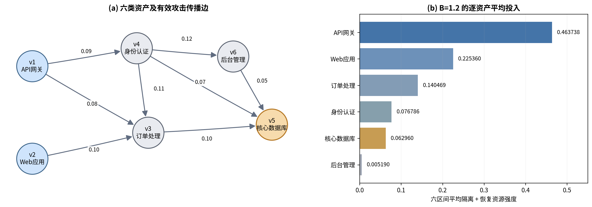
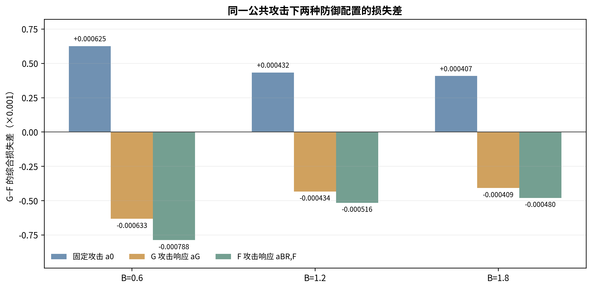
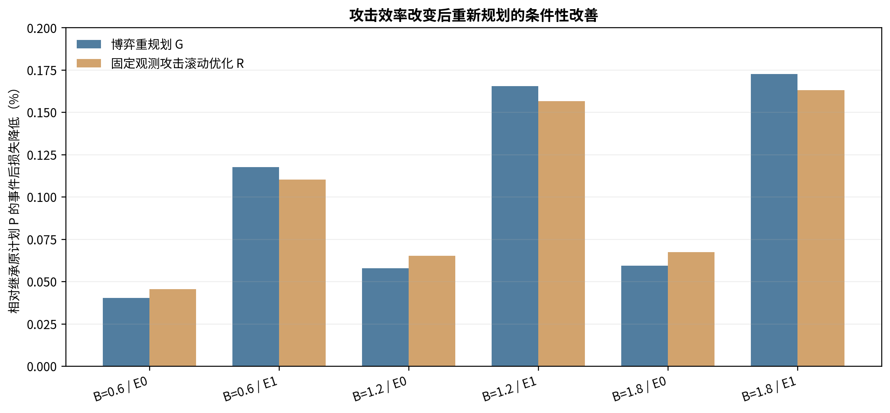

# 基于非零和微分博弈的有限资源网络防御决策方法

**中文会议论文初稿｜2026-11-15｜第三章沿用已确认基准版**

## 摘要

针对多资产网络中攻击传播关系复杂、资产业务价值存在差异以及防御资源受限的问题，提出一种基于非零和微分博弈的动态网络防御决策方法。首先，构建考虑直接攻击、跨资产传播、源端隔离和本地恢复的网络安全状态演化模型，并建立包含安全损失、业务中断和行动成本的非零和攻防收益函数。其次，将连续时间攻防控制划分为分段常值策略，设计基于交替最佳响应的动态防御行动求解算法（ABR-DAD），结合四阶Runge–Kutta积分和约束非线性优化，生成逐资产、逐时段的隔离与恢复资源配置。最后，在包含六类云平台逻辑资产的非对称有向网络上开展数值仿真，并与固定攻击条件下的防御优化方法进行比较。结果表明，所提方法能够生成满足资源容量约束的动态防御行动，且资源配置随资产受损状态、攻击传播关系及资源容量变化。在相同攻击条件下，博弈防御与固定攻击优化的综合损失差异较小，方案优劣受攻击策略影响。研究验证了该方法在受限策略空间内的数值可行性及其对攻防战略响应的刻画能力，为有限资源条件下的网络防御行动选择提供了可计算的决策框架。

**关键词：** 网络安全；非零和微分博弈；防御决策；交替最佳响应；动态资源分配

# 第一章 引言

## 1.1 研究背景与问题提出

随着业务系统逐步采用云平台和微服务架构，API网关、Web应用、身份认证、业务处理与数据库等逻辑资产之间形成了复杂的访问依赖关系。攻击者一旦控制外部入口或内部服务，便可能利用服务凭证、授权缺陷与可利用漏洞向其他资产传播，使局部受损转化为跨资产的安全风险。不同资产在此过程中承担的作用并不相同：核心数据库可能具有较高的业务损失权重，但没有明显的对外传播能力；身份认证服务具有较强的潜在横向传播影响，却不一定在攻击初期处于较高受损水平。因此，仅依据静态业务价值、节点连接数或当前受损程度中的单一指标确定防御优先级，难以同时兼顾本地安全损失与跨资产传播风险。

防御者可采用访问隔离、凭证权限收缩、受损实例清理和服务重建等手段干预攻击传播。不同措施具有不同的作用位置：源端隔离降低已受损资产向下游扩散的有效传播率，本地恢复降低该资产的受损比例。防御措施不仅消耗有限的安全运维资源，而且可能带来业务中断与实施成本。当多个资产同时存在保护需求时，防御决策需要回答三个具体问题：**防御哪个资产、采取隔离还是恢复、在什么时间投入多少资源**。与此同时，攻击者可能根据既定防御配置重新分配攻击投入，防御计划的评价结果因而依赖攻击者的战略响应。

上述问题具有状态连续演化、攻防策略相互依赖和逐时共享资源限制等特征。微分博弈能够将网络安全状态的变化与双方行动收益置于统一的动态决策框架中。然而，从数学博弈模型到可执行的防御配置之间仍存在实现层面的距离：求解器需要将连续时间控制转化为可计算的有限维决策，生成逐资产、逐控制区间的行动数值，并通过独立响应检验、状态积分复核和一致攻击条件下的基准对照判断结果的可信性。本文以此为研究对象，侧重非零和微分博弈模型驱动的动态防御行动计算，而非仅讨论抽象收益或均衡定义。

## 1.2 相关研究现状

已有云平台安全研究采用攻击图、随机博弈等模型表达资产关联与攻防决策。Li等[1]构建云平台安全随机博弈模型，表明云平台资产关系与长期攻防收益需要联合刻画。面向有向网络的传播控制，Preciado等[2]研究预防性与纠正性防护资源的优化分配；Paarporn和Xu[3]进一步分析预防与反应性防御投入之间的博弈权衡。这些工作说明传播结构及防御行动类型会影响资源分配，但其优化目标、时间结构或博弈设定与本文的非零和连续动态攻防问题并不完全一致。

微分博弈为网络攻防的连续时间决策提供了研究路径。Tian等[4]面向云环境恶意软件传播控制建立攻防博弈模型；Zhang等[5]将复杂网络状态演化与微分博弈结合，研究无标度网络防御决策；其后又利用势微分博弈研究复杂网络防御问题[6]。孙鹏宇等[7]针对攻防时机选择开展博弈建模，胡春娇等[8]通过Markov过程与阶段内微分博弈研究移动目标防御，Lou等[9]研究不完全信息条件下的协同防御。上述成果已涉及连续时间攻防、行动控制、策略均衡和防御算法，故本文不将“使用微分博弈”或“应用最佳响应”本身视作新的博弈理论贡献。有关模型预测控制的经典研究[10]也表明根据最新状态重新规划并执行首段控制是一种已有的动态优化思想。

综合已有研究，仍有必要从**防御行动的具体输出与公平评价**两个方面推进实际问题的数值研究。其一，传播能力与业务价值不同的资产在有限共享容量下，隔离、恢复和行动成本之间如何形成可解释的时空分配，需给出完整的控制变量与资源占用。其二，博弈求解与固定攻击条件下的防御优化存在不同的攻击假设，若直接比较各自攻击条件下的防御损失，容易混淆攻击输入差异与防御配置效果。因而，应冻结防御策略并在相同攻击轨迹下开展交叉评价，明确博弈响应究竟在什么条件下改变决策效果。

## 1.3 研究问题与主要工作

本文考虑一个具有有向攻击传播关系的多资产网络。攻击者在外部入口配置攻击强度，防御者在全部资产间配置源端隔离和本地恢复强度。以各类资产的受损比例为状态，以安全损失、业务中断及资源行动成本定义防御者目标，以攻击收益扣除攻击投入成本定义攻击者目标，建立共享容量约束下的完全信息非零和开环微分博弈。本文重点回答以下研究问题：在给定网络结构、状态演化模型和行动成本下，如何计算符合资源限制的逐资产、逐时段防御行动；考虑攻击者策略响应之后，所得配置与仅针对固定攻击进行优化的防御计划有何异同；当攻击参数发生变化时，重新计算行动是否优于继续执行原计划。

围绕上述问题，本文开展以下工作：

（1）**构建多资产动态攻防决策模型。** 将逻辑资产的业务价值、有效攻击传播边、入口攻击、源端隔离与本地恢复映射为统一的受损状态微分方程；分别设置攻防双方目标函数及逐时容量约束，明确两类防御行动的成本与作用边界。

（2）**形成博弈驱动的防御行动数值求解流程。** 对连续控制实施分段常值离散，采用四阶Runge–Kutta（RK4）方法计算状态轨迹与累计收益，借助序列最小二乘规划（SLSQP）求解固定对手计划下的约束响应，并通过交替最佳响应生成逐资产、逐区间的隔离/恢复计划。对可行性、已发现的单方偏离、驻点残差和积分精度分别进行检验。

（3）**建立以共同攻击为基准的评价协议。** 在固定的六资产非对称传播场景下，将博弈防御G与固定攻击优化F置于同一攻击轨迹下交叉评价，分解安全损失与防御成本，并补充攻击效率变化后的重新规划对照，以区分行动调整收益与博弈响应的条件性贡献。

本文的研究贡献主要体现为模型面向具体防御行动的表达、受约束数值求解与可复核的评价闭环；并不主张非零和微分博弈、交替最佳响应或滚动优化的理论首创，也不将有限维局部数值响应直接认定为连续时间全局纳什均衡。

## 1.4 论文结构

第一章介绍研究背景、相关工作和问题定义。第二章建立网络受损状态模型、双方收益函数及共享资源约束，并给出开环微分博弈的理论定义。第三章提出基于交替最佳响应的动态防御行动求解方法，输出逐资产、逐控制区间的隔离和恢复强度。第四章在六资产网络中分析防御配置、攻防响应及统一攻击条件下的损失差异，并报告数值有效性与参数扰动对照。第五章总结研究结论及适用范围。

# 第二章 网络攻防系统模型

## 2.1 网络资产与攻击传播关系

考虑由$n$类逻辑资产构成的有向加权网络$\mathcal G=(V,E_\beta)$，其中$V=\{v_1,\ldots,v_n\}$表示功能或安全属性相近的工作负载实例组，$E_\beta$表示满足可达性、授权路径和可利用弱点等条件的有效攻击传播关系。设$\beta_{ji}\geq0$为从来源资产$v_j$向目标资产$v_i$的传播率，并令$\beta_{ii}=0$。普通业务流量并不必然构成攻击传播边。资产$i$的加权出向传播强度定义为$d_i^{\mathrm{out}}=\sum_{\ell=1}^n\beta_{i\ell}$，它反映预设场景中的传播关联强度，并非经过实测的网络中心性。

用$x_i(t)\in[0,1]$表示时刻$t$资产$i$所属实例组中受损实例的比例。该变量用于描述聚合安全状态，不解释为单台主机被攻陷的概率。设$\mathcal E_a\subseteq V$为可接受外部直接攻击的入口资产集合；攻击者在入口$i$配置归一化攻击强度$a_i(t)\in[0,1]$，非入口的直接攻击控制固定为零。

防御者的控制包括两类：源端隔离$s_i(t)\in[0,1]$和本地恢复$r_i(t)\in[0,1]$。隔离通过访问限制或权限收缩降低来源资产$i$对下游目标的有效传播；恢复通过清理、重建受损工作负载等措施提高本地恢复速率。二者属于归一化聚合投入，尚未与具体平台命令或实际工时完成量纲标定。

为在后续实验中展示非对称资产属性，采用六类云平台逻辑资产：API网关$v_1$、Web应用$v_2$、订单处理$v_3$、身份认证$v_4$、核心数据库$v_5$与后台管理$v_6$。其中$v_1,v_2$为外部攻击入口，$v_4$具有较高的潜在出向传播影响，$v_5$具有较高业务价值且无出向传播边。网络的具体数值仅用于第四章预设合成场景，不代表来自真实云平台的攻击概率或现场测量。

## 2.2 网络安全状态动态演化

考虑未受损实例受直接攻击和跨资产传播影响而受损，以及受损实例在自然修复或防御恢复作用下重新恢复的动态过程。资产$i$的安全状态方程为

$$
\dot x_i(t)=\bigl(1-x_i(t)\bigr)\left[\alpha_i a_i(t)+\sum_{j\neq i}\beta_{ji}\bigl(1-\varepsilon_j s_j(t)\bigr)x_j(t)\right]-\bigl(\delta_i+\gamma_i r_i(t)\bigr)x_i(t),\quad x_i(0)=x_{i0}.\tag{1}
$$

其中，$\alpha_i\geq0$表示直接攻击效率，在非入口资产取零；$\varepsilon_j\in(0,1]$为源端隔离效率；$\delta_i\geq0$为基础恢复率；$\gamma_i\geq0$为防御恢复效率。式（1）第一项描述由外部入口攻击与受损来源传播引起的新增受损，乘子$(1-x_i)$限制其只作用于未受损实例；第二项表示自然恢复与额外恢复投入共同降低受损比例。

需要强调，$s_j$作用于从资产$j$发出的传播边，而非直接降低$j$自身遭受的外部入口攻击；$r_j$降低来源资产的受损状态，因而还会间接减弱其后续外传。采用这一设定后，两种防御行动具有不同的作用机制和成本，不能简单合并为一个“防御强度”。

对于有限非负模型参数及有界可测的控制，式（1）右端关于状态向量在有限区间内局部Lipschitz，故在给定控制下具有唯一的绝对连续状态轨迹。在边界$x_i=0$处，$\dot x_i\geq0$；在边界$x_i=1$处，$\dot x_i=-(\delta_i+\gamma_i r_i)\leq0$。因此，初态$x(0)\in[0,1]^n$时，状态保持在$[0,1]^n$。该性质适用于连续方程，并不免除数值积分的误差检查。

## 2.3 攻防双方收益函数与资源约束

防御者的目标是在规划时域$[0,T]$内同时降低资产受损损失、隔离造成的业务影响以及两类行动实施成本。定义$u(t)=(s(t),r(t))$，防御者累计损失为

$$
J_D(u,a)=\int_0^T\left[\sum_{i=1}^{n}\bigl(q_i x_i(t)+h_i s_i(t)\bigr)+\frac12\sum_{i=1}^{n}\left(c_i^s s_i^2(t)+c_i^r r_i^2(t)\right)\right]\,\mathrm dt+\omega^\top x(T).\tag{2}
$$

式中，$q_i\geq0$为资产业务损失权重，$h_i\geq0$为隔离引起的业务中断系数，$c_i^s,c_i^r>0$分别为隔离、恢复的二次成本系数，$\omega\geq0$为终端损失权重。防御者希望使$J_D$最小。由于线性业务中断成本和二次行动成本的存在，投入更多防御资源并不一定降低综合损失。

攻击者则通过分配入口攻击资源获取资产受损收益，同时承担攻击投入成本，其累计净收益为

$$
J_A(u,a)=\int_0^T\left[\sum_{i=1}^{n}g_i x_i(t)-\frac12\sum_{i=1}^{n}c_i^a a_i^2(t)\right]\,\mathrm dt+\nu^\top x(T),\tag{3}
$$

其中$g_i\geq0$为攻击者对资产受损的收益权重，$c_i^a>0$为攻击投入成本系数，$\nu\geq0$为终端收益权重。攻击者希望最大化$J_A$。由于双方价值权重及控制成本独立设定，通常有$J_A\neq -J_D$，因此这是一个非零和动态攻防博弈，而非以同一目标函数进行极小极大的零和博弈。

为反映两方资源约束，所有控制满足箱约束$0\leq a_i,s_i,r_i\leq1$，且对几乎所有$t\in[0,T]$满足

$$
\sum_{i=1}^{n}\left(b_i^s s_i(t)+b_i^r r_i(t)\right)\leq B,\qquad \sum_{i=1}^{n}d_i^a a_i(t)\leq A.\tag{4}
$$

其中$b_i^s,b_i^r,d_i^a>0$分别表示相应控制的单位容量占用，$B,A$为防御与攻击的**瞬时容量上限**。同一时刻隔离和恢复竞争同一防御容量，但式（2）中的行动经济成本在整个时域上累计。瞬时容量与累计成本的含义不能混淆。

## 2.4 非零和开环微分博弈定义

设$\mathcal U$为满足箱约束、非入口控制规则和防御容量约束的有界可测防御策略集合，$\mathcal A$为满足攻击控制与容量约束的策略集合。本文采用完全信息的开环博弈结构：双方在初始时刻依据已知模型及初态分别选择完整时间控制计划，且计划本身不表示为实时状态的反馈函数。开环纳什均衡的定义为一对可行计划$(u^*,a^*)$，满足

$$
\begin{aligned}
J_D(u^*,a^*)&\leq J_D(v,a^*),\quad \forall v\in\mathcal U,\\
J_A(u^*,a^*)&\geq J_A(u^*,b),\quad \forall b\in\mathcal A.
\end{aligned}\tag{5}
$$

上述不等式表明：固定攻击者策略时，防御者无法通过单方修改完整控制计划进一步降低损失；固定防御者策略时，攻击者无法通过单方修改计划进一步提高收益。这是连续时间博弈的理论基准，不等同于第三章使用SLSQP和交替最佳响应所找到的有限维局部数值解。

本文采用开环结构，主要目的是计算离线动态行动计划，并在外部参数变化时重新调用求解器。交替求解的计算顺序不代表攻击者或防御者拥有先行动权，故该机制不应称为Stackelberg博弈；重新规划也不意味着已求得覆盖全状态空间的Markov反馈均衡。 非合作动态博弈的一般理论可参见文献[11]；状态积分和约束数值优化采用的数值分析及算法基础分别见文献[12–14]。最优控制理论[15]可辅助解释边际行动收益，但本文不以局部最优的必要条件替代对整个动态博弈的均衡证明。

## 2.5 本章小结

本章以多资产有向传播网络为基础，定义工作负载实例组受损比例，并分别刻画直接攻击、源端隔离和本地恢复对安全状态的影响；随后建立具有独立攻防收益和逐时共享容量约束的非零和开环微分博弈模型。该模型明确了防御行动的作用位置、收益计算方式与可行空间，为第三章生成逐资产、逐时段隔离及恢复配置提供数学基础。

# 第三章 基于非零和微分博弈的动态防御行动求解方法

## 3.1 防御决策问题的离散化

第二章构建了以网络资产受损状态为状态变量、攻击投入与隔离及恢复投入为控制变量的非零和微分博弈模型。本章进一步研究该模型的数值求解方法，以获得有限防御资源约束下各网络资产的动态防御行动配置。

考虑到连续时间控制策略难以直接计算，将规划时域 [0,T] 均匀划分为 K 个控制区间，区间长度为 Δt=T/K，并假设各区间内攻防控制保持常值。

由此，防御者和攻击者的控制分别表示为：

- 防御策略：`z_D = {(s_i,k, r_i,k)}`
- 攻击策略：`z_A = {a_i,k}`

其中，s_i,k 和 r_i,k 分别表示第 k 个区间对资产 i 的隔离与恢复强度，a_i,k 表示攻击投入强度。

防御策略需要满足控制边界与逐区间共享容量约束，攻击策略满足相应的攻击容量约束。记双方的有限维可行策略集合分别为 U_K 和 A_K。

经过上述处理，连续时间微分博弈转化为有限维非线性动态优化博弈。该处理仅离散控制策略，网络安全状态仍由原连续微分方程描述。

## 3.2 基于最佳响应的攻防策略求解

### 3.2.1 双方最佳响应

在给定攻击策略的情况下，防御者通过配置不同资产的隔离与恢复投入，使累计防御损失最小；在给定防御策略的情况下，攻击者通过调整攻击投入，使自身净收益最大。

因此，双方的最佳响应问题定义为：

**防御者：**

`BR_D(z_A) = argmin J_D(z_D, z_A)，z_D ∈ U_K`

**攻击者：**

`BR_A(z_D) = argmax J_A(z_D, z_A)，z_A ∈ A_K`

其中，J_D 和 J_A 分别为第二章定义的防御损失函数与攻击收益函数，其数值通过状态方程积分获得。

对于给定的分段常值控制，采用四阶Runge–Kutta（RK4）方法计算网络资产的受损状态轨迹，并进一步计算攻防双方的累计目标函数。

在此基础上，采用序列最小二乘规划（SLSQP）方法求解双方的约束优化子问题，得到固定对手策略下的局部数值最佳响应。

### 3.2.2 交替最佳响应机制

为了体现攻防双方的战略相互依赖，采用交替最佳响应机制迭代更新双方策略。

具体而言，固定攻击策略，计算防御者的数值响应；随后固定更新后的防御策略，重新计算攻击者的数值响应。重复上述过程，使双方策略逐步达到数值响应一致状态。

对于当前完整策略对，还需分别检查双方在固定对手策略时能否进一步改善自身目标。

若双方已发现的单方改善量、优化驻点残差及响应距离均满足预设阈值，则认为算法达到数值停止条件。

需要指出，该方法求得的是受限分段常值策略空间内的数值策略解。由于使用局部非线性优化，不能仅凭迭代收敛就断言获得连续时间博弈的全局纳什均衡。

## 3.3 动态防御行动求解算法

综合上述模型与数值求解方法，提出基于交替最佳响应的动态防御行动求解流程。

**算法1：基于交替最佳响应的动态防御行动求解算法（ABR-DAD）**

**输入：** 网络拓扑与模型参数、初始受损状态、规划时域、资源容量及数值求解参数。

**输出：** 各资产的隔离和恢复行动、攻击策略、网络状态轨迹及双方累计收益。

**步骤1：初始化。** 将规划时域划分为 K 个控制区间，建立双方的控制变量及可行策略集合，生成初始攻防策略。

**步骤2：防御响应求解。** 固定当前攻击策略，利用RK4积分与SLSQP优化，计算满足资源约束的防御响应。

**步骤3：攻击响应求解。** 固定更新后的防御策略，以攻击者净收益最大化为目标，重新计算攻击响应。

**步骤4：迭代与停止。** 在当前完整策略对上检验双方的数值响应改善、驻点残差及响应距离。若满足停止条件，则结束迭代；否则继续执行步骤2和步骤3。达到最大迭代次数仍未满足条件时，标记为未通过收敛检验。

**步骤5：生成防御行动。** 对最终策略进行可行性与数值精度检查，输出各资产在不同时间区间的隔离强度、恢复强度及资源占用。

算法1通过双方响应更新求解动态防御配置。其核心特点是将攻击者的策略调整纳入防御行动计算过程，而非仅针对预先固定的攻击策略进行单方资源优化。

需要说明，实际实现采用预设的多初始化路径与最终单方偏离审计检查数值结果的可信性。具体求解器参数、停止阈值和积分精度设置在仿真实验部分说明。

## 3.4 防御行动输出与数值有效性

### 3.4.1 防御行动配置

算法输出的防御策略由各资产在不同控制区间的隔离和恢复投入组成。

对于资产 i，在第 k 个区间的防御行动为：

`D_i,k = (s_i,k, r_i,k)`

对应的资源占用为：

`R_i,k = b_i^s × s_i,k + b_i^r × r_i,k`

其中，b_i^s 和 b_i^r 分别表示隔离与恢复的单位容量占用系数。

由此可以得到防御行动配置表：

| 资产 | 时间区间 | 隔离强度 | 恢复强度 | 资源占用 |
|---|---|---|---|---|
| 资产1 | 区间1 | s_1,1 | r_1,1 | R_1,1 |
| 资产2 | 区间1 | s_2,1 | r_2,1 | R_2,1 |
| … | … | … | … | … |
| 资产n | 区间K | s_n,K | r_n,K | R_n,K |

因此，算法能够明确回答有限防御资源条件下的三个核心决策问题：**防御哪个资产、采取何种行动、投入多少防御资源。**

隔离与恢复强度均为归一化连续控制量，其实际数值反映模型中的投入强度，不直接等同于具体平台操作命令。

### 3.4.2 数值有效性检验

为了保证防御行动结果的可信性，从三个方面进行检验。

首先，检查全部控制变量与逐区间资源占用是否满足可行域约束，确保输出的防御策略在模型容量条件下可执行。

其次，分别固定最终攻防策略中的一方，重新计算另一方的数值响应，检验是否能够发现进一步的目标函数改善，并结合驻点残差评估求解质量。

最后，对固定攻防策略采用更精细的数值积分设置重新计算状态轨迹和双方目标，检查积分误差对结果的影响。

上述检验用于评价所求策略的数值可行性与局部响应一致性，不构成连续时间全局最优性或严格纳什均衡证明。

## 3.5 本章小结

本章针对非零和微分博弈模型的动态防御行动求解问题，提出基于交替最佳响应的数值决策流程。

通过控制时间离散，将连续时间攻防策略转化为有限维控制变量；采用RK4方法计算网络状态演化与双方收益，结合SLSQP约束优化和交替最佳响应机制求解攻防策略，最终获得逐资产、逐控制区间的隔离和恢复行动配置。

该方法建立了从攻防博弈模型到防御资源配置的数值计算流程。下一章将在六资产网络场景下，通过防御行动配置、攻防策略响应和基准方法对比，检验算法的数值可行性与防御效果。

# 第四章 仿真实验与防御决策分析

## 4.1 仿真环境、网络场景与评价协议

为检验第三章ABR-DAD算法能否输出具有明确位置、时序和资源占用的防御行动，并分析攻击者响应对防御方案评价的影响，本文在固定的六资产非对称有向网络中开展确定性数值仿真。资产分别为API网关$v_1$、Web应用$v_2$、订单处理$v_3$、身份认证$v_4$、核心数据库$v_5$及后台管理$v_6$。$v_1,v_2$可直接接受外部攻击；$v_4$的加权出向传播强度为0.30；$v_5$的业务价值权重为4，且无出向传播边。该网络用于构造可解释的云平台安全情景，节点及边权均为固定模型输入，**不是从真实企业网络测量得到的攻击转移概率**。

**表4-1 六资产非对称网络的有效传播边**

| 来源资产 | 目标资产 | 传播率$\beta$ | 情景假设 |
|---|---|---:|---|
| API网关$v_1$ | 订单处理$v_3$ | 0.08 | 网关凭证可被滥用且订单接口存在可利用弱点 |
| API网关$v_1$ | 身份认证$v_4$ | 0.09 | 网关具有认证调用路径且认证接口存在弱点 |
| Web应用$v_2$ | 订单处理$v_3$ | 0.10 | 内部订单服务存在可利用访问路径 |
| 身份认证$v_4$ | 订单处理$v_3$ | 0.11 | 认证凭证可被用于越权调用 |
| 身份认证$v_4$ | 核心数据库$v_5$ | 0.07 | 授权边界失效导致数据库凭证被滥用 |
| 身份认证$v_4$ | 后台管理$v_6$ | 0.12 | 认证令牌可被用于后台授权路径 |
| 订单处理$v_3$ | 核心数据库$v_5$ | 0.10 | 订单服务凭证被窃取且存在可利用弱点 |
| 后台管理$v_6$ | 核心数据库$v_5$ | 0.05 | 数据库管理访问权限可被滥用 |

**表4-2 主要模型与求解参数**

| 参数 | 设置 | 说明 |
|---|---|---|
| 资产数$n$、时域$T$、控制区间$K$ | 6、10、6 | 单区间长度为$5/3$个模型时间单位 |
| 攻击容量$A$ | 0.8 | 两个直接入口竞争共享攻击容量 |
| 防御容量$B$ | 0.6、1.2、1.8 | 分别代表低、中、高容量情景；主展示$B=1.2$ |
| 直接攻击效率$\alpha$ | 入口0.25，其余0 | 仅$v_1,v_2$接受直接攻击 |
| 恢复率$\delta$与恢复效率$\gamma$ | 0.1、0.3 | 对所有资产采用相同值 |
| 隔离效率$\varepsilon$ | 1 | 源端隔离对其出向传播发挥作用 |
| 业务价值权重$q$ | $q_5=4$、其余为1 | 高价值数据库与其他资产形成异质性 |
| 攻击收益权重$g$ | 全部为1 | 不等同于防御者的价值评价 |
| 业务中断系数$h$ | 0.05 | 所有资产一致 |
| 二次行动成本、单位容量系数 | 全部为1 | 归一化投入与约束 |
| 终端权重$\omega,\nu$ | 全部为0 | 不额外设置终端损失 |
| 初始状态$x(0)$ | $(0.1,0,0,0,0,0)$ | 仅API网关初始10%受损 |
| 数值方法 | RK4、SLSQP、交替响应 | 每区间48个RK4子步，后续做积分细化复核 |

实验数据沿用D7已保存的六资产新拓扑模型与输出，第四章仅进行结构化整理和算术核对。D7记录的软件环境为Python 3.11.7、NumPy 1.26.4、SciPy 1.11.4。模型时间、行动强度和成本均为相对单位，不对应真实秒数、平台命令数量或货币开销。由于三个容量共用同一个合成网络，不能将其当作三个独立的真实网络样本进行统计显著性推断。

为评价攻防战略响应，定义两种离线防御方案：博弈求解方案$G$由第三章ABR-DAD同时更新攻防双方策略，得到防御控制$u_G$及模型攻击响应$a_G$；固定攻击优化方案$F$在预先设置的攻击$a_0=(0.4,0.4,0,0,0,0)$下仅优化防御控制$u_F$。为避免比较中攻击输入不同导致的混淆，求解完成后分别冻结$u_G$和$u_F$，在共同的$a_0$、$a_G$及固定$u_F$后重新求得的攻击响应$a_{BR,F}$下进行交叉评价。比较指标为第二章的累计综合防御损失$J_D$，数值越小表示防御方案在该共同攻击下越优。

**图4-1 六资产有向传播网络与主容量下的平均防御资源。** 左图为预设传播率；右图为$B=1.2$下六区间平均$s_i+r_i$。网络边表达有效攻击传播条件，并非普通调用流量。防御资源柱值来自已保存控制的时间平均统计。

## 4.2 防御行动的时空配置及网络含义

在$B=1.2$、$T=10$和$K=6$条件下，算法输出72个防御控制分量与12个入口攻击控制分量，每个资产在每个控制区间分别具有隔离强度$s_{i,k}$与恢复强度$r_{i,k}$。六个区间的防御容量实际使用依次为0.843705、1.200000、1.200000、1.200000、1.065570和0.337751，均未超过容量上限，区间平均使用为0.974504。该结果表明算法输出并非对所有区间强制用满预算，而是综合状态收益与防御成本确定行动强度。

**表4-3 典型资产的防御动作与状态（$B=1.2$）**

| 资产及区间 | 该区间起点受损比例 | 隔离强度$s$ | 恢复强度$r$ | 防御决策含义 |
|---|---:|---:|---:|---|
| API网关，第1区间 | 0.100000 | 0.323232 | 0.294892 | 同时降低入口传播源强度和受损比例 |
| API网关，第2区间 | 0.194672 | 0.345588 | 0.348708 | 面对持续入口攻击仍保持较高投入 |
| 身份认证，第2区间 | 0.014047 | 0.000951 | — | 潜在传播强，但初期受损较低 |
| 身份认证，第5区间 | 0.073640 | 0.042531 | 0.083404 | 随受损积累增加抑制及恢复 |
| 核心数据库，第1区间 | — | 0（数值） | 0.004480 | 高价值但早期受损较低 |
| 核心数据库，第5区间 | — | 0（数值） | 0.139747 | 主要通过恢复降低本地受损 |

注：“—”表示当前汇总资料中未列出该数值，不能当作零；数据库源端隔离为模型结构下的理论零，已存控制表现为数值零。该表仅列展示例，不代替72个控制量的完整导出。

API网关最初已有10%实例受损，且分别存在通向订单处理和身份认证的出向传播边。因此，早期恢复既降低网关自身受损比例，也间接降低向下游的传播来源；隔离直接抑制其出向传播率。这解释了前两个区间网关获得较高隔离和恢复投入。身份认证的加权出向强度为0.30，虽然高于其他资产，但在第二控制区间起点的受损比例仅为0.014047，传播控制的实际边际作用仍然受来源受损状态与业务中断成本限制。至第五区间其受损比例和对应防御投入均增加，说明单凭节点的静态传播影响不能确定全时域隔离优先级。

核心数据库的业务损失权重为4，但没有出向传播边。在当前采用**源端隔离**的模型中，对数据库施加隔离既不减少自身遭受的入向传播，也不能削弱任何下游边，却产生正业务中断与二次控制成本。因此，固定其他变量时最优源端隔离为零，其防御资源主要用于恢复。这不意味着现实数据库不需要入向防火墙规则、身份鉴别或访问控制，而是表明模型选定的控制作用方向必须与结论一致。

**表4-4 不同防御容量下六资产平均资源投入$s+r$**

| 资产 | $B=0.6$ | $B=1.2$ | $B=1.8$ |
|---|---:|---:|---:|
| API网关 | 0.339102 | 0.463738 | 0.480837 |
| Web应用 | 0.116986 | 0.225360 | 0.249486 |
| 订单处理 | 0.056986 | 0.140469 | 0.162958 |
| 身份认证 | 0.012188 | 0.076786 | 0.101903 |
| 核心数据库 | 0.037143 | 0.062960 | 0.073916 |
| 后台管理 | 0.001960 | 0.005190 | 0.011925 |

在容量由0.6提高至1.8时，网关占实际使用资源的份额由60.09%下降至44.48%，身份认证份额则由2.16%提高至9.43%，订单处理份额由10.10%提高至15.07%。说明防御容量变化不仅使投入规模变化，也改变了受损状态、传播能力、业务价值和成本共同决定的相对配置。该分析属于固定模型的数值相关性解释，并非各因素独立因果效应的证明。

## 4.3 博弈响应与固定攻击优化的公平对照

表4-5展示不同容量下$G$和$F$在三种**完全相同的公共攻击轨迹**下的累计综合损失。对同一容量，先分别固定两种方案的防御控制，再施加同一列攻击策略评价；这种交叉设计可避免将“防御行动的改善”与“实际遭受攻击不同”混为一谈。

**表4-5 不同公共攻击下G/F累计防御损失（越低越好）**

| 容量 | 公共评价攻击 | G | F | G−F |
|---:|---|---:|---:|---:|
| 0.6 | 固定攻击$a_0$ | 9.760493 | 9.759868 | +0.000625 |
| 0.6 | 博弈响应$a_G$ | 9.620103 | 9.620736 | −0.000633 |
| 0.6 | F对应响应$a_{BR,F}$ | 9.620834 | 9.621622 | −0.000788 |
| 1.2 | 固定攻击$a_0$ | 9.467228 | 9.466796 | +0.000432 |
| 1.2 | 博弈响应$a_G$ | 9.326647 | 9.327081 | −0.000434 |
| 1.2 | F对应响应$a_{BR,F}$ | 9.326860 | 9.327376 | −0.000516 |
| 1.8 | 固定攻击$a_0$ | 9.449465 | 9.449058 | +0.000407 |
| 1.8 | 博弈响应$a_G$ | 9.310823 | 9.311232 | −0.000409 |
| 1.8 | F对应响应$a_{BR,F}$ | 9.310880 | 9.311360 | −0.000480 |

**图4-2 不同公共攻击下的$J_D(G)-J_D(F)$。** 负值表示G在相同攻击下优于F；正值表示F优于G。纵轴为$10^{-3}$单位，必须按实际数值阅读，不应通过零基线以外的视觉放大宣称显著领先。

三个容量均显示同样的**比较方向**：在$F$预先优化所针对的固定攻击$a_0$下，$F$综合损失略低；当评价攻击改为$a_G$或$a_{BR,F}$时，$G$综合损失略低。然而绝对差异仅为约$4\times10^{-4}$至$8\times10^{-4}$，无法支持“博弈防御显著优于固定攻击优化”的普遍判断。$G$与$F$针对不同攻击假设形成了略有区别的资源配置，这才是当前数据直接支持的结论。

为明确综合损失为何与纯安全损失的比较结果不同，表4-6分解$B=1.2$、公共固定攻击$a_0$下的累计成本。

**表4-6 主容量固定攻击下的损失分解**

| 指标 | G | F | G−F |
|---|---:|---:|---:|
| 加权受损安全损失 | 8.317571 | 8.329118 | −0.011547 |
| 隔离业务中断 | 0.145233 | 0.145134 | +0.000099 |
| 隔离二次成本 | 0.303665 | 0.296437 | +0.007228 |
| 恢复二次成本 | 0.700758 | 0.696106 | +0.004652 |
| 综合防御损失 | 9.467228 | 9.466796 | +0.000432 |

在共同固定攻击下，$G$的安全损失比$F$低0.011547，但隔离中断和两类行动成本合计增加约0.011979，使得综合防御损失反而高0.000432。这说明仅比较受损比例或累计安全损失，可能高估博弈配置在总目标上的优势。由于表内数值保留六位小数，分项求和与总数可能存在末位舍入差异。

在主容量下，$G$攻击响应与固定$F$之后的攻击响应，其最大入口攻击控制分量差约为0.002321。这表明攻击者的独立目标与防御选择之间存在可观察的数值响应，但幅度有限。攻击者依据$J_A$最大化净收益，并不是以最大化$J_D$为目标，因此不能把模型攻击响应直接称为防御者的最坏攻击。进一步地，直接比较$(G,a_G)$与$(F,a_{BR,F})$所得收益，会同时改变防御控制与攻击输入，**不能**单独证明G在相同攻击下的收益。

### 网络状态演化图及其分析口径

仅凭累计目标$J_D$无法判断哪一个资产在何时获得状态改善。为直观展示“模型输出的防御行动怎样影响实际网络状态”，第四章应在此处加入**网络状态演化图**。建议在保持相同初态、相同公共评价攻击且分别冻结$u_G,u_F$的条件下，重新积分式（1），绘制三个共用时间轴的面板：API网关受损比例$x_1(t)$、核心数据库受损比例$x_5(t)$以及全网加权受损程度

$$
\bar x_q(t)=\frac{\sum_{i=1}^{6}q_i x_i(t)}{\sum_{i=1}^{6}q_i}=\frac{x_1+x_2+x_3+x_4+4x_5+x_6}{9}.\tag{6}
$$

建议优先使用公共攻击$a_G$绘制G/F对照曲线，再以固定攻击$a_0$进行补充复核。三条曲线分别对应“入口状态演化”“高价值资产状态演化”和“全网整体受损水平演化”，能够把表4-5中的累计结果转化为时间维度上的动态比较。

**【待D7真实逐时数据补图：图4-3 G/F在公共攻击下的网络状态演化趋势】**

- (a) API网关受损比例$x_1(t)$：用于观察入口资产在相同攻击输入下，博弈防御与固定攻击优化对早期受损扩张的抑制差异；
- (b) 核心数据库受损比例$x_5(t)$：用于展示高价值资产的状态是否在中后期出现分化；
- (c) 全网加权受损程度$\bar x_q(t)$：用于从系统层面比较两种防御方案在整个演化过程中的综合防护效果。

**【待核验后采用的图4-3图注】**
“图4-3 G/F在同一公共攻击下的网络状态演化。三幅子图分别给出API网关、核心数据库和全网价值加权受损程度随时间的变化。两种防御方案采用相同初始状态和相同执行攻击轨迹，仅防御控制不同。曲线差异反映防御行动配置对关键资产状态和系统整体受损演化的影响。”

配套正文可写为：在相同公共攻击条件下，图4-3进一步展示了两种防御方案对应的网络状态演化差异。若G在某一阶段的$x_1(t)$低于F，说明博弈方案对入口受损扩张抑制更强；若$x_5(t)$在中后期低于F，则说明其更有利于保护高价值数据库资产；而$\bar x_q(t)$则提供了面向全网加权损失的动态视角。需要强调的是，状态曲线的局部领先并不必然等价于综合损失$J_D$更优，因为综合目标还包含隔离业务中断和行动成本，因此应将图4-3与表4-5、表4-6联合解读。

曲线必须使用D7保存的逐区间完整控制与状态积分结果生成，不能根据表4-5的累计收益反推出时间序列，更不能用示意曲线替代实验结果。当前写作包已补入绘图脚本`plot_gf_state_trends.py`与数据模板`figure_data/gf_states_common_attack_TEMPLATE.csv`，待从D7原始结果导出逐时状态后即可生成正式图件。

## 4.4 攻击效率变化下的防御行动调整（补充实验）

为考察防御行动求解器在外部条件变化后能否重新使用，在$t=5$将API网关直接攻击效率由$\alpha_1=0.25$提高为0.50。事件发生前，比较方法沿用相同防御行动和状态历史；事件后依据最新模型重新规划剩余三个控制区间。对照方案为：继续执行原计划的$P$（Plan Inheritance）、重新运行攻防博弈求解的$G$以及固定上一已观测攻击并单独重新优化防御的$R$（Rolling Optimization）。三种方案在每一实验组中受到同一条实际攻击。E0表示事件后两入口攻击强度固定为0.4；E1表示以原计划P为条件、按攻击者目标$J_A$生成并冻结的攻击轨迹，E1不是针对G/R各自分别求得的真实“最坏攻击”。

以事件后区间$[5,10]$的累计防御损失为比较口径。表4-7给出三种容量下的真实保存结果：

**表4-7 攻击效率变化后同一实际攻击下的事件后防御损失**

| $B$ | 攻击 | P | G | R | G相对P降低 | R相对P降低 |
|---:|---|---:|---:|---:|---:|---:|
| 0.6 | E0 | 7.450623 | 7.447613 | 7.447232 | 0.040393% | 0.045501% |
| 0.6 | E1 | 7.431210 | 7.422472 | 7.423012 | 0.117591% | 0.110316% |
| 1.2 | E0 | 6.925324 | 6.921314 | 6.920807 | 0.057912% | 0.065226% |
| 1.2 | E1 | 6.901625 | 6.890208 | 6.890813 | 0.165432% | 0.156664% |
| 1.8 | E0 | 6.825423 | 6.821366 | 6.820818 | 0.059432% | 0.067461% |
| 1.8 | E1 | 6.801935 | 6.790200 | 6.790840 | 0.172527% | 0.163117% |

**图4-4 参数改变后G/R相对继承原计划P的事件后损失降幅。** 比例以每组P的$[5,10]$损失为分母，不可与全时域损失降幅混用。

六组情景中，G和R均比直接继承旧计划P有所改善，但幅度仅为约0.04%—0.17%。对固定E0攻击，R在所有容量下均略优于G；对E1攻击，G则略优于R。以$B=1.2$为例，E0下G的事件后损失为6.921314，略高于R的6.920807；E1下G为6.890208，略低于R的6.890813。可见重新配置计划的收益并非攻防博弈机制独有，G/R优劣也与内部攻击假设与实际攻击条件是否匹配有关。本实验用于说明ABR-DAD可在参数更新后重复调用，不把滚动重规划单独包装为新均衡求解理论。

## 4.5 数值有效性、结果讨论与实验边界

第三章算法输出的可靠性不仅取决于是否满足容量约束，还应检查固定对手时能否通过重新优化发现明显的单方改善，以及目标函数计算是否受数值积分精度影响。D7保存记录中，1544次数值优化尝试均正常退出；最终数值响应诊断的最大归一化已发现改善为$1.43\times10^{-9}$，最大投影驻点残差为$9.44\times10^{-5}$，三初始化路径最大控制差为$4.32\times10^{-5}$，最大容量违反为$3.89\times10^{-15}$。独立DOP853对固定控制进行复算，保存检查中的最大误差为$6.11\times10^{-11}$。这些结果支持已检查策略对的容量可行性、数值响应一致性与积分稳定性，但只对当前受限策略类和已检查初值有效，不能据此证明连续时间全局最优性、Nash均衡唯一性或交替迭代的全局收敛。

综合本章实验，ABR-DAD能够产生具体而非仅停留于定性排序的防御行动计划，并表现出与资产受损状态、传播条件和预算相关的时空分配。与固定攻击优化F相比，博弈方案G会因攻击者模型响应而产生略有不同的资源配置；在某些公共攻击条件下G综合损失更低，但未呈现普遍优势，且差异很小。攻击参数变化后重新优化防御行动可以小幅改善原计划的执行表现，但普通滚动优化也获得相近收益。因此，当前证据支持**防御行动的可计算性与攻防策略的条件性响应**，不支持“博弈方法在各种网络条件下显著优于非博弈优化”的结论。

需要指出，本实验依赖一个六资产合成场景，缺少真实云环境中的状态估计、漏洞路径验证、动作映射和执行时延；模型将隔离与恢复描述为连续投入，不能直接对应防火墙规则数量或Kubernetes命令。不同容量和攻击条件下的损失差异处于较小量级，尚需在控制时间离散精化、模型参数扰动和真实部署成本下检验是否稳定。提交论文前，应以D7原始`cross_evaluation.csv`、`objectives.csv`、`comparisons.csv`及逐区间控制导出为依据，逐项核对本文图表与代码版本；本文没有运行新的仿真或补造缺失轨迹。

# 第五章 结论

本文针对多资产网络中攻击传播影响与资产业务价值不一致、隔离和恢复行动竞争有限防御容量的问题，构建以资产受损比例为状态、以源端隔离和本地恢复为防御控制的非零和开环微分博弈模型，给出了攻防双方独立的累计目标函数与逐时资源约束。围绕具体防御行动的生成，采用分段常值控制离散、RK4状态积分、SLSQP约束优化及交替最佳响应，形成ABR-DAD动态防御行动求解流程，输出各资产在不同控制区间的行动类型、投入强度与资源占用。

在固定的六资产非对称攻击传播网络中，数值实验表明，该方法能够生成满足容量约束的行动计划。API网关因初始受损、直接攻击和下游传播关联在前期获得较多投入；身份认证服务虽具有较高潜在传播影响，实际隔离强度仍受到当前受损状态、剩余保护时域与行动成本制约；高价值且没有出向传播边的核心数据库主要采用本地恢复。资源容量变化会改变资产间的相对配置，并非按单一静态价值或传播排序分配。

与固定攻击优化方案F的交叉评价显示，博弈方案G能根据攻击者响应调整防御计划，但未表现出对F的普遍综合损失优势。在预设固定攻击下，F的综合损失略低；在双方响应产生的公共攻击条件下，G的综合损失略低，差异量级为$10^{-4}$。攻击效率变化后的补充实验显示，重新规划通常优于继承旧行动计划，但博弈重规划与普通滚动优化的优劣随实际攻击轨迹而改变。因此，本文的主要结果是**博弈驱动的、可检查的动态防御行动求解能力**及有限场景中的条件性战略响应，而非无条件性能领先。

本研究仍存在以下局限：实验采用参数化合成网络，控制强度尚未标定为真实云平台操作；现有数值结果限定于有限维分段常值策略空间，不能证明连续时间纳什均衡的存在唯一性或算法全局收敛；G/F收益差异较小，对控制离散精度、参数扰动和攻击假设的敏感性仍需进一步验证。后续将优先开展控制精化、真实工作负载数据标定、不同攻击观测误差下的稳健性实验与实际执行代价评估，以检验模型输出能否稳定映射为平台安全策略。

# 参考文献

[1] LI L, HUANG L, ZHAO G, et al. A Stochastic Game Model for Cloud Platform Security[C]//Proceedings of the 9th International Conference on Information Systems Security and Privacy. 2023: 152–162. DOI: [10.5220/0011778900003405](https://doi.org/10.5220/0011778900003405).

[2] PRECIADO V M, ZARGHAM M, ENYIOHA C, et al. Optimal Resource Allocation for Network Protection Against Spreading Processes[J]. IEEE Transactions on Control of Network Systems, 2014, 1(1): 99–108. DOI: [10.1109/TCNS.2014.2310911](https://doi.org/10.1109/TCNS.2014.2310911).

[3] PAARPORN K, XU S. Preventive-Reactive Defense Tradeoffs in Resource Allocation Contests[J]. IEEE Control Systems Letters, 2024, 8: 2421–2426. DOI: [10.1109/LCSYS.2024.3486629](https://doi.org/10.1109/LCSYS.2024.3486629).

[4] TIAN L, GAN C, LIN J, et al. Analysis of attack-defense game for advanced malware propagation control in cloud[J]. Computer Communications, 2025, 237: 108148. DOI: [10.1016/j.comcom.2025.108148](https://doi.org/10.1016/j.comcom.2025.108148).

[5] ZHANG H, MI Y, LIU X, et al. A differential game approach for real-time security defense decision in scale-free networks[J]. Computer Networks, 2023, 224: 109635. DOI: [10.1016/j.comnet.2023.109635](https://doi.org/10.1016/j.comnet.2023.109635).

[6] ZHANG H, MI Y, FU Y, et al. Security defense decision method based on potential differential game for complex networks[J]. Computers & Security, 2023, 129: 103187. DOI: [10.1016/j.cose.2023.103187](https://doi.org/10.1016/j.cose.2023.103187).

[7] 孙鹏宇, 张恒巍, 谭晶磊, 等. 基于时机博弈的网络安全防御决策方法[J]. 计算机工程, 2022, 48(11): 145–151. DOI: [10.19678/j.issn.1000-3428.0063866](https://doi.org/10.19678/j.issn.1000-3428.0063866).

[8] 胡春娇, 陈瑛, 王高才. 基于Markov微分博弈的移动目标防御决策优化[J]. 计算机应用研究, 2023, 40(9): 2832–2837. DOI: [10.19734/j.issn.1001-3695.2023.01.0011](https://doi.org/10.19734/j.issn.1001-3695.2023.01.0011).

[9] LOU K, ZHAO G, WANG J, et al. Collaborative defense model for crowdsensing networks based on incomplete Information differential games[J]. Cybersecurity, 2026, 9: 143. DOI: [10.1186/s42400-026-00577-4](https://doi.org/10.1186/s42400-026-00577-4).

[10] MAYNE D Q, RAWLINGS J B, RAO C V, et al. Constrained model predictive control: Stability and optimality[J]. Automatica, 2000, 36(6): 789–814. DOI: [10.1016/S0005-1098(99)00214-9](https://doi.org/10.1016/S0005-1098(99)00214-9).

[11] BAŞAR T, OLSDER G J. Dynamic Noncooperative Game Theory[M]. 2nd ed. Philadelphia: SIAM, 1999. DOI: [10.1137/1.9781611971132](https://doi.org/10.1137/1.9781611971132).

[12] HAIRER E, NØRSETT S P, WANNER G. Solving Ordinary Differential Equations I: Nonstiff Problems[M]. 2nd ed. Berlin: Springer, 1993. DOI: [10.1007/978-3-540-78862-1](https://doi.org/10.1007/978-3-540-78862-1).

[13] NOCEDAL J, WRIGHT S J. Numerical Optimization[M]. 2nd ed. New York: Springer, 2006. DOI: [10.1007/978-0-387-40065-5](https://doi.org/10.1007/978-0-387-40065-5).

[14] KRAFT D. A Software Package for Sequential Quadratic Programming[R]. DFVLR-FB 88-28. Deutsche Forschungs- und Versuchsanstalt für Luft- und Raumfahrt, 1988.

[15] LIBERZON D. Calculus of Variations and Optimal Control Theory: A Concise Introduction[M]. Princeton: Princeton University Press, 2012.
