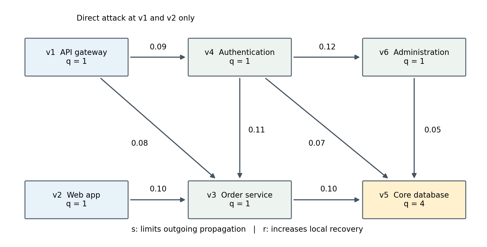

# 面向非对称云平台传播网络的最佳防御行动求解与滚动重规划

**版本：D7中文第二版；2026-11-14。稿件与新增数值结果待人工审阅。历史D4-P0-1、D5-P0及D5结果的待审状态未改变；本文主结果全部来自D7新拓扑。**

## 摘要

云平台内部传播与资产价值差异使防御资源配置同时面临位置、时序和攻击响应的选择。针对有限资源下的动态防御行动求解问题，采用完全信息非零和开环微分博弈，将工作负载实例组受损比例作为状态，将源端隔离与本地恢复作为竞争同一瞬时容量的防御投入。通过控制时间离散、Runge–Kutta积分及灵敏度计算、约束局部优化和交替最佳响应，生成逐资产、逐时段的防御配置；在入口攻击效率改变后，以当前状态重新求解剩余时域问题并执行首区间行动。在预先固定的六资产非对称网络上，对三个容量水平开展固定攻击优化、策略交叉评价及两类公共攻击下的执行仿真，并增加主容量下的无扰动对照。结果显示，扰动后博弈重规划相对继承旧计划使全时域防御损失降低0.02884%–0.11623%；其相对非博弈滚动优化的优势依赖攻击评价条件，公共均分攻击下略差，针对旧计划生成的冻结攻击下略优。固定公共攻击下，离线博弈配置也未优于针对该攻击优化的防御。多起点与积分细化检查支持所报告数值配置的局部一致性，但不构成连续控制全局最优或严格Nash证明。研究给出从资产语义、资源约束到实际执行行动及损失分解的可复核计算流程，并揭示本场景中战略响应收益较小且具有条件性。

**关键词：** 云平台安全；非零和微分博弈；动态防御行动；源端隔离；资源配置；滚动重规划

# 1 引言

云平台中的API网关、应用服务、认证系统和数据库承担不同业务功能，也形成不同的内部访问与授权关系。若工作负载受损后可以利用这些关系继续传播，仅按单点业务价值配置安全投入可能忽略上游传播影响。另一方面，限制来源资产的访问能够降低外传，却可能造成业务中断；恢复受损实例能够降低本地损失，却同样占用有限运维资源。防御决策因而需要确定每一控制时段对哪些资产采取隔离或恢复、投入多少容量，以及在攻击条件变化后如何调整既有计划。

已有研究从不同层次刻画上述决策。Li等[1]将云平台攻击图与防御选择纳入随机博弈，说明云资产结构与长期安全收益需要共同建模。网络传播控制研究则直接分析资源对传播动态的影响：Preciado等[2]在有向网络中研究预防与纠正资源配置，Paarporn和Xu[3]研究预防与反应性防御之间的资源权衡。这些工作提供了行动耦合与共享资源的重要背景，但其目标、状态及信息结构不能直接替代具体的非零和攻防问题。

微分博弈已被用于网络安全动态决策。Tian等[4]针对云恶意软件传播建立非零和开环模型，并利用状态与伴随方程构造策略迭代；Zhang等分别研究无标度网络的动态防御[5]和基于势微分博弈的复杂网络决策[6]。因此，开环攻防建模、连续行动以及最佳行动计算本身已有直接先例。孙鹏宇等[7]进一步讨论行动与时间选择，胡春娇等[8]结合阶段内微分博弈与阶段间Markov转移，Lou等[9]面向不完全信息条件研究协同防御。上述模型分别依赖特定传播结构、势函数、阶段转移或信息推断机制；本研究保持完全信息非零和开环结构，不引入这些额外机制，也不继承其理论保证。

从防御执行角度看，离线求得完整计划仍需回答两个问题：其一，防御改善是否在相同实际攻击条件下成立；其二，攻击效率改变后，按新状态计算的行动是否优于继续执行原计划和普通滚动优化。根据当前状态求解有限时域计划并执行首段，是模型预测控制中的既有思想[10]。将该执行机制用于攻防问题，并不能自动说明战略响应不可替代，更不能把不同攻击轨迹下的损失差解释为纯防御行动收益。

本文围绕一组明确的云平台资产和固定的有向传播假设，研究源端隔离与本地恢复共同受限时的动态行动计算。主要工作包括：建立六类云工作负载与受损状态、两类防御投入之间的明确映射，区分高业务价值与上游传播作用；以既有离散最佳响应方法形成具有逐时容量检查和局部响应诊断的行动求解流程，并将其嵌入缩短剩余时域的执行过程；通过公共固定攻击、各自攻击响应、参数扰动及无扰动对照分层评价配置效果。本文的贡献定位为特定问题的行动建模、计算流程和可复核执行证据，不主张新的均衡存在定理、通用优化算法或普遍性能优势。


# 2 多资产网络攻防微分博弈模型

## 2.1 资产状态与防御行动

将云平台表示为有向有效传播网络\(\mathcal G=(V,\mathcal E_\beta)\)。每个资产\(v_i\)对应一组具有相近功能和安全属性的工作负载实例，\(x_i(t)\in[0,1]\)表示该实例组的受损比例。边权\(\beta_{ji}\ge0\)描述由来源资产\(j\)到接收资产\(i\)的有效传播率，且\(\beta_{ii}=0\)。传播关联以可达性、授权路径和可利用弱点同时成立为条件，不等同于普通业务流量。本研究不把实例组受损比例解释为单台服务器被攻陷的概率。

攻击者在入口集合\(\mathcal E_a\)上配置直接攻击投入\(a_i(t)\)。防御者配置源端隔离\(s_i(t)\)与本地恢复\(r_i(t)\)：前者削弱来源资产的全部出向传播，后者提高本地受损实例的恢复速率。两类行动的强度均为归一化连续投入，可分别对应访问限制、凭证权限收缩，以及受损工作负载清理或重建所投入的资源。其数值尚未标定为具体安全设备规则或平台操作次数。

状态方程为

\[
\dot x_i=(1-x_i)\left[\alpha_i a_i+\sum_{j\ne i}\beta_{ji}(1-\varepsilon_j s_j)x_j\right]-(\delta_i+\gamma_i r_i)x_i,\qquad x(0)=x_0.\tag{1}
\]

其中，\(\alpha_i>0\)仅在入口成立；\(\varepsilon_i\in(0,1]\)为隔离有效性，\(\delta_i\ge0\)为基础恢复率，\(\gamma_i\ge0\)为恢复投入效率。隔离不直接削减同一资产上的入口攻击，恢复则通过降低来源受损程度间接减弱外传。给定有界可测控制与有限非负参数，右端关于状态局部Lipschitz；在\(x_i=0\)处导数非负，在\(x_i=1\)处导数非正，因此状态立方体正不变，唯一解可延拓至有限时域\([0,T]\)。该连续性质不替代离散积分检查。

## 2.2 非零和目标与共享容量

防御者最小化安全损失、隔离业务中断与行动成本，攻击者最大化受损收益扣除攻击投入成本后的净收益：

\[
\begin{aligned}
J_D(u,a)&=\int_0^T\left[\sum_i(q_ix_i+h_is_i)+\frac12\sum_i(c_i^ss_i^2+c_i^rr_i^2)\right]\,dt+\omega^\top x(T),\\
J_A(u,a)&=\int_0^T\left[\sum_i g_ix_i-\frac12\sum_i c_i^aa_i^2\right]\,dt+\nu^\top x(T),\qquad u=(s,r).
\end{aligned}\tag{2}
\]

\(q_i,g_i\)分别为防御损失与攻击收益权重；\(h_i\)为隔离业务中断系数；\(c_i^s,c_i^r,c_i^a>0\)为二次成本系数；\(\omega,\nu\ge0\)为终端权重。双方估值和成本不同，故不能将该问题化为以\(J_D\)为唯一目标的零和极小极大问题。

所有控制取值于\([0,1]\)，非入口\(a_i=0\)，并在几乎每一时刻满足

\[
\sum_i(b_i^ss_i+b_i^rr_i)\le B,\qquad
\sum_i d_i^aa_i\le A.\tag{3}
\]

容量系数\(b_i^s,b_i^r,d_i^a>0\)反映资源占用。\(A,B\)是瞬时容量，不是全时域累计预算；同一时段内隔离与恢复竞争防御容量，经济成本则按式(2)累计。

## 2.3 开环理论基准

采用完全信息、两方同时选择完整时间计划的开环信息结构[11]。令\(\mathcal U,\mathcal A\)分别为满足式(3)及箱约束的有界可测防御与攻击计划集合。开环Nash基准定义为

\[
J_D(u^*,a^*)\le J_D(v,a^*),\quad \forall v\in\mathcal U;
\qquad J_A(u^*,a^*)\ge J_A(u^*,b),\quad\forall b\in\mathcal A.\tag{4}
\]

本文计算受限分段常值策略空间中的数值策略解。交替更新是离线求解顺序，不赋予任何参与者先行承诺权，因而不改变上述信息结构，也不构成Stackelberg博弈。

# 3 基于最佳响应的动态防御行动求解方法

## 3.1 离散优化与响应子问题

将\([0,T]\)划分为\(K\)个等长控制时段，\(t_k=kT/K\)，在\([t_k,t_{k+1})\)内保持\((a_k,s_k,r_k)\)不变。防御决策向量为\(z_D=(s_0,r_0,\ldots,s_{K-1},r_{K-1})\in\mathbb R^{2nK}\)，攻击向量仅包含入口分量\(z_A\in\mathbb R^{|\mathcal E_a|K}\)。六资产、六时段实例的维数分别为72和12。线性容量矩阵按时段构成块对角形式，防御单块为\([(b^s)^\top,(b^r)^\top]\)，攻击单块为\((d^a_{\mathcal E_a})^\top\)。

采用四阶Runge–Kutta（RK4）推进状态及累计成本[12]，每个控制时段取\(H\)个积分子步；同步对离散积分映射求灵敏度，得到目标关于全部控制分量的梯度。给定对手计划，两个理想响应问题为

\[
\min_{z_D\in U_K}\widehat J_D(z_D,z_A),\qquad
\min_{z_A\in A_K}-\widehat J_A(z_D,z_A),\tag{5}
\]

其中帽号表示离散积分目标。程序使用序列最小二乘规划（SLSQP）处理箱约束和逐时容量约束[13,14]，返回局部数值响应；式(5)中的全局最小化定义不等于求解器已实现全局搜索。

对同一完整策略对\((u,a)\)，理论偏离量为\(\Delta_D=J_D(u,a)-\min_vJ_D(v,a)\)与\(\Delta_A=\max_bJ_A(u,b)-J_A(u,a)\)。实际报告多起点局部响应\(\widetilde u,\widetilde a\)所发现的改善

\[
\widehat\Delta_D=\max\{0,\widehat J_D(u,a)-\widehat J_D(\widetilde u,a)\},\qquad
\widehat\Delta_A=\max\{0,\widehat J_A(u,\widetilde a)-\widehat J_A(u,a)\}.\tag{6}
\]

二者不是未知全局偏离的上界。对每一方最小化形式的目标\(F_p\)，还计算投影残差\(\|z_p-\Pi_{C_p}(z_p-\nabla F_p)\|_\infty\)，其中\(C_D=U_K,C_A=A_K\)。目标改善、驻点残差、响应距离、控制可行性及优化器状态分别检查，避免仅由相邻迭代变化较小判断均衡。

## 3.2 防御资源的边际解释

Pontryagin最大值原理与Karush–Kuhn–Tucker（KKT）条件用于解释固定对手时的必要条件[13,15]。设\(H_D=L_D+(p^D)^\top f\)、\(H_A=L_A+(p^A)^\top f\)，则正常型极值满足\(-\dot p^D=q+(D_xf)^\top p^D\)、\(-\dot p^A=g+(D_xf)^\top p^A\)，终值分别为\(\omega,\nu\)。令\(z_i=\alpha_i a_i+\sum_j\beta_{ji}(1-\varepsilon_js_j)x_j\)，有\(\partial f_i/\partial x_i=-z_i-\delta_i-\gamma_ir_i\)，且\(\partial f_i/\partial x_\ell=(1-x_i)\beta_{\ell i}(1-\varepsilon_\ell s_\ell)\)（\(\ell\ne i\)）。

来源隔离与本地恢复的边际量分别为

\[
M_i^s=\varepsilon_i x_i\sum_{j\ne i}\beta_{ij}(1-x_j)p_j^D,
\qquad M_i^r=\gamma_i x_ip_i^D.\tag{7}
\]

固定状态与伴随量，防御容量乘子\(\lambda_D\ge0\)给出

\[
s_i=\operatorname{clip}_{[0,1]}\frac{M_i^s-h_i-\lambda_Db_i^s}{c_i^s},\quad
r_i=\operatorname{clip}_{[0,1]}\frac{M_i^r-\lambda_Db_i^r}{c_i^r};\qquad
a_i=\operatorname{clip}_{[0,1]}\frac{\alpha_i(1-x_i)p_i^A-\lambda_Ad_i^a}{c_i^a},\ i\in\mathcal E_a.\tag{8}
\]

两个容量乘子满足相应可行性与互补松弛。式(7)说明隔离主要取决于出向传播及下游价值，恢复主要取决于本地受损及其未来代价；这些量随状态和剩余时域变化，不能简化为固定节点排序。对于无出边数据库，\(M_5^s=0\)，且隔离成本为正，因此固定其他控制时最优隔离为零。本文实际算法求解式(5)，**不直接求解连续伴随两点边值问题**；瞬时Hamiltonian的凸凹性不保证完整动态问题全局最优。

## 3.3 动态防御行动求解算法

算法1采用均匀、零和预设随机三条初始化路径；滚动阶段以原剩余计划替代均匀路径。每条路径最多进行40次策略更新，并可在第40次更新后再次检查。每次检查中的攻防响应均固定同一对手计划。固定主展示路径在实验前登记，多起点用于检验局部初始化敏感性，不用于筛选有利收益。

```text
算法1：基于交替最佳响应的动态防御行动求解
Input: 模型Θ，初态x0，剩余时域长度T'，K'个控制时段；
       U_K、A_K，H=48，预登记种子与三条初始计划；
       最大更新次数M=40，改善/残差/距离/可行性阈值。
Output: 分时段攻防计划、状态、成本、数值诊断与通过/失败状态。

LocalResponse(p, fixed_opponent, initial, Nstart):
    构造式(5)中本方目标、箱约束及逐时容量矩阵
    初值依次为当前计划、零计划、按种子生成并缩放的可行随机计划
    仅取前Nstart个；每个初值调用RK4灵敏度+SLSQP
    设置maxiter=300，ftol=10^-10，保存全部退出码和原始返回值
    以当前可行计划为基准，保留可行且目标不增的最佳返回值
    Return 返回计划及全部尝试日志（正常退出另作质量要求）

For 初始化路径p in {主路径, 零, 随机}:
    (u,a) ← 该路径的可行初始计划
    For m=0,...,M:
        d ← LocalResponse(D, a, u, 1)
        b ← LocalResponse(A, u, a, 1)       // 同一未修改完整对
        计算式(6)、当前投影残差、双方响应距离及退出状态
        If 非有限值、状态越界或约束异常: 保存失败；Return 失败
        If 两方全部终止门槛通过: 保存当前(u,a)；Break
        If m=M: 保存迭代耗尽；标记该路径失败；Break
        u ← d
        a ← LocalResponse(A, u, a, 1)      // 新防御下另求攻击
    保存该路径完整轨迹与最终诊断
选取预登记主路径；不按目标好坏更换主路径
在同一主策略对上以H=48、96分别进行双方三起点独立响应检查
检查三路径控制差、所有优化调用成功、逐时容量与状态范围
用固定控制在H=48/96/192重新积分，比较状态、总目标及分项
If 任一质量门槛失败: Return 已保存策略与失败诊断，禁止扩批
Return 逐时段逐资产a/s/r、容量使用、起止状态、成本及通过状态
```

响应改善采用\(\widehat\Delta_p/(1+|\widehat J_p|)\le10^{-7}\)，当前投影残差不超过\(10^{-4}\)，响应距离及三路径控制差不超过\(10^{-3}\)，控制与容量误差不超过\(10^{-10}\)。积分细化差不超过\(10^{-6}\)。输出记录明确“何时、何处、采取何种行动、投入多少资源及状态如何变化”，每行至少包含控制起止时刻、资产名称、\(s_{ik},r_{ik}\)、资产容量消耗、起止状态、成本及诊断状态。

## 3.4 攻击参数扰动下的滚动执行

滚动优化以当前状态初始化有限时域问题并只执行首段控制，这一思想已有成熟控制理论基础[10]。本文在固定终端时刻\(T\)下缩短剩余时域，将算法1嵌入防御执行过程。事件表示已知入口效率参数变化，而非攻击者主动切换行动；内部预测攻击\(a^{pred}\)与公共实际攻击\(a^{exec}\)分别保存。

```text
算法2：攻击参数扰动下的防御重规划与执行
Input: 初始G计划，事件时刻τ=5，更新后的已知模型参数；
       更新时刻{5,20/3,25/3}，公共执行攻击E0或E1。
Output: P/G/R实际防御、状态、分项损失、资源使用和计算耗时。

执行初始G计划前三个控制时段，得到公共x_exec(τ)
生成并冻结事件后执行攻击：E0入口均分；E1固定P尾段求攻击响应
E1先三起点，再12起点及入口稀疏初值检查；保持P防御不变
For 方法 in {P,G,R}:
    x ← x_exec(τ)；warm ← 初始计划剩余部分
    For j=0,1,2:
        Θ_j ← 更新参数、当前实际状态x及剩余K'=3-j
        If 方法=P: 取原计划对应防御行动
        If 方法=G: 按算法1重求剩余攻防计划
        If 方法=R:
            a_pred ← 将上一已观测区间攻击持续到剩余时域
            固定a_pred，以三起点局部响应仅优化防御并作H96复核
        If 重规划质量失败: 保存诊断；停止该轨迹，不计成功回退
        仅执行所选防御计划首时段；用公共a_exec推进实际状态
        保存当前行动与新状态；warm ← 本次计划删除首时段
    拼接公共历史和实际防御，按公共a_exec重新积分累计分项
    用H=48/96/192检查连续性、约束、状态与积分精度
比较相同预算、相同参数组与相同实际攻击下P/G/R的结果
```

P可直接按完整继承计划积分，与上述逐时取原行动等价。R在第一次更新使用公共历史最后一段已观测攻击，后续使用上一实际区间攻击。E1仅针对P构造，不是G或R的最坏攻击。该执行流程依赖实际历史，但没有构造或求解全状态反馈策略，因此不能称为Markov反馈Nash。


# 4 数值仿真实验

## 4.1 六资产云平台环境与评价设置

仿真网络包含API网关(v1)、Web应用(v2)、订单处理服务(v3)、身份认证服务(v4)、核心数据库(v5)和后台管理服务(v6)，每个节点对应一组同类工作负载。仅v1和v2接受直接攻击，v5的防御损失权重为其他资产的4倍。图1给出全部八条传播关联；其含义是在访问可达、相应凭证或权限可用且存在可利用弱点的条件下，受损来源可能影响接收资产。例如，网关到订单服务对应内部调用凭证或接口弱点，认证服务到订单、数据库和后台管理服务对应授权材料被滥用，后台管理到数据库对应管理权限被滥用。这些关联均为参数化安全假设，不表示已经确认具体漏洞。



**图1　预设六资产有向传播网络与防御作用位置。** 箭头为传播方向，边标注每模型时间的归一化有效传播率；黄色节点为高价值数据库。隔离削弱来源的全部出边，恢复作用于本地。图为一个固定场景的结构示意，不是生产平台测量结果。

**表1　固定参数、量纲与设置依据。** 所有值在优化前确定；三个防御容量构成同一网络的资源情景，不是三个独立真实网络样本。

|参数|设定|含义与依据|
|---|---|---|
|n,T,K|6，10，6|六类资产；未标定模型时间；等长控制区间5/3|
|A；B|0.8；0.6/1.2/1.8|瞬时攻击/防御容量；主展示B=1.2|
|α|入口0.25，其他0|直接攻击效率；事件后仅v1改为0.50|
|β|图1八条边，其余0|预设归一化传播率，来源行、接收列|
|δ,γ,ε|0.1，0.3，1|基础恢复率、恢复效率、隔离效率|
|q；g|q5=4，其余1；g全1|区分防御业务价值与攻击收益权重|
|h；cˢ,cʳ,cᵃ|0.05；均为1|隔离业务损失率；二次行动成本率|
|bˢ,bʳ,dᵃ；ω,ν|均为1；均为0|每单位行动的容量占用；不设终端损失|
|x(0)|[0.1,0,0,0,0,0]|仅v1初始10%实例受损|

时间单位没有映射到真实秒钟，成本采用相对单位，没有货币标定。传播率、初态、成本与价值参数用于构造可解释且可复算的非对称场景，不来自现场估计，也未根据收益调整。防御行动可映射到网关访问限制、服务凭证权限收缩、工作负载清理与重建等运维活动，但连续投入尚未转换为具体平台命令。

离线方法G计算非零和攻防响应配置\(u^{DG}\)，F在预先设定的全时域攻击\(a_0=(0.4,0.4,0,0,0,0)\)下仅优化防御\(u^{FT}\)。两种防御冻结后，分别在\(a_0\)、G的攻击计划\(a_G\)以及固定F防御重新计算的攻击响应\(a_{BR,F}\)下进行完整交叉评价。公共攻击比较固定攻击条件；各自响应比较允许攻击变化，二者回答不同问题。攻击响应最大化\(J_A\)，不等于最大化\(J_D\)。

执行阶段比较P、G、R：P继承原G防御；G用最新状态和参数重新求解剩余攻防计划；R将上一时段观察到的攻击持续到剩余时域，仅重新优化防御。三者共享事件前历史，在每一评价条件下接受完全相同的实际攻击。E0在事件后仍为两入口各0.4；E1固定P尾段防御生成局部攻击响应，随后冻结并用于三种方法。完整训练—防御—实际攻击协议矩阵见补充材料S1。图2显示计划与执行的区分。


**图2　攻击参数变化后的防御决策与执行流程。** 当前状态和已知参数进入剩余时域优化，仅首区间防御进入状态积分；内部预测攻击不替代公共实际攻击。更新时刻为5、20/3、25/3。

所有案例均为确定性数值实验，随机数只用于优化初值。采用Python 3.11.7、NumPy 1.26.4与SciPy 1.11.4的本地运行环境。优化、积分与停止阈值见第3章；完整种子规则和环境记录见补充材料。未据单一场景进行统计显著性推断。

## 4.2 动态防御行动与资源配置

主容量B=1.2下，G配置的总防御损失为9.326647，其中安全损失8.176990、业务中断0.145233、隔离成本0.303665、恢复成本0.700758；攻击净收益为5.819711。六时段平均防御容量使用为0.974504，并非所有时段都用满容量。图3展示全部六资产和六时段的隔离与恢复，表2给出认证与数据库两类关键资产的详细行动；完整36行行动及每节点成本见补充材料S2。


**图3　B=1.2下G的逐资产逐时段防御配置。** 左右面板分别为隔离与恢复，横轴为控制区间起点，纵轴为资产；色标固定为0–1，数值为归一化行动强度并保留两位小数。展示一个固定主初始化路径的解，不是多次样本平均。

**表2　关键资产行动决策摘录（B=1.2，离线G）。** 资源为该资产的s+r；起止状态为实例组受损比例；成本为该资产在本区间的四项防御损失之和。小于显示精度的值不表示精确数学零。

| 区间          | 资产   |        s |        r |     资源 |   起始状态 |   结束状态 |   区间成本 |
|:--------------|:-------|---------:|---------:|---------:|-----------:|-----------:|-----------:|
| [0.00, 1.67)  | v4     | 0.000000 | 0.032731 | 0.032731 |   0.000000 |   0.014047 |   0.011668 |
| [0.00, 1.67)  | v5     | 0.000000 | 0.004480 | 0.004480 |   0.000000 |   0.002321 |   0.004702 |
| [1.67, 3.33)  | v4     | 0.000951 | 0.067163 | 0.068113 |   0.014047 |   0.031218 |   0.041327 |
| [1.67, 3.33)  | v5     | 0.000000 | 0.013671 | 0.013671 |   0.002321 |   0.011243 |   0.041352 |
| [3.33, 5.00)  | v4     | 0.010906 | 0.074199 | 0.085106 |   0.031218 |   0.051656 |   0.074773 |
| [3.33, 5.00)  | v5     | 0.000000 | 0.043864 | 0.043864 |   0.011243 |   0.026804 |   0.124628 |
| [5.00, 6.67)  | v4     | 0.033022 | 0.085494 | 0.118516 |   0.051656 |   0.073640 |   0.114503 |
| [5.00, 6.67)  | v5     | 0.000000 | 0.102525 | 0.102525 |   0.026804 |   0.046755 |   0.251221 |
| [6.67, 8.33)  | v4     | 0.042531 | 0.083404 | 0.125935 |   0.073640 |   0.096092 |   0.152788 |
| [6.67, 8.33)  | v5     | 0.000000 | 0.139747 | 0.139747 |   0.046755 |   0.069591 |   0.402335 |
| [8.33, 10.00) | v4     | 0.000000 | 0.030317 | 0.030317 |   0.096092 |   0.119074 |   0.181292 |
| [8.33, 10.00) | v5     | 0.000000 | 0.073475 | 0.073475 |   0.069591 |   0.100448 |   0.569979 |

网关在早期具有较大的隔离与恢复投入，订单与数据库的恢复投入随后增加。数据库的隔离在数值精度内为零，与其无出边的源端隔离机制一致；其恢复在第五区间达到约0.140，随后随剩余时域缩短而下降。身份认证虽然具有多条出边，隔离投入仍明显低于入口网关，说明资源配置同时受到当前受损程度、下游价值、行动成本及剩余时域影响，不能仅按出度排序。末期投入下降还受到终端权重为零的设置影响，不宜解释为一般安全运维规律。

全部登记优化尝试均正常退出。最终响应检查的最大归一化已发现改善为1.43×10⁻⁹，当前投影残差最大9.44×10⁻⁵，三路径控制差最大4.32×10⁻⁵；逐时容量违反不超过3.89×10⁻¹⁵。积分细化及独立DOP853固定控制复算的误差均低于预定门槛。上述诊断支持局部数值配置及轨迹计算的一致性，不提供全局偏离上界。详细数值指标列于补充材料S4。

## 4.3 攻防战略响应与防御性能比较

表3分开报告公共固定攻击和各自攻击响应下的防御损失。公共固定攻击下，F在三个容量水平均略优于G，这是针对该攻击直接优化的合理结果。各自攻击响应下，G的损失略低于F，差异为0.000537–0.001519，即0.00577%–0.01579%。由于两种方法此时接受不同攻击，该差异反映整个响应协议的结果，不能解释为仅改变防御行动的因果效应。

**表3　离线G/F的两类评价。** 差值为F损失减G损失；百分比以同一行F损失为分母。正值表示该协议下G损失较低。

|        B | 评价         |    G损失 |    F损失 |       F−G |   相对差(%) |
|---------:|:-------------|---------:|---------:|----------:|------------:|
| 0.600000 | 共同固定攻击 | 9.760493 | 9.759868 | -0.000625 |   -0.006401 |
| 0.600000 | 各自攻击响应 | 9.620103 | 9.621622 |  0.001519 |    0.015793 |
| 1.200000 | 共同固定攻击 | 9.467228 | 9.466796 | -0.000432 |   -0.004564 |
| 1.200000 | 各自攻击响应 | 9.326647 | 9.327376 |  0.000729 |    0.007820 |
| 1.800000 | 共同固定攻击 | 9.449465 | 9.449058 | -0.000407 |   -0.004309 |
| 1.800000 | 各自攻击响应 | 9.310823 | 9.311360 |  0.000537 |    0.005767 |


**图4　公共固定攻击与各自响应下的成对损失差。** 纵轴为1000倍差值，保留零线及负结果，并非截断后的原总损失。每个容量对应一个固定场景；连线仅辅助阅读。原总损失见表3，完整六项交叉评价及成本分解见补充材料S3。

攻击计划随防御变化，但幅度有限：从针对G的攻击到针对F的攻击，最大分量变化在B=0.6、1.2、1.8下分别为0.003163、0.002321、0.002131。主容量下，两入口的攻击并非始终均分，首区间v1/v2分别为0.401868/0.398132，末区间分别为0.139831/0.137174，末区间总攻击投入低于0.8的容量上限。因此数据支持存在可测的策略相互响应，却不支持战略响应带来大幅防御优势。

G与F在B=1.2下的离线求解耗时分别为99.36 s和14.01 s，包括登记的多初始化路径及H=48最终响应检查，不包括额外H=96精度复核。G在三个容量下平均使用的防御资源分别为0.564365、0.974504、1.081024；F分别为0.565792、0.974188、1.077408。较大的容量上限未必全部使用，因为进一步行动还会增加二次成本和业务中断。比较既须考察损失，也须考虑实际资源使用与计算代价。

## 4.4 攻击效率变化后的重规划与执行

在t=5将网关入口效率由0.25提高到0.50，攻击投入本身由E0/E1独立规定。表4列出全部事件组及主容量无扰动对照的全时域损失。事件组中G相对P的改善为0.003010–0.011735，即0.02884%–0.11623%；事件后区间的相对改善为0.04039%–0.17253%，两个百分比分母不同，不能混用。

**表4　扰动及无扰动对照的执行结果。** ΔPG=P−G，ΔRG=R−G；括号中的百分比依次以P、R的全时域损失为分母。E1只针对P生成，非G/R最坏攻击。

| 组别     |        B | 攻击   |     P损失 |     G损失 |     R损失 | ΔPG (%)            | ΔRG (%)              |
|:---------|---------:|:-------|----------:|----------:|----------:|:-------------------|:---------------------|
| 效率突变 | 0.600000 | E0     | 10.434503 | 10.431493 | 10.431113 | 0.003010 (0.02884) | -0.000381 (-0.00365) |
| 效率突变 | 0.600000 | E1     | 10.415090 | 10.406352 | 10.406892 | 0.008738 (0.08390) | 0.000541 (0.00520)   |
| 效率突变 | 1.200000 | E0     | 10.135939 | 10.131928 | 10.131422 | 0.004011 (0.03957) | -0.000507 (-0.00500) |
| 效率突变 | 1.200000 | E1     | 10.112240 | 10.100822 | 10.101428 | 0.011418 (0.11291) | 0.000605 (0.00599)   |
| 效率突变 | 1.800000 | E0     | 10.119840 | 10.115784 | 10.115236 | 0.004056 (0.04008) | -0.000548 (-0.00542) |
| 效率突变 | 1.800000 | E1     | 10.096352 | 10.084617 | 10.085257 | 0.011735 (0.11623) | 0.000640 (0.00635)   |
| 无扰动   | 1.200000 | E0     |  9.472951 |  9.472921 |  9.472840 | 0.000030 (0.00032) | -0.000081 (-0.00085) |
| 无扰动   | 1.200000 | E1     |  9.326647 |  9.326647 |  9.326734 | 0.000000 (0.00000) | 0.000087 (0.00093)   |

G与R之间的差异改变符号：E0下G比R高0.000381–0.000548，E1下G比R低0.000541–0.000640。主容量E0中，G的安全损失相对P降低0.052344，同时隔离业务与行动成本发生补偿变化，最终总损失只降低0.004011。完整成本分解和未加价值权重的受损面积见补充材料S3，不能由总损失单独推断所有成本分量同时改善。


**图5　B=1.2时数据库状态差与认证服务恢复行动。** 上排为各方法相对P的数据库受损比例差，纵轴明确放大1000倍并保留正负变化；下排为实际执行的认证恢复强度。列分别对应E0与E1，t=5竖线标出参数事件，6.67与8.33为后续更新时点。全部三方法共享事件前历史；原状态、全部节点行动及数值精度保存在补充数据。

图5显示，数据库受损差并非在事件后立即单调降低，短暂正差之后才转为负差；认证服务的恢复也不是所有后续区间统一增加，而是在第一更新区间略降、后两区间上调。例如，E1下认证服务在三个更新区间实际执行的恢复强度依次为0.082296、0.092094、0.036463，对应隔离强度依次为0.031608、0.053527、0.000000。 这说明算法输出的是与时段和状态相关的具体配置，而非一个恒定防御等级。

无扰动E0中，G相对P仅改善0.00003017；无扰动E1中，两者总损失在所报精度下相同。E0在事件与对照之间保持相同实际攻击轨迹，支持该固定场景中效率突变提高了重规划的收益幅度；仍不能据此推广到其他扰动或网络。E1在两组中均按同一规则重新生成攻击，因此组间攻击不同，不是仅改变α的纯因果对照。

三个事件组共18次G和18次R重规划，计算时间中位数分别为14.38 s和3.18 s；G范围3.87–28.62 s，R范围0.90–5.81 s。统计包含三初始化路径/多起点及H=48诊断，额外精度复核单独保存；嵌套单方优化时间不重复累加。模型时间尚未映射到真实时间，实验也未模拟计算过程中系统继续演化的延迟，故不能由上述时长宣称实时可部署。

## 4.5 主要发现与适用边界

首先，非对称传播结构与资产价值共同决定行动位置；无出边数据库适合本地恢复而不需要源端隔离，是该模型结构与正行动成本下的直接性质。其次，博弈配置产生了与固定攻击优化不同的行动和攻击计划，但在本场景中损失差很小，评价攻击决定比较方向。再次，参数变化后基于实际状态重新配置行动比继承旧计划更有效，但普通滚动优化已解释大部分可见收益，现有数据不足以证明博弈重规划不可替代。

本研究仅验证K=6分段常值控制，未在新拓扑上进行K精化，也未开展传播率或成本敏感性实验；积分步长细化不能替代控制离散精化。多起点局部优化不能排除其他吸引域或未发现的单方改善。六资产逻辑映射与传播率均为人工设定，参数、状态估计和操作接口尚未用真实云集群数据校准。已知效率突变不同于未知攻击识别或学习；公共冻结攻击也未覆盖自适应攻击者在真实执行中的完整策略空间。

# 5 结论

本文围绕有限瞬时容量下的隔离与恢复配置，将非零和开环攻防计算落实为可解释的逐资产、逐时段行动，并在攻击效率变化后以当前状态重新求解和执行剩余计划。六资产非对称网络上的数值实验表明，重新规划能够在所测事件条件下小幅降低继续执行旧计划的损失；但博弈方法对固定攻击优化和普通滚动优化均不存在统一优势，增益还伴随更高计算成本。已有结果支持该固定模型下的行动计算与执行流程，而非连续控制全局均衡、通用算法优越性或真实云平台效果。后续验证应优先考察新拓扑的控制离散精化、参数校准、状态估计误差与执行延迟，检验这些小幅差异在更贴近部署的条件下是否仍有实际意义。

## 数据与代码说明

新拓扑参数、全部控制与状态、逐资产行动成本、优化器退出记录、图表数据及复算说明随补充材料提供。正文不使用旧拓扑数据作为新结果。完整稿件与证据包尚待人工审核，本文不代替作者确认投稿版本及目标会议格式。


## 参考文献

[1] Li L, Huang L, Zhao G, Shi K, Zhang F. A Stochastic Game Model for Cloud Platform Security. Proceedings of the 9th International Conference on Information Systems Security and Privacy, 2023: 152–162. DOI: 10.5220/0011778900003405.

[2] Preciado V M, Zargham M, Enyioha C, Jadbabaie A, Pappas G J. Optimal Resource Allocation for Network Protection Against Spreading Processes. IEEE Transactions on Control of Network Systems, 2014, 1(1): 99–108. DOI: 10.1109/TCNS.2014.2310911.

[3] Paarporn K, Xu S. Preventive-Reactive Defense Tradeoffs in Resource Allocation Contests. IEEE Control Systems Letters, 2024, 8: 2421–2426. DOI: 10.1109/LCSYS.2024.3486629.

[4] Tian L, Gan C, Lin J, Shang F, Zhu Q. Analysis of attack-defense game for advanced malware propagation control in cloud. Computer Communications, 2025, 237: 108148. DOI: 10.1016/j.comcom.2025.108148.

[5] Zhang H, Mi Y, Liu X, Zhang Y, Wang J, Tan J. A differential game approach for real-time security defense decision in scale-free networks. Computer Networks, 2023, 224: 109635. DOI: 10.1016/j.comnet.2023.109635.

[6] Zhang H, Mi Y, Fu Y, Liu X, Zhang Y, Wang J, Tan J. Security defense decision method based on potential differential game for complex networks. Computers & Security, 2023, 129: 103187. DOI: 10.1016/j.cose.2023.103187.

[7] 孙鹏宇, 谭晶磊, 李晨蔚, 张恒巍. 基于时间微分博弈的网络安全防御决策方法. 信息网络安全, 2022, 22(5): 64–74. DOI: 10.3969/j.issn.1671-1122.2022.05.008.

[8] 胡春娇, 陈瑛, 王高才. 基于Markov微分博弈的移动目标防御决策优化. 计算机应用研究, 2023, 40(9): 2832–2837. DOI: 10.19734/j.issn.1001-3695.2023.01.0011.

[9] Lou K, Zhao G, Wang J, Huang X, Wan Z. Collaborative defense model for crowdsensing networks based on incomplete Information differential games. Cybersecurity, 2026, 9: 143. DOI: 10.1186/s42400-026-00577-4.

[10] Mayne D Q, Rawlings J B, Rao C V, Scokaert P O M. Constrained model predictive control: Stability and optimality. Automatica, 2000, 36(6): 789–814. DOI: 10.1016/S0005-1098(99)00214-9.

[11] Başar T, Olsder G J. Dynamic Noncooperative Game Theory. 2nd ed. SIAM, 1999. DOI: 10.1137/1.9781611971132.

[12] Hairer E, Nørsett S P, Wanner G. Solving Ordinary Differential Equations I: Nonstiff Problems. 2nd ed. Springer, 1993. DOI: 10.1007/978-3-540-78862-1.

[13] Nocedal J, Wright S J. Numerical Optimization. 2nd ed. Springer, 2006. DOI: 10.1007/978-0-387-40065-5.

[14] Kraft D. A Software Package for Sequential Quadratic Programming. DFVLR-FB 88-28. Deutsche Forschungs- und Versuchsanstalt für Luft- und Raumfahrt, 1988.

[15] Liberzon D. Calculus of Variations and Optimal Control Theory: A Concise Introduction. Princeton University Press, 2012.
