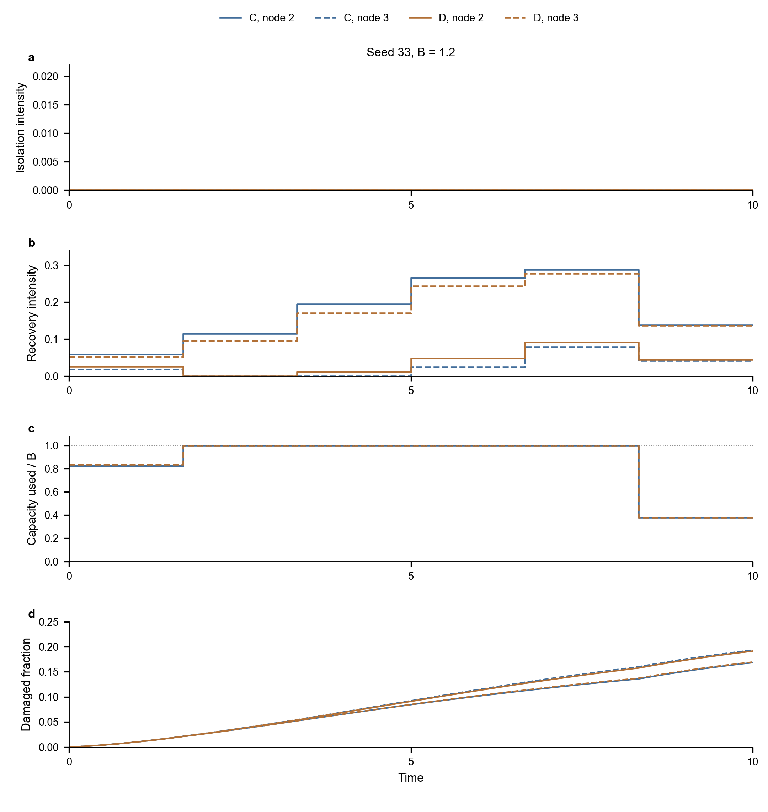

# 补充索引S1：源数据、完整配置与图S1

下列CSV均由已有保存数据重算或提取，不是新增实验。原始路径、参数、K/H、评价模式及SHA256见[证据清单](00_D2_evidence_inventory.md)与[逐结果来源](tables/result_provenance.csv)。

|正文显示项|完整数值文件|含义|
|---|---|---|
|表1、图1|[边权](tables/matched_edges.csv)、[参数表](tables/design_table_1.csv)|全部36模型的8边及实际权重|
|图2及原值表|[四格配对](tables/matched_four_cells.csv)、[双方目标](tables/matched_objectives.csv)|9组全部原值，H48；H12分项单列|
|图3、5.2|[全部节点控制](tables/matched_controls_all_nodes.csv)、[全部状态](tables/matched_states_H12.csv)、[容量](tables/matched_budgets.csv)|36配置、6节点、6槽；状态H12，时间不重标|
|5.2时窗分析|[时窗投入](tables/allocations_all_nodes.csv)、[全部控制交互](tables/control_interactions_all_nodes.csv)|全时域、前四槽、末两槽；全部节点与a/s/r|
|表3、5.3|[八方法全部目标](tables/baseline_all_objectives.csv)、[全部配对](tables/baseline_pairs.csv)、[范围统计](tables/baseline_statistics.csv)|9D格与原图反例分命名空间；H192目标及H48分解|
|5.4反例|[交叉攻击矩阵](tables/counterexample_cross_evaluation.csv)|固定同一攻击与各自响应的区别|
|表4、5.5|[K目标配对](tables/robust_paired_objectives.csv)、[K交互](tables/robust_interactions.csv)、[跨类偏离](tables/robust_cross_class.csv)、[K控制差](tables/k_control_distances.csv)|仅两组8格；多初值spread与跨K控制差不同|
|5.5可靠性|[32路径](tables/robust_all_paths.csv)、[隔离复现误差](tables/environment_cross_environment_errors.csv)|初始化不是独立网络样本|

重算入口为`python paper/work_d2/analysis/build_analysis.py`；绘图与表格导出命令见证据清单。只消费保存数据，不调用研究求解器。

**图S1 种子33、B=1.2的C/D时序配置。** a为节点2/3隔离，b为恢复，c为六节点总容量使用率，d为节点2/3保存受损比例轨迹（H12）。颜色区分C/D，a/b/d实虚线区分节点2/3；c蓝实线为C、橙虚线为D。横轴均为物理模型时间0–10。近零隔离、容量松弛及状态差异均保留；该例用于呈现中容量异质性，不代表全部配置。
