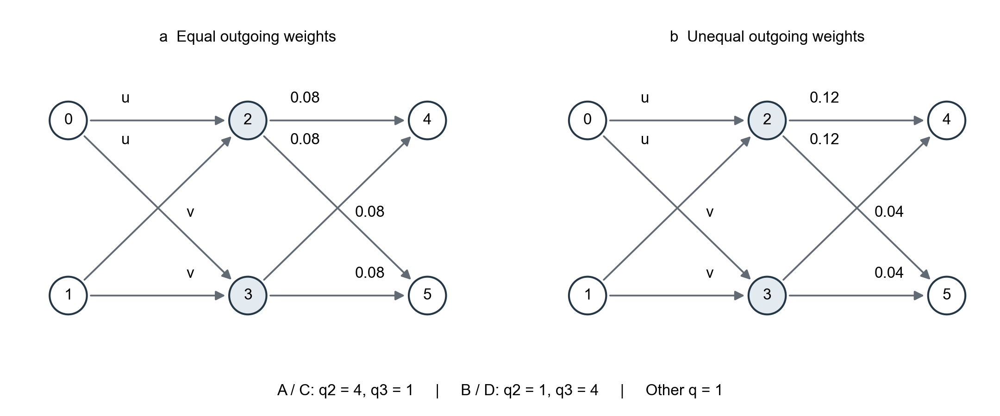
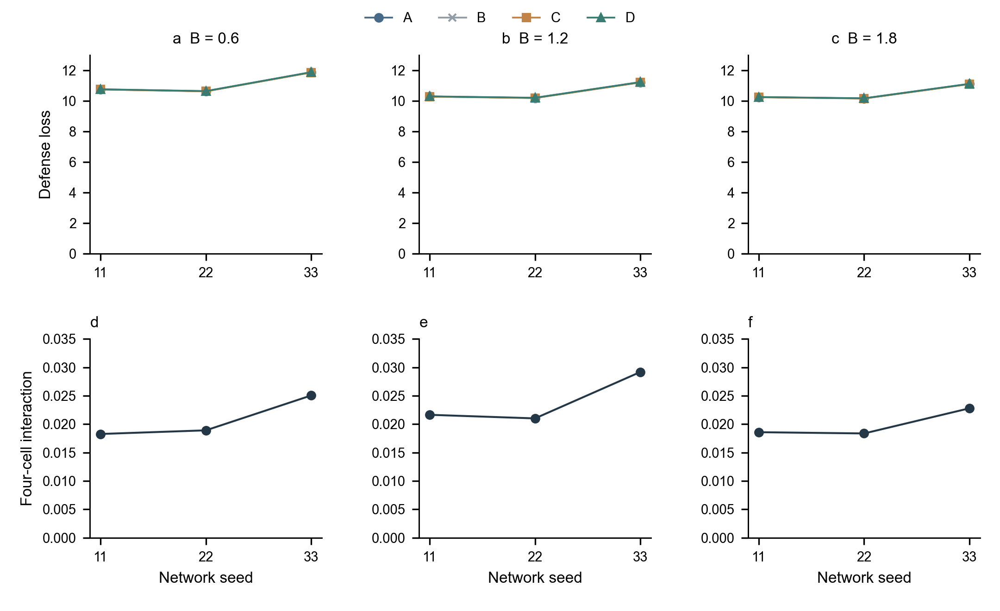
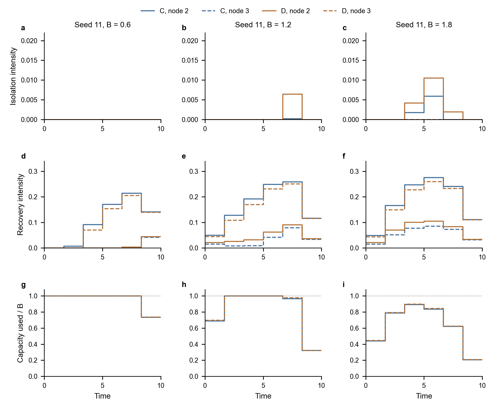

# 攻防交互下异质传播网络的隔离与恢复配置：匹配对照与收益边界

## 摘要

资产的直接价值与出向传播能力并不总是一致，其相对位置如何影响隔离与恢复配置，需要在匹配条件下检验。本文采用隔离与恢复共享逐时容量的非零和开环攻防模型，构造上游暴露匹配的六节点合成网络，交叉改变高价值位置与出向传播条件。在三个种子、三个容量的36个分段开环局部候选中，九组价值—传播损失交互均为正，为0.018274—0.029192，相当于同组C格损失的0.170%—0.261%。控制记录显示，低容量下两个价值交换节点的隔离近零，中容量存在时窗与种子异质性，高容量大多松弛，因而正向目标交互不对应普遍动作切换。九个D格配置中，联合动态计划相对固定攻击训练计划的损失改善在响应攻击评价下仅为0.029%—0.286%，在公共固定攻击下均为负；原网络另有联合计划不占优反例。两组控制槽精化保持目标交互方向，但六槽嵌入后仍可发现十二槽单边改善。结果表明，该构造族中的价值位置效应依赖传播条件，联合防御收益同时受训练与攻击评价规则限制；证据不构成连续控制全局Nash或真实云环境有效性证明。

**关键词：** 开环微分博弈；传播网络；隔离与恢复；匹配对照；资源配置

# 1 引言

网络化工作负载之间的访问与信任关系可能形成有向攻击传播通道，使局部受损影响下游资产。在资源容量有限时，防御者既需要抑制传播，也需要恢复已受损服务。两类行动面向不同的状态变化过程，其配置不能仅由资产的直接业务价值决定：高价值节点未必具有较强的出向传播能力，而传播较强的节点也未必承担较高的直接损失。云工作负载为这一问题提供了应用动机，本文则在合成网络上分析相应的资源取舍。

联合配置传播抑制与恢复资源已有充分研究基础。Preciado等[1]在有向异质网络中联合调整感染率与恢复率，通过几何规划求解预算约束下的传播控制问题。Paarporn和Xu[2]进一步研究攻击竞争下预防与恢复共享资源的取舍，给出特定零和资源竞赛的均衡刻画。前者采用静态率参数优化，后者以独立节点的攻破概率及恢复时长描述损失。上述工作构成联合防御与资源竞争的研究基础。

传播微分博弈为动态攻防提供了另一条研究路径。Tian等[3]已针对云恶意软件传播建立非零和开环攻防模型，并利用状态和伴随方程求取控制计划。价值异质性与网络位置的共同作用同样已有先例：Botteghi等[4]在Stackelberg安全博弈中分析双方估值与传播风险对保护配置的影响。Chen等[5]则从负载级联角度考察保护—恢复比例，表明资源条件会改变两类行动的取舍。这些结果为检验价值位置与传播条件的具体交互提供了基础。

本文关注：在上游攻击暴露匹配时，高价值位置变化对防御计划和损失的影响，是否依赖节点的出向传播条件？进一步地，在指定训练与攻击评价协议下，联合计划相对单动作、静态计划及固定攻击训练计划的配对损失差异有多大？回答这些问题需要把价值位置干预与传播条件交叉比较，并在相同攻击评价规则下设置不同的强基线。直接价值、出向传播强度与未来动态损失须分别处理，不能用一个静态节点指标替代三者。

本文采用有限时域非零和开环微分博弈，将攻击入口投入、来源节点出边隔离和本地恢复纳入同一状态模型，隔离与恢复共享逐时容量。双方事前确定时间计划，数值上以分段常值控制和直接射击计算目标，通过交替局部响应形成候选。Hamiltonian分析解释资源边际作用，多初值、单边偏离及积分精化检查数值质量。

本文主要贡献是在匹配上游暴露的合成网络中，以价值位置交换和传播条件变化构造四格对照，分析两因素对损失与资源计划的交互响应。支撑贡献是在指定训练与攻击评价协议下，分别与单动作、静态联合及固定攻击训练方案进行配对比较，并将小增益、容量松弛与负反例纳入解释。比较限于各自协议，三层差异不可相加或独立作因果归因。模型与局部求解为研究设置，主要增量是匹配交互分析及其收益边界。

下文第2节给出系统模型与问题定义，第3节分析控制的必要条件并说明数值求解及诊断边界，第4节介绍匹配实验和评价设计，第5节报告结果及适用限制，第6节总结研究发现。

# 2 攻防微分博弈模型

## 2.1 参与者、状态与行动

考虑防御者\(D\)和攻击者\(A\)构成的两人有限时域非零和博弈，\(0<T<\infty\)。双方已知网络、参数、初态、目标和容量约束，在\(t=0\)同时选择\([0,T]\)上的完整时间计划，执行期间不按新状态修正行动；一方选择前不能观察另一方已选计划。离线交替求解不改变这一开环信息结构。

有向网络\(G=(V,E_G)\)中，\(V=\{0,\ldots,n-1\}\)表示逻辑资产实例组，\(\beta_{ji}\geq0\)为来源\(j\)到接收\(i\)的有效传播率，无边及自环时为零。状态\(x_i(t)\in[0,1]\)表示实例组受损比例，不是单台服务器的被攻击概率。防御直接损失权重为\(q_i\)，出向强度\(w_i^{\mathrm{out}}=\sum_{k\ne i}\beta_{ik}\)仅概括局部出边，不能替代动态影响。

攻击投入\(a_i\)仅作用于预定义入口\(\mathcal E\)：入口效率\(\alpha_i>0\)，非入口\(\alpha_i=a_i=0\)。防御行动为来源节点隔离\(s_i\)和本地恢复\(r_i\)，均与\(a_i\)一样取值于\([0,1]\)。节点是配置对象，不是独立参与者。

## 2.2 可行策略与状态演化

令\(u=(s,r)\)。双方几乎处处满足逐时容量约束

\[
\sum_i(b_i^ss_i+b_i^rr_i)\leq B,
\qquad \sum_i d_i^aa_i\leq A. \tag{1}
\]

\(b_i^s,b_i^r,d_i^a>0\)为容量占用系数，\(B,A\geq0\)为同时可用的容量上限；它们不是累计消耗预算，也不同于经济成本。令\(U,\mathsf A\)分别为满足式(1)、箱约束及非入口零攻击的瞬时可行集合，开环策略集合为

\[
\mathcal U=\{u:[0,T]\to U\mid u\text{有界可测}\},
\qquad
\mathcal A=\{a:[0,T]\to\mathsf A\mid a\text{有界可测}\}. \tag{2}
\]

给定\(x(0)=x_0\in[0,1]^n\)，状态演化为

\[
\dot{x}_i=(1-x_i)\left[\alpha_i a_i+
\sum_{j\ne i}\beta_{ji}(1-\varepsilon_j s_j)x_j\right]
-(\delta_i+\gamma_i r_i)x_i,
\qquad x(0)=x_0. \tag{3}
\]

其中隔离效率\(0<\varepsilon_i\leq1\)，基础恢复率\(\delta_i\geq0\)，投入恢复效率\(\gamma_i\geq0\)。隔离作用于来源节点的全部出边，不直接削减其入口攻击；恢复减少本地受损，并通过后续状态改变外传。记\(z_i=\alpha_i a_i+\sum_{j\ne i}\beta_{ji}(1-\varepsilon_js_j)x_j\)、\(d_i=\delta_i+\gamma_ir_i\)，则\(f_i=(1-x_i)z_i-d_ix_i\)，\(d_i\)与\(d_i^a\)含义不同。

参数有限、控制有界可测时，\(f\)对时间可测、对状态局部Lipschitz，给定控制对存在局部唯一绝对连续解。立方体各面上，\(x_i=0\)时\(f_i=z_i\geq0\)，\(x_i=1\)时\(f_i=-d_i\leq0\)，故\([0,1]^n\)正不变，解可延拓至整个有限时域；数值积分另行检查越界与精度。

## 2.3 双方目标与研究问题

防御者最小化累计受损损失、隔离业务中断及行动成本：

\[
J_D(u,a)=\int_0^T\left[
\sum_i(q_ix_i+h_is_i)+\frac12\sum_i(c_i^ss_i^2+c_i^rr_i^2)
\right]dt+\sum_i\omega_ix_i(T). \tag{4}
\]

攻击者最大化受损收益扣除攻击成本后的净收益：

\[
J_A(u,a)=\int_0^T\left[
\sum_i g_ix_i-\frac12\sum_i c_i^aa_i^2
\right]dt+\sum_i\nu_ix_i(T). \tag{5}
\]

其中\(q_i,g_i,h_i,\omega_i,\nu_i\geq0\)，\(c_i^s,c_i^r,c_i^a>0\)。恢复不另设线性业务中断项；\(q_i\)与\(g_i\)可不同，双方成本分别计入目标，通常形成非零和结构。正式基准取\(\omega_i=\nu_i=0,g_i=1\)，交换\(q_i\)不改变攻击者的直接状态收益权重。

模型由参与者、时域、状态、初态、策略集合、动力学和目标共同定义。本文检验价值位置效应是否随出向传播条件改变，并比较指定训练与攻击评价规则下的防御损失。参数均为合成或归一化设定，不含检测、信念更新或学习机制；实际云环境的传播率与行动副作用须另行校准。

# 3 博弈分析与数值求解

## 3.1 理论基准与必要条件

理论上的开环Nash控制对满足

\[
J_D(u^*,a^*)\leq J_D(u,a^*)\quad\forall u\in\mathcal U,
\qquad
J_A(u^*,a^*)\geq J_A(u^*,a)\quad\forall a\in\mathcal A. \tag{6}
\]

本文不预设其存在或唯一；计算对象为有限槽策略类中经局部响应诊断的开环候选。将式(4)、(5)的被积函数记为\(L_D,L_A\)，定义

\[
H_D=L_D+(p^D)^\top f,
\qquad H_A=L_A+(p^A)^\top f. \tag{7}
\]

固定对手计划，在正常型最优控制满足Pontryagin极值原理（Pontryagin maximum principle，PMP）的条件下，状态—伴随关系与Hamiltonian极值为必要条件。向量场及目标可微，控制集固定、紧且凸；状态边界由动力学保持，不另作独立路径约束。状态Jacobian及伴随方程为

\[
F_{ii}=-z_i-d_i,
\qquad F_{i\ell}=(1-x_i)\beta_{\ell i}(1-\varepsilon_\ell s_\ell)
\quad(\ell\ne i). \tag{8}
\]

\[
\begin{aligned}
-\dot p_\ell^D&=q_\ell-(z_\ell+d_\ell)p_\ell^D
 +(1-\varepsilon_\ell s_\ell)\sum_{i\ne\ell}\beta_{\ell i}(1-x_i)p_i^D,
&p_\ell^D(T)&=\omega_\ell,\\
-\dot p_\ell^A&=g_\ell-(z_\ell+d_\ell)p_\ell^A
 +(1-\varepsilon_\ell s_\ell)\sum_{i\ne\ell}\beta_{\ell i}(1-x_i)p_i^A,
&p_\ell^A(T)&=\nu_\ell.
\end{aligned} \tag{9}
\]

防御最小化\(H_D\)，攻击最大化\(H_A\)；实现中最小化\(-J_A\)等价，但相应连续伴随为\(-p^A\)。非负权重和\(F\)的非负非对角元给出\(p^D,p^A\geq0\)。伴随是沿给定轨迹的未来边际损失，不是反馈价值函数。

## 3.2 行动边际与容量竞争

对控制求导可得

\[
\frac{\partial f_k}{\partial s_i}
=-(1-x_k)\beta_{ik}\varepsilon_i x_i,
\qquad
\frac{\partial f_k}{\partial r_i}=-\gamma_i x_i\mathbf1_{\{k=i\}},
\qquad
\frac{\partial f_k}{\partial a_i}=\alpha_i(1-x_i)\mathbf1_{\{k=i\}}. \tag{10}
\]

由此定义瞬时边际削减量

\[
M_i^s=\varepsilon_i x_i\sum_{k\ne i}\beta_{ik}(1-x_k)p_k^D,
\qquad M_i^r=\gamma_i x_ip_i^D. \tag{11}
\]

隔离作用于下游增长，取决于来源受损、下游未受损比例及其未来损失；恢复直接影响本地受损，也改变之后的传播。二者都含动态系统信息，不能简化为“隔离只看传播、恢复只看价值”。

固定\((t,x,p^D,p^A)\)时，防御Hamiltonian对本方控制严格凸，攻击Hamiltonian严格凹；瞬时可行子问题各有唯一解。这不意味着整段动态目标全局凸/凹。令容量乘子\(\lambda_D,\lambda_A\geq0\)，由Karush–Kuhn–Tucker（KKT）条件得到

\[
\begin{aligned}
s_i&=\operatorname{clip}_{[0,1]}
 \left(\frac{M_i^s-h_i-\lambda_Db_i^s}{c_i^s}\right),\\
r_i&=\operatorname{clip}_{[0,1]}
 \left(\frac{M_i^r-\lambda_Db_i^r}{c_i^r}\right),\\
a_i&=\operatorname{clip}_{[0,1]}
 \left(\frac{\alpha_i(1-x_i)p_i^A-\lambda_Ad_i^a}{c_i^a}\right)
 \quad(i\in\mathcal E),\qquad a_i=0\quad(i\notin\mathcal E).
\end{aligned} \tag{12}
\]

\[
\begin{aligned}
&\sum_i(b_i^ss_i+b_i^rr_i)\leq B,\quad
\lambda_D\left[\sum_i(b_i^ss_i+b_i^rr_i)-B\right]=0,\\
&\sum_i d_i^aa_i\leq A,\quad
\lambda_A\left[\sum_i d_i^aa_i-A\right]=0.
\end{aligned} \tag{13}
\]

这里\(\operatorname{clip}_{[0,1]}(v)=\min(1,\max(0,v))\)。容量松弛时乘子为零，绑定时乘子未必严格为正；非零投入的单位容量边际还须扣除二次成本并考虑箱约束。式(12)是给定状态—伴随条件下的关系，不给出普适时间优先级。

## 3.3 分段开环求解与诊断

将时域等分为\(K\)槽，每槽控制常值，得到\(\mathcal U_K\subset\mathcal U,\mathcal A_K\subset\mathcal A\)。式(1)逐槽实施，左侧不乘槽长。直接射击采用经典四阶Runge–Kutta（RK4）积分，每槽\(H\)子步、步长\(T/(KH)\)，同步传播离散映射灵敏度得到梯度，再以序列最小二乘规划（Sequential Least Squares Programming，SLSQP）求本方局部响应。该过程不求连续PMP边值问题，式(12)也不替代槽变量优化。

匹配实验从均分、零、随机三类可行初值开始，以均分路径为登记主路径。每轮固定同一候选分别检查双方局部偏离，再用顺序攻击响应生成下一轮候选；不采用阻尼。通过条件为双方归一化已发现改善不超过\(10^{-7}\)、当前候选投影残差不超过\(10^{-4}\)、响应控制最大变化不超过\(10^{-3}\)，且优化成功退出。未通过且到达轮数上限仍记失败。主路径经12起点及稀疏起点偏离审计，再以\(H=48\)重求并作三起点审计；全部路径保留。算法1与复现参数见补充S3。

相对于精确常微分方程（ordinary differential equation，ODE）目标，受限策略类的全局单边改善为

\[
\Delta_D^K=J_D(u,a)-\min_{v\in\mathcal U_K}J_D(v,a),
\qquad
\Delta_A^K=\max_{b\in\mathcal A_K}J_A(u,b)-J_A(u,a). \tag{14}
\]

有限槽可行集紧且目标连续，单方极值可取到，局部搜索不保证找到它。令\(\widehat J\)为RK4目标，\(\widetilde u,\widetilde a\)为返回的可行响应，展示的已发现改善为

\[
\begin{aligned}
\widehat\Delta_D&=\max\{0,\widehat J_D(u,a)-\widehat J_D(\widetilde u,a)\},\\
\widehat\Delta_A&=\max\{0,\widehat J_A(u,\widetilde a)-\widehat J_A(u,a)\},\\
\widehat\rho_D&=\frac{\widehat\Delta_D}{1+|\widehat J_D(u,a)|},\qquad
\widehat\rho_A=\frac{\widehat\Delta_A}{1+|\widehat J_A(u,a)|}.
\end{aligned} \tag{15}
\]

对最小化目标\(F\)（防御为\(\widehat J_D\)，攻击为\(-\widehat J_A\)）、本方槽向量\(v\)及可行多面体\(\mathcal C\)，投影残差定义为

\[
R(v)=\left\|v-\Pi_{\mathcal C}\bigl(v-\nabla F(v)\bigr)\right\|_\infty. \tag{16}
\]

其中\(\Pi_{\mathcal C}\)是欧氏投影。搜索保留当前计划，返回点须目标有限、约束违反不超过\(10^{-10}\)且不劣于当前候选；优化退出码另行检查。积分失败或状态越界显式报告，不裁剪隐藏。式(15)至多给出同一数值目标的已发现改善下界，小值不是未知全局偏离的上界；式(16)只是一阶诊断。候选上的积分精化也不提供全可行域误差界。控制槽数\(K\)改变策略空间，\(H\)改变固定策略的积分精度，必须分别核验。

# 4 实验设计

## 4.1 参数与匹配四格

实验采用六节点合成网络，\(T=10,K=6\)，每槽宽\(5/3\)；入口为0、1，\(x(0)=(0.1,0,0,0,0,0)\)。三个种子生成成对匹配的上游边权，不代表现实样本。表1列出主要参数，精确边权及完整参数见补充S1。成本系数进入目标，容量系数进入约束；相同容量上限不要求实际用量相同。

**表1 主要合成参数。** 各节点相同取值仅列一次。

|参数|取值|
|---|---|
|\(n,T,K\)；种子|6，10，6；11、22、33|
|入口\(\mathcal E\)、入口效率\(\alpha_i\)|\(\{0,1\}\)、0.25；非入口为0|
|\(\delta_i,\gamma_i,\varepsilon_i\)|0.10，0.30，1.00|
|\(q_i,g_i,h_i\)|高价值位置\(q_i=4\)，其余1；\(g_i=1,h_i=0.05\)|
|\(c_i^s,c_i^r,c_i^a,b_i^s,b_i^r,d_i^a\)|全部1|
|\(\omega_i,\nu_i\)；\(B,A\)|全部0；\(B=0.6,1.2,1.8\)，\(A=0.8\)|
|积分子步\(H\)|匹配粗/细求解12/48；强基线最终目标192|

网络含八条边（图1）：0、1各连2、3，2、3各连4、5。对每个入口，到2、3的边权相同，匹配初态与路径长度；此结构匹配不强制防御后的状态相同。equal条件下，2、3各条出边均为0.08，出向强度均为0.16；unequal条件下，2的各出边0.12、3的各出边0.04，出向强度分别为0.24、0.08。两条件下游总边权均为0.32，上游边及连接关系不变。

**图1 六节点匹配网络。** 左、右面板分别为equal、unequal；\(u=\beta_{02}=\beta_{03}\)、\(v=\beta_{12}=\beta_{13}\)是图内边标签，与防御计划\(u\)无关。蓝灰节点为价值交换位置，两者不同时高价值；边交叉处无节点。

在两传播条件中分别将高价值置于2或3，形成A（equal，高价值2）、B（equal，高价值3）、C（unequal，高价值2）、D（unequal，高价值3）。价值交换仅改变\(q_2,q_3\)，\(g\)及其他参数不变。A/B为镜像，C/D因强出边仍在2而不是镜像。3种子×3容量×4格共36配置，逐格允许双方重新形成局部候选。对同一种子与容量定义

\[
V_J^{\mathrm{equal}}=J_D^{B}-J_D^{A},\qquad
V_J^{\mathrm{unequal}}=J_D^{D}-J_D^{C},\qquad
I_J=V_J^{\mathrm{unequal}}-V_J^{\mathrm{equal}}. \tag{17}
\]

\(J_D\)下标D为防御者，上标A—D为实验格。交互包含双方计划及状态共同调整，不是固定攻击下的纯防御效果或现实因果效应。强基线预先限定为9个D格，原网络反例另列；K精化和环境复现复用既有实例，不追加为独立样本。

## 4.2 防御方法与攻击评价

表2中的八方法共享模型、种子、容量上限与评价规则。Uniform、Value-only、Spread-only按1、\(q_i\)、出向强度加权，将一半容量用于隔离、一半用于恢复，六槽不变；本批箱约束截断未触发，用满容量。它们是内部规则基线，不是外部算法复现。优化方法允许容量松弛。

**表2 八种防御方法。** 优化均为局部求解。

|方法|防御计划及自由度|训练／形成方式|实际容量使用|
|---|---|---|---|
|Uniform|六节点均分，隔离与恢复各半，六槽不变|直接规则生成；无防御优化|本组配置每槽用满B|
|Value-only|按\(q_i\)加权，隔离与恢复各半，六槽不变|直接规则生成|本组配置每槽用满B|
|Spread-only|按出向边权和加权，隔离与恢复各半，六槽不变|直接规则生成；无出边节点权重为0|本组配置每槽用满B|
|Isolation-only|\(r=0\)，6×6个隔离槽变量|与六槽攻击计划交替局部响应；三初值及积分精化|允许容量松弛，不固定为B/2|
|Recovery-only|\(s=0\)，6×6个恢复槽变量|同上，仅允许恢复|允许容量松弛，不固定为B/2|
|Joint-dynamic|隔离、恢复均可分槽变化，共72个防御变量|复用匹配实验的fine局部候选；反例使用原图强化候选|隔离与恢复共享B，允许松弛|
|Joint-static|各节点隔离、恢复跨六槽相同，共12个防御变量|攻击仍有六槽；对绑定时间变量的防御问题交替局部响应|逐槽同一用量，允许松弛|
|Fixed-trained|与Joint-dynamic相同的72个防御变量|对入口各0.4的固定攻击作三起点防御局部优化|共享B，允许松弛|

每份防御计划分别接受公共固定攻击（common_fixed_attack）和响应攻击（adaptive_attack）评价。前者固定入口各0.4；后者固定防御，以三起点局部优化重新计算完整六槽攻击。两评价逐分量使用相同防御计划，额外防御响应检查只作诊断。响应攻击不是实时反馈，也不把原同时行动模型改为Stackelberg博弈。各规则内分别比较，不将两模式计作独立重复。

## 4.3 指标与数值核验

匹配交互使用H=48目标，八方法最终配对使用H=192目标；分解与轨迹另按来源精度报告。同配置、同评价\(e\)内，以基线\(m\)损失为分母定义

\[
G_{m,e}=100\frac{J_D^{m,e}-J_D^{\mathrm{Joint},e}}{J_D^{m,e}}. \tag{18}
\]

该数值以百分数报告，\(G=0.1\)即降低0.1%；正值为联合动态损失较低。1%是原协议描述门槛，不是显著性或现实经济收益阈值。三类强基线改变的策略限制及训练假设不同，可能伴随不同攻击响应与资源用量，不能把配对差异相加或独立归因。

时窗控制和容量按

\[
\bar s_i^W=|W|^{-1}\int_W s_i(t)dt,\quad S_i^W=\int_Ws_i(t)dt,
\quad\bar r_i^W=|W|^{-1}\int_W r_i(t)dt,\quad Q_i^W=\int_Wr_i(t)dt,
\quad U_{D,k}=\sum_i(b_i^ss_{ki}+b_i^rr_{ki}). \tag{19}
\]

统计，\(W\)固定为全时域、前段\([0,20/3)\)、末段\([20/3,10]\)。\(S,Q\)为控制积分，乘容量系数后才是容量时间积。控制交互沿用式(17)，绝对均值交互超过0.001为工程分辨率；\(|B-U_{D,k}|<10^{-6}\)标记绑定，全部节点均计入。种子与控制槽均不作独立随机样本，不实施总体显著性检验。

以\(E\)表示逐槽复制的六槽到十二槽嵌入，定义

\[
\delta J_D=J_D^{(12)}-J_D^{(6)},\qquad
D_u=\|u^{(12)}-E(u^{(6)})\|_\infty,\qquad
D_a=\|a^{(12)}-E(a^{(6)})\|_\infty. \tag{20}
\]

两组精化比较\((K,H)=(6,48)\)与\((12,24)\)，保持物理步长一致，再以96与48子步核验。另固定嵌入后的对手搜索十二槽偏离，区别于十二槽重新求解后的残余改善。优化退出、式(15)/(16)、多初值、可行性及积分检查分别报告。

# 5 实验结果与讨论

## 5.1 价值位置效应依赖传播条件

九组种子—容量组合的损失交互均为正（图2）。equal下价值交换的目标差绝对值不超过\(7.32\times10^{-12}\)，交换节点后的全控制最大差为\(7.75\times10^{-11}\)；unequal下，价值移至弱出向节点均使损失增加，\(I_J\)为0.018274—0.029192。以同组C格损失归一化，量级为0.170%—0.261%；该比例描述交互尺度，不是式(18)的方法改善率。三个种子均在中容量取得较大交互，未随容量单调增大。全部36目标及九组差值见补充S1，不以精选示例替代。

**图2 四格原始损失及交互。** a—c为三个容量下A/B/C/D的H=48防御目标，d—f为同种子、容量的\(I_J\)。零轴保留，A/B近乎重合；每点是确定性配置，连线只区分种子，不表示连续趋势。

C格高价值与强出边位于同一节点，D格将两者分离。C格损失较低，与恢复高价值节点同时减少较强外传的解释相容。然而交互还含攻击共同响应、业务中断和行动成本变化，不能视为已独立分离的传播收益，更不意味着所有时段控制同向。

## 5.2 配置变化与容量条件

图3固定展示种子11，补充图S1展示种子33的中容量异质性，两者不承担总体代表性。低容量12个候选中，节点2、3隔离最大仅\(7.65\times10^{-16}\)，资源主要用于入口0、1的治理及中间节点恢复。因此，低容量变化不能解释为两个中间节点持续隔离—恢复切换。前段节点2、3的恢复交互分别为−0.007356至−0.006017、−0.006030至−0.004761，均超过0.001分辨率；末段种子22节点2已转为+0.001425，而种子11为−0.000354。

**图3 种子11的C/D控制与容量。** 三列为B=0.6、1.2、1.8；上两行为节点2、3的隔离和恢复，下行为全部六节点的容量使用率。每槽宽5/3，颜色区分C/D、线型区分节点；隔离与恢复轴尺度不同，近零和重合曲线保留。

中容量全时域恢复交互在种子11、22为小幅正值且低于分辨率，种子33的节点2、3则为−0.001174、−0.003069。低、中、高容量分别仅有60/72、40/72、1/72槽绑定，高容量主要松弛。由此，正向目标交互可与控制异质性并存；容量松弛时仍有传播收益与成本取舍，不能将所有配置解释为紧容量竞争或普遍“先隔离后恢复”。式(11)提供定性组织，未直接重建伴随轨迹验证优先级定理。全部节点用量、状态与成本分解见补充S2。

## 5.3 强基线与评价依赖

9个D格在响应攻击评价下，联合动态相对仅恢复、静态联合、固定攻击训练的改善分别为0.887%—4.796%、0.661%—2.190%、0.029%—0.286%（表3）。最后一项九值均低于1%描述门槛；公共固定攻击下又全部反向。结果支持具体协议内的差异，不能据此宣称一般博弈方法优势。

**表3 协议内强基线配对改善。** 单位为%，按式(18)以该行基线损失为分母；使用H=192。范围和中位数是九项描述统计，正向项数表示联合动态损失较低的配置数。

|攻击评价|基线|最小值(%)|中位数(%)|最大值(%)|正向项数|
|---|---|---:|---:|---:|---:|
|局部响应|Recovery-only|0.887424|3.512142|4.796222|9/9|
|局部响应|Joint-static|0.661035|1.543242|2.190133|9/9|
|局部响应|Fixed-trained|0.028962|0.146343|0.286081|9/9|
|公共固定|Recovery-only|0.770175|3.124615|4.633167|9/9|
|公共固定|Joint-static|0.734060|1.695124|2.389951|9/9|
|公共固定|Fixed-trained|−0.094142|−0.055678|−0.016590|0/9|

Fixed-trained专门对公共固定攻击训练，其在该评价下领先与训练目标一致。响应攻击下，相对Uniform、Value-only、Spread-only、Isolation-only的差距分别为7.693%—11.480%、8.223%—17.542%、5.578%—14.053%、5.665%—11.000%，但规则方法用满容量，优化方法可松弛，差距还含资源用量与成本差异。较弱基线的大差距不能替代相对Fixed-trained的小收益。完整八方法目标和逐配置配对见补充S4。

## 5.4 反例与数值边界

原网络seed33/business_cost/B0.6在各自局部响应攻击下，联合损失12.437518228196426，仅恢复12.436854043461201，联合改善为−0.005340456%。该反例不是第十个D格。固定联合候选攻击时，联合与仅恢复分别为12.437518、12.439491；固定仅恢复候选攻击时，分别为12.434801、12.436854。共同攻击的两列中联合较低，而各自响应后的排名相反，说明攻击响应参与了排名；局部候选的交叉评价不能证明增添动作本质有害，也不能确定全局最佳响应结果。

36匹配配置通过登记局部门槛：最大归一化已发现单边改善\(1.54\times10^{-9}\)，当前候选投影残差\(9.97\times10^{-5}\)，三初值控制差\(8.88\times10^{-5}\)，容量违反\(8.10\times10^{-15}\)，保存计划积分精化目标差\(9.45\times10^{-9}\)。这些分别是局部搜索、一阶、初始化、可行性和积分诊断，不能合并为全局均衡证书。

**表4 控制槽精化及复现范围。** 不同行不累加为独立样本。

|范围|结果|解释边界|
|---|---|---|
|seed11/B0.6四格，K=6→12|交互0.0182736907→0.0182733189|该组目标方向保持|
|seed33/B1.2四格，K=6→12|交互0.0291919616→0.0291096181|该组目标方向保持|
|六槽复制至十二槽，8格|防御已发现归一化改善0.1223%—0.2141%；攻击0.1731%—0.1767%|六槽候选跨类偏离仍存在|
|重新求解十二槽，32路径|最大归一化已发现改善\(3.36\times10^{-9}\)，投影残差\(9.94\times10^{-5}\)|十二槽自身策略类的局部质量|
|seed11/B1.2，K=6四格隔离环境|目标差≤\(1.96\times10^{-12}\)，控制差≤\(1.13\times10^{-11}\)，状态差≤\(4.08\times10^{-12}\)|同Windows主机、Python3.11.7与算法的重求复现|

表4只覆盖两组精化，不能推广到全部36配置或连续控制收敛。防御控制最大分量差在低、中容量组分别为0.063305—0.064929、0.082446—0.084091，攻击也同时改变；部分末段交互跨越0.001分辨率。目标方向稳定不等于控制时序稳定，十二槽重新求解的小残差也不能抹去嵌入六槽候选的偏离。

实现修复后的53项历史测试与单配置回放提供防护证据，四张三节点两槽有限表的纯均衡仅对各自菜单有效。历史补充run01失败，run02为完成批次；隔离环境复现不称跨平台或独立数学实现。上述检查支撑所报告数值的有限可信性，不证明连续开环Nash的存在、唯一或全局可求性。补充S3、S4保留诊断、失败记录与重现入口。

# 6 结论

本文在上游暴露匹配的合成传播网络中，通过价值位置与出向传播条件的四格比较，识别了所测构造族中方向一致的损失交互。高价值从强出向节点移至弱出向节点时，损失增加；这一位置效应在出向条件相等时不可分辨。其配置基础表现为恢复、入口治理与行动成本的共同调整，并随容量、种子和时窗改变，不能概括为普遍的隔离—恢复切换规则。

与强基线的配对比较进一步表明，联合动态计划的收益取决于训练和攻击评价规则。相对固定攻击训练，响应攻击评价中的改善仅为0.029%—0.286%，公共固定攻击下则九项均不占优，原网络还存在相对仅恢复的负反例。因此，本文的研究增量是可重算的价值—传播交互及其适用条件，而非联合防御普遍领先或新的均衡求解方法。

两组控制槽精化保持了目标交互方向，但配置时序有所变化，六槽候选在十二槽策略类中仍存在已发现偏离。研究限于六节点合成构图与局部开环搜索；后续应围绕真实传播参数及隔离副作用的校准，以及更广策略类中的偏离控制，检验这些条件性结论的外部适用范围。

## 参考文献

[1] Preciado V M, Zargham M, Enyioha C, Jadbabaie A, Pappas G J. Optimal Resource Allocation for Network Protection Against Spreading Processes. IEEE Transactions on Control of Network Systems, 2014, 1(1): 99–108. DOI: [10.1109/TCNS.2014.2310911](https://doi.org/10.1109/TCNS.2014.2310911).

[2] Paarporn K, Xu S. Preventive-Reactive Defense Tradeoffs in Resource Allocation Contests. IEEE Control Systems Letters, 2024, 8: 2421–2426. DOI: [10.1109/LCSYS.2024.3486629](https://doi.org/10.1109/LCSYS.2024.3486629).

[3] Tian L, Gan C, Lin J, Shang F, Zhu Q. Analysis of attack-defense game for advanced malware propagation control in cloud. Computer Communications, 2025, 237: 108148. DOI: [10.1016/j.comcom.2025.108148](https://doi.org/10.1016/j.comcom.2025.108148).

[4] Botteghi E, Centonze M S, Pastorello D, Tantari D. Contagion Effects of Heterogeneous Cyber Risk on Network Security and Systemic Stability. arXiv:2601.16805v2, 2026-10-05. [版本全文](https://arxiv.org/html/2601.16805v2).

[5] Chen W, Wang J, Xia Y, Wang Z. To protect, or to recover? The effect of defense resource allocation on network robustness. Chaos, 2025, 35(12): 123136. DOI: [10.1063/5.0267934](https://doi.org/10.1063/5.0267934).
