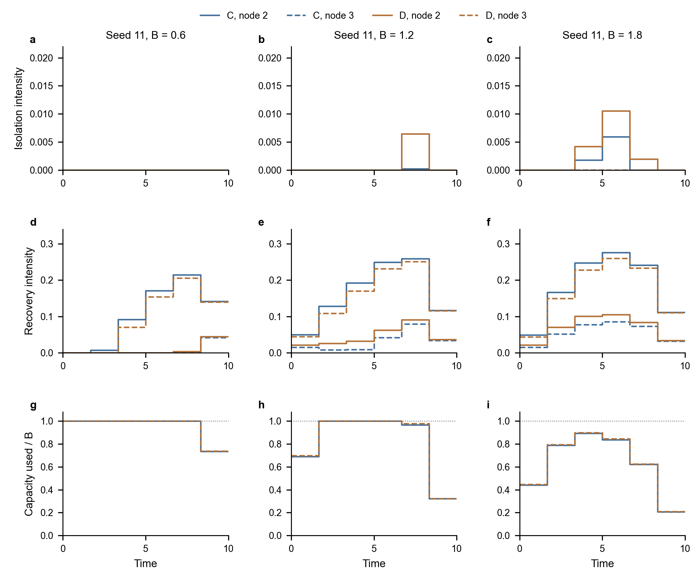
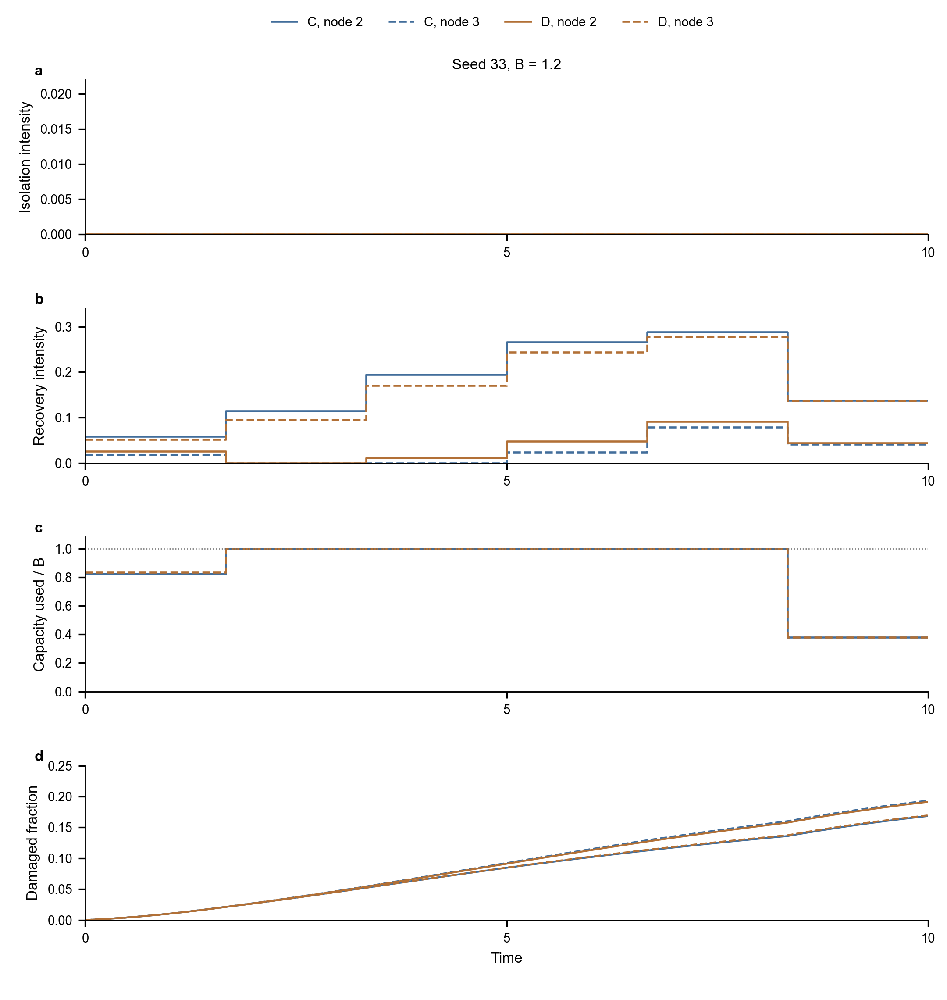

# 补充材料：攻防交互下异质传播网络的隔离与恢复配置：匹配对照与收益边界

本文件保留压缩主文之外的参数、全量原值与技术细节。它与主文共同构成D3中文审阅稿，不是新增实验。路径均可从本项目访问；投稿时应按会议附件政策打包，不将本地链接直接当作公开数据地址。

## S1 参数与全部四格原值

以下参数表及原值表继承D2；来源S/M/P含义分别为冻结规格、保存匹配模型/配置、实验协议。传播与经济参数均为合成或归一化量。

|参数|取值|含义|来源／性质|
|---|---|---|---|
|\(n,T,K\)|6，10，6|资产数、时域、控制槽数|S/M；合成规模与离散设定|
|网络种子|11、22、33|上游有效传播率的生成标识|M；非现实抽样|
|\(\mathcal E,\alpha_i\)|\(\{0,1\}\)；入口0.25，其他0|攻击入口及效率|S/M；合成|
|\(x(0)\)|\((0.1,0,0,0,0,0)\)|初始受损比例|S/M；合成|
|\(\delta_i,\gamma_i,\varepsilon_i\)|0.10，0.30，1.00|基础恢复率、投入恢复效率、隔离效率|S/M；合成|
|\(q_i,g_i\)|高价值位置\(q_i=4\)，其他\(q_i=1\)；全部\(g_i=1\)|防御损失与攻击状态收益权重|M；合成，二者不联动|
|\(h_i\)|全部0.05|隔离业务中断代价|M；合成|
|\(c_i^s,c_i^r,c_i^a\)|全部1|二次行动成本系数|S/M；归一化|
|\(b_i^s,b_i^r,d_i^a\)|全部1|容量占用系数|S/M；归一化|
|\(\omega_i,\nu_i\)|全部0|终端目标权重|S/M；合成|
|\(B,A\)|\(B=0.6,1.2,1.8\)；\(A=0.8\)|逐时可用容量|S/M；合成|
|上游边权\((\beta_{02},\beta_{12})\)|种子11：(0.0502856162, 0.0799422290)；22：(0.0693077532, 0.0559436304)；33：(0.0754913790, 0.0854792954)|同时令\(\beta_{03}=\beta_{02},\beta_{13}=\beta_{12}\)|M；由[0.04,0.12]生成，显示值需以源表完整精度为准|
|下游边权|equal：均0.08；unequal：节点2各0.12，节点3各0.04|节点2、3分别向4、5传播|M；合成|
|\(H\)|匹配求解12，细求解48；强基线最终评价48并以192核验|每槽RK4子步|P；数值设定|

以下四格目标使用H=48。上标A—D是实验格，不与防御者下标D混淆。交互依主文式(17)；以C格损失为分母的0.170%—0.261%仅表示相对量级。

|种子|B|\(J^A\)|\(J^B\)|\(J^C\)|\(J^D\)|equal差B−A|unequal差D−C|\(I_J\)|
|---|---:|---:|---:|---:|---:|---:|---:|---:|
|11|0.6|10.748962|10.748962|10.739528|10.757802|−7.39e−13|0.018274|0.018274|
|22|0.6|10.628770|10.628770|10.618966|10.637880|−1.92e−12|0.018914|0.018914|
|33|0.6|11.867196|11.867196|11.854254|11.879313|7.32e−12|0.025059|0.025059|
|11|1.2|10.283569|10.283569|10.272034|10.293684|−5.31e−13|0.021650|0.021650|
|22|1.2|10.191760|10.191760|10.180580|10.201597|−3.12e−12|0.021017|0.021017|
|33|1.2|11.215489|11.215489|11.200145|11.229337|−3.84e−12|0.029192|0.029192|
|11|1.8|10.242429|10.242429|10.232449|10.251036|−5.22e−13|0.018587|0.018587|
|22|1.8|10.158698|10.158698|10.148861|10.167227|−1.64e−12|0.018366|0.018366|
|33|1.8|11.105095|11.105095|11.092573|11.115371|−6.55e−12|0.022798|0.022798|

完整精度：[四格原值](../work_d2/tables/matched_four_cells.csv)；原始文件定位：[D2源数据索引](../work_d2/S1_source_data_index.md)。

## S2 全节点配置、状态及成本分解

防御计划的实际变化主要体现为恢复配置与上游治理的联合调整，而不是节点2、3持续发生明显的隔离—恢复切换。图3固定展示种子11的三个容量，补充图S1展示种子33的中容量配置，以呈现已报告的异质性；两者均不承担总体代表性。完整源数据保留36配置全部六节点的控制、状态与容量，具体对应补充索引S1。



**图3 种子11下C/D两格的控制与逐时容量。** a—c为节点2、3的隔离，d—f为恢复，g—i为六节点总防御容量使用率；三列依次为B=0.6、1.2、1.8。控制按真实时间画成阶梯，每槽宽5/3。前两行颜色区分C/D、实虚线区分节点2/3；最后一行蓝实线为C、橙虚线为D，虚点水平线表示容量上限。近零及重合曲线原样保留，隔离轴与恢复轴尺度不同。

低容量\(B=0.6\)时，36配置中对应的12个低容量候选在节点2、3上的最大隔离仅为\(7.65\times10^{-16}\)。这在数值上等于零，不能用来支持两个中间节点发生显著动作切换的叙述。隔离主要位于上游入口0、1，两节点恢复也占据主要资源；将该容量的12格×6槽按等长槽汇总，入口0、1的平均隔离分别约为0.05975和0.06520，平均恢复约为0.17398和0.15810。节点2、3的平均恢复为0.05822和0.05544，节点4、5各约0.00334。该汇总只用于交代全部通道，并非独立重复样本的均值估计。

在低容量的前段\([0,20/3)\)，节点2恢复均值的四格交互为−0.007356至−0.006017，节点3为−0.006030至−0.004761，三个种子均超过0.001的工程分辨率。这说明价值交换引起的恢复变化随出向条件改变，而非两节点隔离投入在竞争。末段则已出现异质性：种子22的节点2恢复交互为+0.001425，种子11相应值为−0.000354，不能将前段方向推广至全时域每一槽。

保存状态与损失分解进一步限定了这种解释。以种子11、B=0.6为例，C格末态\((x_2,x_3)\)约为(0.165931,0.188940)，D格约为(0.187820,0.166505)。价值交换后，受较强恢复保护的位置随之变化，但高价值节点的末态受损在D格仍略高。H=12保存分解中，C到D的累计受损损失增加约0.015180，业务中断和隔离成本分别增加约0.002518和0.005843，恢复成本减少约0.005267，合计与该精度下的总损失差一致。末态本身不能替代累计目标；这些同时变化的分项说明，\(I_J\)并非只由某一个恢复通道决定。

中容量\(B=1.2\)下，恢复交互不再跨种子同向。节点2、3全时域恢复交互在种子11分别为+0.000463、+0.000612，在种子22分别为+0.000465、+0.000607，均未超过工程分辨率；种子33则分别为−0.001174、−0.003069。种子11、22的节点2隔离交互主要集中在末段，分别为+0.003107和+0.002721，种子33对应量接近零。这一异质性与三组入口传播强度、由此形成的状态和资源需求不同相容，但本实验没有将各路径的边际贡献独立分解。目标交互方向一致与控制交互局部反向可以同时成立。

容量记录也排除了“始终紧约束竞争”的解释。低容量12格共72槽中60槽绑定，各格最后一槽均松弛；中容量仅40/72槽绑定，其中种子11、22各格为3槽，种子33各格为4槽；高容量仅1/72槽绑定，唯一绑定槽来自种子33的D格。因此，高容量下的配置主要受传播收益、业务中断和行动成本的权衡限制，不能一概归结为容量短缺。节点3的隔离仍近零，节点2只在部分中后段出现小幅隔离；没有证据支持跨容量通用的“先隔离、后恢复”排序。

这些观察可由第3节\(M_i^s,M_i^r\)作定性组织。隔离收益需经过来源受损、下游传播及未来损失链，并抵消业务中断代价；恢复同时影响本地直接损失和后续外传。紧容量时，入口治理与中间节点恢复共享资源，容量松弛时则仍需满足各自的成本—收益权衡。实验记录支持这种条件性解释，但未直接重建连续伴随轨迹来检验普适优先级定理，亦未将瞬时PMP必要条件等同于槽控制的全局最优规则。



**补充图S1 种子33、B=1.2的配置与状态。** 沿用D2图形及其源数据映射，呈现与种子11不同的中容量行为，不承担总体代表性；纵轴覆盖完整状态数据。

## S3 算法、实现与重现

```text
算法1：匹配实验的分段开环局部候选求解与审计
输入：冻结模型、T、K、积分子步H、登记种子、可行初始计划c=(a,s,r)
单路径 StrictSolve(c,H)：
  对轮次 m=0,...,40：
    固定同一个c，分别从当前本方计划启动SLSQP，求防御响应d与攻击响应b
    计算当前c的双方目标、已发现相对改善、R_D、R_A及d_resp
    检查：相对改善均≤1e-7；R_D,R_A≤1e-4；d_resp≤1e-3；双方优化退出成功
    若检查通过：保存当前c及通过记录，返回
    若m=40：保存当前c及未通过记录，返回
    固定防御响应d，再求攻击方对(a,d_s,d_r)的局部响应b_seq
    记录顺序攻击响应及退出码，更新c=(b_seq_a,d_s,d_r)
  不把达到轮数上限视为数值通过
主流程：
  从均分、零、随机三类可行初值分别执行StrictSolve，保留全部路径
  以均分路径为登记主路径，比较三路径终点，不择优删除路径
  对主路径执行12起点与各单通道稀疏起点的单方偏离审计
  以主路径为初值、H=48执行StrictSolve，再作三起点偏离审计
  汇总路径通过标记、优化退出码、约束、积分与跨初值控制差
输出：全部计划、轨迹、目标、诊断及通过/失败标记；不输出全局均衡证书
```

基础配置为\(n=6,K=6,T=10\)。匹配实验粗求解采用\(H=12\)，之后以\(H=48\)重新求解，并比较保存控制的12/24/48子步积分。SLSQP单次上限300次迭代，匹配流程\(\texttt{ftol}=10^{-10}\)。该精度参数是优化器停止参数，既不是目标误差严格上界，也不是Nash误差保证。

强化迭代的每轮偏离搜索均固定同一个当前控制对；顺序攻击响应仅用于生成下一轮控制。匹配流程采用完整更新，无阻尼。与之不同，原P3通用流程采用阻尼系数0.35、每次三起点响应和1%的探索性相对改善目标，其质量条件检查响应点残差，不应冒充上述当前候选检查。旧补充C2强基线流程的SLSQP容差为\(10^{-11}\)，同样保留局部候选的性质；不同流程的阈值须随结果来源报告。

匹配实验三类初值之间以及积分精化前后的最大控制差门槛均为\(10^{-3}\)。随机初始计划种子为网络种子加20261027；粗迭代使用网络种子加10000，每轮增加10，顺序攻击调用再加2；强偏离审计使用加80000，细求解使用加90000，细审计使用加91000。单路径迭代每次一个当前起点，外围多初值及最终多起点审计承担额外搜索，不能将每一轮描述为12起点搜索。

以下为既有结果的核验与研究重现入口，D3没有执行求解或实验；研究命令须指定新的空输出目录，不覆盖历史结果：

```powershell
python paper/work_d2/analysis/build_analysis.py
python paper/work_d2/analysis/final_verify.py
python -m src.matched_mechanism --output <新的空目录>
python -m src.supplement_c2 --output <新的空目录>
results/work_c2_robustness/cross_environment/venv/Scripts/python.exe -m handoffs.C2_refine <新运行名>
results/work_c2_robustness/cross_environment/venv/Scripts/python.exe -m handoffs.C2_refine_analysis <同一运行名>
```

前两条消费保存数据；后四条会运行研究计算。具体环境、种子与完整命令以[Work C2交接](../../handoffs/C2_robustness.md)及各运行metadata为准。D3自身文本检查入口为`python paper/work_d3/analysis/verify_d3.py`。

## S4 完整数值诊断与强基线源表

36个匹配配置均通过登记的局部数值门槛。保存审计中，最大归一化已发现单边改善为\(1.54\times10^{-9}\)，当前候选最大投影残差为\(9.97\times10^{-5}\)，接近\(10^{-4}\)门槛；三初值最大控制差为\(8.88\times10^{-5}\)，最大容量违反为\(8.10\times10^{-15}\)。保存计划的积分精化最大目标差为\(9.45\times10^{-9}\)。这些量分别限制局部偏离、一阶驻点、初始化、可行性和积分误差，不能互相替代，更不能合并为全局均衡证书。

控制槽精化仅覆盖种子11/B0.6和种子33/B1.2各四格，共8配置。以登记的热启动路径为主，另外保留均分、零、随机路径，全部32路径通过局部门槛。六槽细化为十二槽并重新求解后，两组目标交互分别从0.0182736907变为0.0182733189、从0.0291919616变为0.0291096181，相对变化约为−0.00204%和−0.28208%（补充表S2）。该证据支持这两组实例的交互方向在两个策略网格间保持，不支持全部36配置的网格稳定性或连续控制收敛。

**补充表S2 反例与数值边界摘要。** 各行属于不同证据层，不能相加为样本量。

|证据及范围|核验结果|允许的解释|
|---|---|---|
|原图反例：seed33/business_cost/B0.6|联合12.4375182282；仅恢复12.4368540435；改善−0.005340456%|各自响应比较下联合不占优|
|K精化：seed11/B0.6四格|\(I_6=0.0182736907\)，\(I_{12}=0.0182733189\)|该组交互正向保持|
|K精化：seed33/B1.2四格|\(I_6=0.0291919616\)，\(I_{12}=0.0291096181\)|该组交互正向保持|
|复制六槽计划后的十二槽偏离：8格|防御已发现绝对改善约0.01438—0.02618；攻击约0.01246—0.01277|原六槽候选不具备跨策略类无偏离性质|
|重新求解的十二槽候选：32路径|最大归一化已发现改善\(3.36\times10^{-9}\)，最大投影残差\(9.94\times10^{-5}\)|自身策略类内的局部质量|
|隔离依赖环境：seed11/B1.2，K=6四格|目标最大差\(1.96\times10^{-12}\)，控制最大差\(1.13\times10^{-11}\)，状态最大差\(4.08\times10^{-12}\)|同Windows主机、同基础Python版本与算法的容差内重求复现|

目标方向保持并不意味着控制时序不变。低容量组节点3末段恢复交互由−0.002293变为−0.000890，降至0.001分辨率以下；中容量组节点2末段隔离交互由近零变为0.001963，节点3末段恢复交互由0.000967变为0.001139。按式(20)逐槽复制对齐，低容量组四格防御控制最大分量差为0.063305—0.064929，中容量组为0.082446—0.084091；攻击控制最大分量变化在两组分别约为0.0657和0.0684。因此不能将细化后的目标变化解释为防御控制单独细分的收益。各组四格的防御目标都下降，但攻击目标在低容量组升高、中容量组降低，反映双方共同调整。

跨类偏离进一步限定了六槽候选的含义。把原六槽计划逐槽复制到十二槽后，固定对手搜索本方偏离，防御发现的归一化改善为0.1223%—0.2141%，攻击为0.1731%—0.1767%。这些量与十二槽重新求解后接近零的残余改善属于不同基准，不能混报。低容量四格的绑定槽数由20/24变为44/48，中容量由16/24变为32/48；应比较相同物理时域下的比例，而非仅以槽数增加说明竞争增强。

隔离环境复现仅针对种子11/B1.2的K=6四格，采用不继承系统包的依赖环境，从三类初值重新求解。其模型、目标、控制、状态、局部改善及交互均满足预登记容差，交互绝对差约为\(1.02\times10^{-12}\)。该复现仍使用同一Windows主机、Python 3.11.7、相同算法与模型，主要数值依赖亦保持相同版本；不能称为独立操作系统或独立数学实现的跨平台验证。

数值接口修复后的53项测试和单配置前后回放提供实现防护证据，未证明均衡正确性。另有三节点、两槽的四张有限策略表分别存在一个表内纯均衡，其穷尽性只覆盖各自有限菜单。所有六节点结论仍受局部响应搜索限制：小的已发现改善不是未知全局偏离的上界，投影残差是一阶诊断，保存候选上的积分精化差也不是全可行域的严格误差界。历史补充实验run01因文件路径处理失败，run02才完成；二者不计作两次成功独立复现。本节的可靠性判断由这些相互区分的检查共同支撑，不涉及连续开环Nash的存在、唯一或全局可求性。

强基线原始目标：[八方法全部目标](../work_d2/tables/baseline_all_objectives.csv)；[逐配置配对](../work_d2/tables/baseline_pairs.csv)；[完整D2结果与交叉攻击反例](../work_d2/03_results_discussion_zh.md)。不得将144评价、160含反例评价、140配对或32路径相加作为独立样本数。

## S5 来源与图形接口

- [逐主张证据映射](../work_d2/04_claim_evidence_matrix.md)与[D2源索引](../work_d2/S1_source_data_index.md)定位全部控制、状态、容量及结果JSON。
- [D1–D2式号对齐](../work_d2/D1_D2_equation_alignment.md)为D3继承的式(1)–(20)版本接口；D3逐式正文保留原公式字节。
- 三张主图与图S1的PDF/SVG/PNG位于[图表清单](../work_d2/05_figure_table_manifest.md)所列目录，D3不重绘、不缩放、不替换。最终套版后须重新检查字号与可读性。
