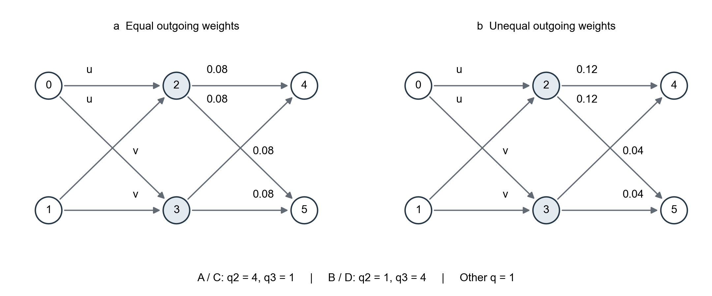
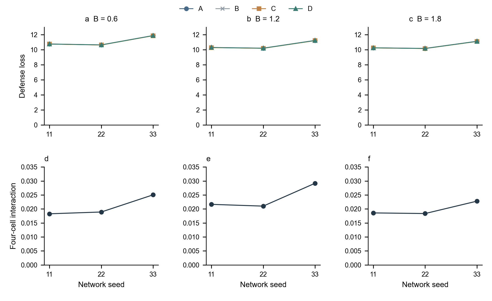
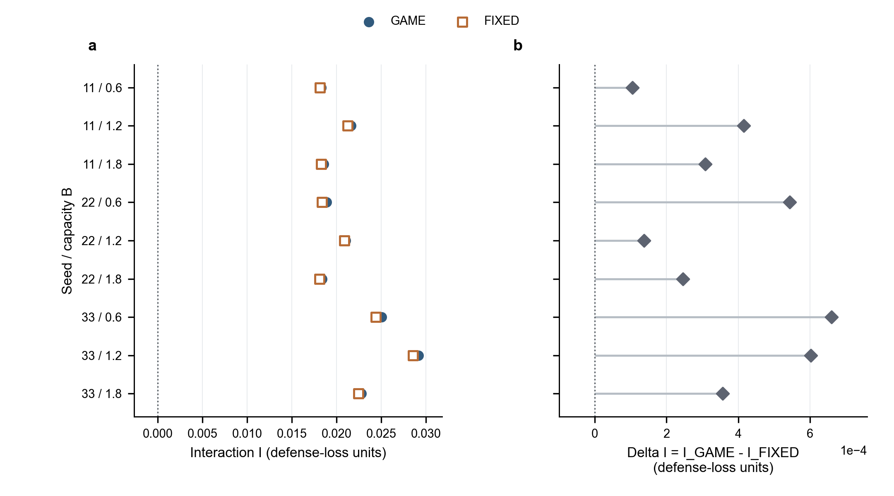
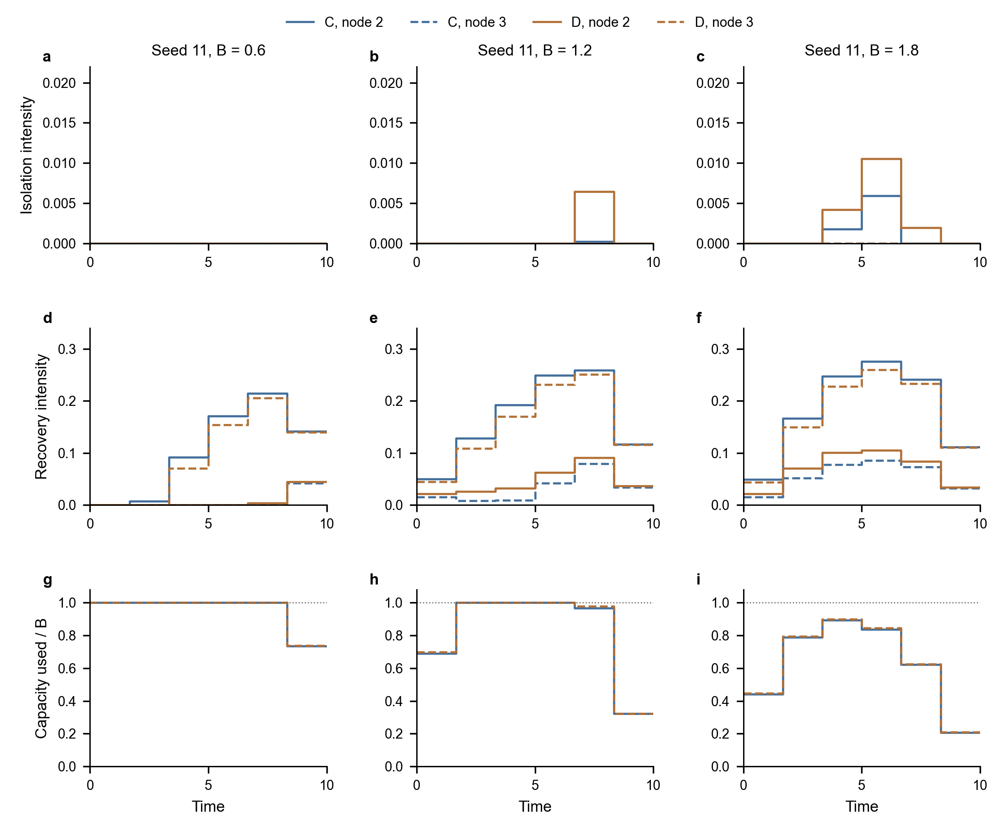
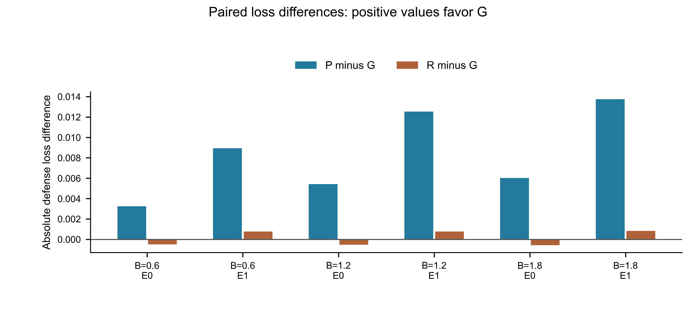
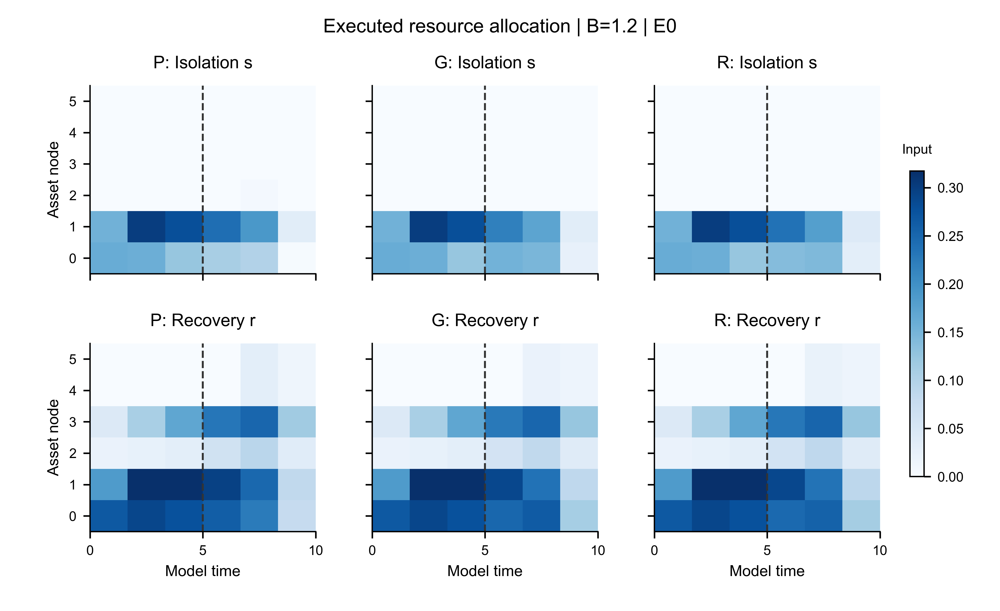
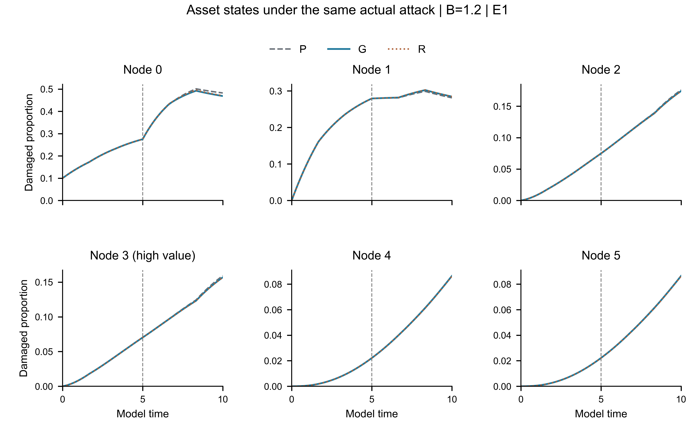

# 基于非零和微分博弈的有限资源网络防御决策方法

> 审阅版说明（2026-11-13）：本稿以D3为底稿，按本次D6授权整合写作。D4-P0-1、D5决策差异审计及滚动重规划run03作为**待批准证据**纳入；其出现不代表结果已获人工验收。原有审批状态保持不变。本稿供完整内容审阅，尚未按具体会议模板套版。

## 摘要

针对传播风险与防御行动成本共同作用下的有限资源配置问题，本文采用有限时域非零和微分博弈，描述攻击入口投入、来源节点隔离与本地恢复之间的动态关联，并以开环Nash作为理论比较基准。将控制离散为分段常值计划，通过四阶Runge–Kutta积分、离散灵敏度、序列最小二乘规划和交替局部响应，计算满足逐时共享容量的隔离与恢复配置；攻击条件变化后，以当前状态重新求解剩余时域问题并仅执行首槽。在六节点合成网络的既有九组方法比较中，联合动态计划相对固定攻击训练计划在各自攻击响应评价下改善0.029%—0.286%，在公共固定攻击下均不占优。待批准的决策差异证据显示双方响应随对方计划改变；待批准的18条重规划轨迹中，博弈重规划相对沿用原计划均降低总损失，但相对非博弈滚动优化在两种公共执行攻击下分别略逊和略优，且计算开销更高。匹配对照进一步表明，价值—传播交互不能全部归因于战略响应。结果支持在指定模型与评价协议下形成可检查的资源决策流程，其收益受攻击假设、容量和策略类限制；数值候选不构成连续控制全局或反馈Nash均衡证明。

**关键词：** 非零和微分博弈；开环策略；有限资源；隔离与恢复；滚动重规划

# 1 引言

网络防御需要回答具体的资源决策问题：在每个时段，应在哪些资产上实施隔离和恢复，各投入多少资源，以及何时重新计算计划。隔离能够抑制来源资产向外传播，却会带来业务中断；恢复能够减少本地受损，也会通过后续状态降低传播。两类行动共享有限容量时，单独按资产价值或网络出向强度排序，难以同时反映未来受损、业务成本和资源竞争。云工作负载之间的访问关系提供了这一问题的应用动机，本文采用合成有效传播网络开展模型分析，而非生产云实测。

联合配置传播抑制与恢复资源已有充分研究基础。Preciado等[1]在有向异质网络中联合调整感染率与恢复率，通过几何规划求解预算约束下的传播控制问题。Paarporn和Xu[2]研究攻击竞争下预防与恢复共享资源的取舍，给出特定零和资源竞赛的均衡刻画。前者采用静态率参数优化，后者以独立节点的攻破概率及恢复时长描述损失，为本文的资源约束与双动作比较提供参照。

传播微分博弈进一步将行动与状态演化联系起来。Tian等[3]已针对云恶意软件传播建立非零和开环攻防模型，并利用状态和伴随方程求取控制计划。价值异质性与网络位置的共同作用也已有先例：Botteghi等[4]在Stackelberg安全博弈中分析双方估值与传播风险对保护配置的影响。Chen等[5]从负载级联角度考察保护—恢复比例，表明资源条件会改变两类行动的取舍。因此，非零和建模、联合防御和动态配置本身均不足以构成本文的独立创新声明。

本文关注有限资源条件下从模型到实际时间计划的计算链，以及战略响应对配置和收益的具体影响。攻击者选择入口投入，防御者选择来源节点的出边隔离和本地恢复，双方通过同一受损状态轨迹形成非零和关联。攻击者的目标不是直接最大化防御总损失，因而“攻击响应更适合自身目标”与“防御损失一定增加”不能等同。判断战略建模的作用，需要同时比较防御动作、攻击响应和统一协议下的目标，不能只凭存在博弈方程或必要条件作出判断。

本文的工作包括两方面。第一，围绕既定传播模型组织有限时域资源决策流程，明确状态与收益如何进入分段控制优化，并将求解结果转化为逐节点、逐槽的隔离与恢复投入；在攻击效率变化时，复用同一求解器重新规划剩余时域。该项是具体问题上的建模应用与计算流程，不提出新的均衡算法。第二，在分别定义的固定攻击、各自攻击响应及公共执行攻击协议下，对照单动作、静态联合、固定攻击训练和非博弈滚动优化，报告战略依赖、资源配置、成本与计算时间的条件性差异。价值位置与传播条件的匹配对照提供辅助解释，不作为博弈不可替代的证明。D4/D5新增证据仍待人工验收，本文如实列示以供审阅。

全文第2章给出网络攻防模型，第3章说明理论基准、数值求解和重新规划执行过程，第4章报告比较设计、资源计划及适用边界，第5章总结研究结论。

# 2 网络攻防微分博弈模型


## 2.1 参与者、状态与行动

考虑防御者\(D\)和攻击者\(A\)构成的两人有限时域非零和博弈，\(0<T<\infty\)。双方已知网络、参数、初态、目标和容量约束，在\(t=0\)同时选择\([0,T]\)上的完整时间计划，执行期间不按新状态修正行动；一方选择前不能观察另一方已选计划。离线交替求解不改变这一开环信息结构。

有向网络\(G=(V,E_G)\)中，\(V=\{0,\ldots,n-1\}\)表示逻辑资产实例组，\(\beta_{ji}\geq0\)为来源\(j\)到接收\(i\)的有效传播率，无边及自环时为零。状态\(x_i(t)\in[0,1]\)表示实例组受损比例，不是单台服务器的被攻击概率。防御直接损失权重为\(q_i\)，出向强度\(w_i^{\mathrm{out}}=\sum_{k\ne i}\beta_{ik}\)仅概括局部出边，不能替代动态影响。

攻击投入\(a_i\)仅作用于预定义入口\(\mathcal E\)：入口效率\(\alpha_i>0\)，非入口\(\alpha_i=a_i=0\)。防御行动为来源节点隔离\(s_i\)和本地恢复\(r_i\)，均与\(a_i\)一样取值于\([0,1]\)。节点是配置对象，不是独立参与者。

## 2.2 可行策略与状态演化

令\(u=(s,r)\)。双方几乎处处满足逐时容量约束

\[
\sum_i(b_i^ss_i+b_i^rr_i)\leq B,
\qquad \sum_i d_i^aa_i\leq A. \tag{1}
\]

\(b_i^s,b_i^r,d_i^a>0\)为容量占用系数，\(B,A\geq0\)为同时可用的容量上限；它们不是累计消耗预算，也不同于经济成本。令\(U,\mathsf A\)分别为满足式(1)、箱约束及非入口零攻击的瞬时可行集合，开环策略集合为

\[
\mathcal U=\{u:[0,T]\to U\mid u\text{有界可测}\},
\qquad
\mathcal A=\{a:[0,T]\to\mathsf A\mid a\text{有界可测}\}. \tag{2}
\]

给定\(x(0)=x_0\in[0,1]^n\)，状态演化为

\[
\dot{x}_i=(1-x_i)\left[\alpha_i a_i+
\sum_{j\ne i}\beta_{ji}(1-\varepsilon_j s_j)x_j\right]
-(\delta_i+\gamma_i r_i)x_i,
\qquad x(0)=x_0. \tag{3}
\]

其中隔离效率\(0<\varepsilon_i\leq1\)，基础恢复率\(\delta_i\geq0\)，投入恢复效率\(\gamma_i\geq0\)。隔离作用于来源节点的全部出边，不直接削减其入口攻击；恢复减少本地受损，并通过后续状态改变外传。记\(z_i=\alpha_i a_i+\sum_{j\ne i}\beta_{ji}(1-\varepsilon_js_j)x_j\)、\(d_i=\delta_i+\gamma_ir_i\)，则\(f_i=(1-x_i)z_i-d_ix_i\)，\(d_i\)与\(d_i^a\)含义不同。

参数有限、控制有界可测时，\(f\)对时间可测、对状态局部Lipschitz，给定控制对存在局部唯一绝对连续解。立方体各面上，\(x_i=0\)时\(f_i=z_i\geq0\)，\(x_i=1\)时\(f_i=-d_i\leq0\)，故\([0,1]^n\)正不变，解可延拓至整个有限时域；数值积分另行检查越界与精度。

## 2.3 双方目标与研究问题

防御者最小化累计受损损失、隔离业务中断及行动成本：

\[
J_D(u,a)=\int_0^T\left[
\sum_i(q_ix_i+h_is_i)+\frac12\sum_i(c_i^ss_i^2+c_i^rr_i^2)
\right]dt+\sum_i\omega_ix_i(T). \tag{4}
\]

攻击者最大化受损收益扣除攻击成本后的净收益：

\[
J_A(u,a)=\int_0^T\left[
\sum_i g_ix_i-\frac12\sum_i c_i^aa_i^2
\right]dt+\sum_i\nu_ix_i(T). \tag{5}
\]

其中\(q_i,g_i,h_i,\omega_i,\nu_i\geq0\)，分别表示防御直接损失权重、攻击状态收益权重、隔离业务中断系数及双方终端受损权重；\(c_i^s,c_i^r,c_i^a>0\)分别为隔离、恢复和攻击的二次成本系数。恢复不另设线性业务中断项；\(q_i\)与\(g_i\)可不同，双方成本分别计入目标，通常形成非零和结构。正式基准取\(\omega_i=\nu_i=0,g_i=1\)，交换\(q_i\)不改变攻击者的直接状态收益权重。

模型由参与者、时域、状态、初态、策略集合、动力学和目标共同定义。本文计算容量约束下逐节点、逐时槽的隔离与恢复计划，并比较不同攻击评价条件下的防御损失；价值位置与传播条件的匹配对照用于解释配置差异。参数均为合成或归一化设定，不含检测、信念更新或学习机制；实际云环境的传播率与行动副作用须另行校准。

# 3 动态防御决策求解方法


## 3.1 理论基准与必要条件

理论上的开环Nash控制对满足

\[
J_D(u^*,a^*)\leq J_D(u,a^*)\quad\forall u\in\mathcal U,
\qquad
J_A(u^*,a^*)\geq J_A(u^*,a)\quad\forall a\in\mathcal A. \tag{6}
\]

本文不预设其存在或唯一；计算对象为有限槽策略类中经局部响应诊断的开环候选。将式(4)、(5)的被积函数记为\(L_D,L_A\)，以\(p^D,p^A\)表示双方伴随向量，定义

\[
H_D=L_D+(p^D)^\top f,
\qquad H_A=L_A+(p^A)^\top f. \tag{7}
\]

固定对手计划，在正常型最优控制满足Pontryagin极值原理（Pontryagin maximum principle，PMP）的条件下，状态—伴随关系与Hamiltonian极值为必要条件。向量场及目标可微，控制集固定、紧且凸；状态边界由动力学保持，不另作独立路径约束。令\(F_{i\ell}=\partial f_i/\partial x_\ell\)为状态Jacobian元素，\(\ell\)表示来源节点索引，则状态Jacobian及伴随方程为

\[
F_{ii}=-z_i-d_i,
\qquad F_{i\ell}=(1-x_i)\beta_{\ell i}(1-\varepsilon_\ell s_\ell)
\quad(\ell\ne i). \tag{8}
\]

\[
\begin{aligned}
-\dot p_\ell^D&=q_\ell-(z_\ell+d_\ell)p_\ell^D
 +(1-\varepsilon_\ell s_\ell)\sum_{i\ne\ell}\beta_{\ell i}(1-x_i)p_i^D,
&p_\ell^D(T)&=\omega_\ell,\\
-\dot p_\ell^A&=g_\ell-(z_\ell+d_\ell)p_\ell^A
 +(1-\varepsilon_\ell s_\ell)\sum_{i\ne\ell}\beta_{\ell i}(1-x_i)p_i^A,
&p_\ell^A(T)&=\nu_\ell.
\end{aligned} \tag{9}
\]

防御最小化\(H_D\)，攻击最大化\(H_A\)；实现中最小化\(-J_A\)等价，但相应连续伴随为\(-p^A\)。非负权重和\(F\)的非负非对角元给出\(p^D,p^A\geq0\)。伴随是沿给定轨迹的未来边际损失，不是反馈价值函数。

## 3.2 行动边际与容量竞争

对控制求导可得

\[
\frac{\partial f_k}{\partial s_i}
=-(1-x_k)\beta_{ik}\varepsilon_i x_i,
\qquad
\frac{\partial f_k}{\partial r_i}=-\gamma_i x_i\mathbf1_{\{k=i\}},
\qquad
\frac{\partial f_k}{\partial a_i}=\alpha_i(1-x_i)\mathbf1_{\{k=i\}}. \tag{10}
\]

其中\(\mathbf1_{\{k=i\}}\)为指示函数，节点相同时取1，否则取0；第一式在\(k=i\)时因零自环等于零。由此定义瞬时边际削减量

\[
M_i^s=\varepsilon_i x_i\sum_{k\ne i}\beta_{ik}(1-x_k)p_k^D,
\qquad M_i^r=\gamma_i x_ip_i^D. \tag{11}
\]

隔离作用于下游增长，取决于来源受损、下游未受损比例及其未来损失；恢复直接影响本地受损，也改变之后的传播。二者都含动态系统信息，不能简化为“隔离只看传播、恢复只看价值”。

固定\((t,x,p^D,p^A)\)时，防御Hamiltonian对本方控制严格凸，攻击Hamiltonian严格凹；瞬时可行子问题各有唯一解。这不意味着整段动态目标全局凸/凹。令容量乘子\(\lambda_D,\lambda_A\geq0\)，由Karush–Kuhn–Tucker（KKT）条件得到

\[
\begin{aligned}
s_i&=\operatorname{clip}_{[0,1]}
 \left(\frac{M_i^s-h_i-\lambda_Db_i^s}{c_i^s}\right),\\
r_i&=\operatorname{clip}_{[0,1]}
 \left(\frac{M_i^r-\lambda_Db_i^r}{c_i^r}\right),\\
a_i&=\operatorname{clip}_{[0,1]}
 \left(\frac{\alpha_i(1-x_i)p_i^A-\lambda_Ad_i^a}{c_i^a}\right)
 \quad(i\in\mathcal E),\qquad a_i=0\quad(i\notin\mathcal E).
\end{aligned} \tag{12}
\]

\[
\begin{aligned}
&\sum_i(b_i^ss_i+b_i^rr_i)\leq B,\quad
\lambda_D\left[\sum_i(b_i^ss_i+b_i^rr_i)-B\right]=0,\\
&\sum_i d_i^aa_i\leq A,\quad
\lambda_A\left[\sum_i d_i^aa_i-A\right]=0.
\end{aligned} \tag{13}
\]

这里\(\operatorname{clip}_{[0,1]}(v)=\min(1,\max(0,v))\)。容量松弛时乘子为零，绑定时乘子未必严格为正；非零投入的单位容量边际还须扣除二次成本并考虑箱约束。式(12)是给定状态—伴随条件下的关系，不给出普适时间优先级。

## 3.3 分段开环求解与诊断

将时域等分为\(K\)槽，槽长\(\Delta=T/K\)，第\(k\)槽为\([k\Delta,(k+1)\Delta)\)，其中\(k=0,\ldots,K-1\)。各槽的\(a_k,s_k,r_k\)为常值向量，得到\(\mathcal U_K\subset\mathcal U,\mathcal A_K\subset\mathcal A\)。式(1)逐槽实施，左侧不乘槽长。直接射击采用经典四阶Runge–Kutta（RK4）积分，每槽\(H\)子步、步长\(T/(KH)\)，同步传播离散映射灵敏度得到梯度，再以序列最小二乘规划（Sequential Least Squares Programming，SLSQP）求本方局部响应。该过程不求连续PMP边值问题，式(12)也不替代槽变量优化。

匹配实验从均分、零、随机三类可行初值开始，以均分路径为登记主路径。每轮固定同一候选分别检查双方局部偏离，再用顺序攻击响应生成下一轮候选；不采用阻尼。通过条件为双方归一化已发现改善不超过\(10^{-7}\)、当前候选投影残差不超过\(10^{-4}\)、响应控制最大变化不超过\(10^{-3}\)，且优化成功退出。未通过且到达轮数上限仍记失败。主路径经12起点及稀疏起点偏离审计，再以\(H=48\)重求并作三起点审计；全部路径保留。算法1在下节给出；各批次的复现参数见配套证据映射，历史流程的优化容差不混用。

相对于精确常微分方程（ordinary differential equation，ODE）目标，受限策略类的全局单边改善为

\[
\Delta_D^K=J_D(u,a)-\min_{v\in\mathcal U_K}J_D(v,a),
\qquad
\Delta_A^K=\max_{b\in\mathcal A_K}J_A(u,b)-J_A(u,a). \tag{14}
\]

有限槽可行集紧且目标连续，单方极值可取到，局部搜索不保证找到它。令\(\widehat J\)为RK4目标，\(\widetilde u,\widetilde a\)为返回的可行响应，展示的已发现改善为

\[
\begin{aligned}
\widehat\Delta_D&=\max\{0,\widehat J_D(u,a)-\widehat J_D(\widetilde u,a)\},\\
\widehat\Delta_A&=\max\{0,\widehat J_A(u,\widetilde a)-\widehat J_A(u,a)\},\\
\widehat\rho_D&=\frac{\widehat\Delta_D}{1+|\widehat J_D(u,a)|},\qquad
\widehat\rho_A=\frac{\widehat\Delta_A}{1+|\widehat J_A(u,a)|}.
\end{aligned} \tag{15}
\]

对最小化目标\(F\)（防御为\(\widehat J_D\)，攻击为\(-\widehat J_A\)）、本方槽向量\(v\)及可行多面体\(\mathcal C\)，投影残差定义为

\[
R(v)=\left\|v-\Pi_{\mathcal C}\bigl(v-\nabla F(v)\bigr)\right\|_\infty. \tag{16}
\]

其中\(\Pi_{\mathcal C}\)是欧氏投影。搜索保留当前计划，返回点须目标有限、约束违反不超过\(10^{-10}\)且不劣于当前候选；优化退出码另行检查。积分失败或状态越界显式报告，不裁剪隐藏。式(15)至多给出同一数值目标的已发现改善下界，小值不是未知全局偏离的上界；式(16)只是一阶诊断。候选上的积分精化也不提供全可行域误差界。控制槽数\(K\)改变策略空间，\(H\)改变固定策略的积分精度，必须分别核验。


## 3.4 从状态和收益到资源计划

求解输入包括网络传播率、入口集合、初始受损状态、双方收益系数、容量上限及控制槽数。对一个给定攻击计划，程序以全部隔离和恢复槽变量为待优化对象：先由式(3)向前计算状态，再由式(4)累计安全损失、业务中断和行动成本，最后以该离散目标及其梯度调用SLSQP。梯度包含某槽行动对后续状态和损失的影响，所以资源配置是整段计划优化的结果，而非将当前受损比例代入式(12)后直接排序。攻击方固定防御计划，以同样方式最小化式(5)的相反数。

在六节点、六槽设置中，防御端有72个槽变量，攻击端仅保留两个入口的12个槽变量。每个防御槽共享同一个容量约束，SLSQP同时处理各节点隔离、恢复的箱约束与容量约束。对于某个节点，增加恢复会降低本地受损及后续外传，增加隔离则立即降低其出边传播；二者引起的安全损失变化要与业务中断和二次成本一起进入目标。式(11)—(13)解释这种取舍，实际数值由离散目标优化确定。

**算法1 分段开环局部响应候选的计算。** 下列流程对应主要匹配实验的强化求解；重规划沿用同一单路径过程。

```text
输入：模型、初态、时域、槽数、积分精度、可行初始攻击和防御计划
对每条登记初始化路径：
  最多进行40次完整更新；每轮先固定同一个当前策略对
  分别求防御局部响应和攻击局部响应，计算当前点的双方偏离与残差
  若改善、残差、响应距离及优化器退出均达标：保存当前候选并停止该路径
  若到达上限仍不达标：保存失败，不能以“迭代结束”替代通过
  否则接受防御响应，再固定新防御求攻击响应，完整更新下一策略对
保留全部路径；使用预先指定主路径，进行多起点偏离及积分精化检查
输出：每槽起止时刻、每节点a/s/r、容量使用与余量、状态、成本和诊断
```

上述攻击与防御的先后更新只属于数值计算步骤，不赋予一方在原博弈中先行承诺的权利。初始匹配实验以均分路径为主，另保留零与随机路径；滚动子问题以继承尾段的暖启动路径为主，另保留零与随机路径，不能根据最终损失择优删掉其他路径。匹配与重规划的SLSQP单次迭代上限为300，停止参数为\(10^{-10}\)；旧补充C2强基线使用\(10^{-11}\)，它们都不是全局误差保证。

输出可以直接解释为归一化资源配置。例如，既有seed11、B=1.2的D格计划在第一槽对节点0分配隔离0.161214、恢复0.267405，对节点1分配隔离0.154894、恢复0.185808；节点2至5的恢复依次约为0.021641、0.044004、0.000939、0.000939，隔离均近零。该槽总容量使用约0.836845，低于上限1.2，攻击投入为入口0约0.318581、入口1约0.481419。后续各槽独立保存，不用这一示例替代完整计划。完整36行数据见[原计划全部节点—时槽动作](figures/data/original_allocation.csv)，对应第4章的固定示例。实际平台仍需校准归一化投入与具体隔离、恢复能力之间的转换关系。

## 3.5 攻击条件变化后的剩余时域重规划

重规划保留单次问题的开环结构。在更新时刻\(t_j\)，以实际已执行过程得到的状态\(x^{\mathrm{exec}}(t_j)\)作为新初态，将式(3)—(5)的积分区间换为\([t_j,T]\)，按当时已知参数重新求解剩余槽数\(K_j\)对应的局部开环候选。这里\(j\)为更新序号，\(K_j\)为尚未执行的槽数，上标exec表示实际执行记录。已发生的累计成本对这一子问题为常数，不再重复优化；终端时刻仍为原来的\(T\)，终端权重沿用原定义。

在D5登记情景中，更新时刻为5、20/3、25/3，剩余时域分别为5、10/3、5/3，剩余槽数为3、2、1。每次仅执行新防御计划的首槽，下一更新点重新读取实际状态，舍弃未执行的旧预测尾段。模型中入口0的有效攻击效率在t=5由0.25变为0.50；这改变状态方程的参数输入，不意味着实际攻击投入被强制翻倍。所有其他参数和目标保持原值。

比较三种执行方式：P继续执行原计划尾段；G在每个更新点重新计算双方开环局部响应候选；R将上一槽已观测攻击持续到剩余时域，仅求防御局部响应。G的攻击计划是内部预测，实际执行攻击由第4章公共协议另行给定；R不读取本槽或未来实际攻击。三者共享事件前执行前缀，G/R从各自已执行状态继续计算，而不是反复使用原轨迹上的预设状态。

**算法2 重新求解与首槽执行。**

```text
执行共同原计划至t=5，观察当前状态并更新已知入口效率
对三个更新时刻：
  G：在实际当前状态上求剩余时域双方局部响应候选，保存全部预测计划
  R：用上一槽攻击作持续预测，求剩余时域防御局部响应
  P：读取原计划对应槽
  各方法仅执行本槽防御；评价器向三方法施加同一条公共实际攻击
  保存实际动作与状态，将槽末实际状态传入下一子问题
汇总前缀与后续实际执行轨迹的目标；预测目标不能替代实际执行目标
```

拼接控制依赖观测历史，因此整条执行轨迹不是t=0选定的单一开环均衡。该实现也没有求解所有状态上的价值函数或反馈最优响应，不能称为Markov反馈Nash均衡。当前验证采用模型内可观测状态、已知事件参数和理想即时动作切换，未包含状态估计误差或计算延迟。D5实现及结果在本稿中按待批准证据报告。

# 4 数值实验与分析


## 4.1 参数与匹配四格

实验采用六节点合成网络，\(T=10,K=6\)，每槽宽\(5/3\)；入口为0、1，\(x(0)=(0.1,0,0,0,0,0)\)。三个种子生成成对匹配的上游边权，不代表现实样本。表1列出主要参数，精确边权及完整参数见[边权源表](figures/data/matched_edges.csv)和[原D3补充S1](../work_d3/supplement_zh.md)。成本系数进入目标，容量系数进入约束；相同容量上限不要求实际用量相同。

**表1 主要合成参数。** 各节点相同取值仅列一次。

|参数|取值|
|---|---|
|\(n,T,K\)；种子|6，10，6；11、22、33|
|入口\(\mathcal E\)、入口效率\(\alpha_i\)|\(\{0,1\}\)、0.25；非入口为0|
|\(\delta_i,\gamma_i,\varepsilon_i\)|0.10，0.30，1.00|
|\(q_i,g_i,h_i\)|高价值位置\(q_i=4\)，其余1；\(g_i=1,h_i=0.05\)|
|\(c_i^s,c_i^r,c_i^a,b_i^s,b_i^r,d_i^a\)|全部1|
|\(\omega_i,\nu_i\)；\(B,A\)|全部0；\(B=0.6,1.2,1.8\)，\(A=0.8\)|
|积分子步\(H\)|匹配粗/细求解12/48；强基线最终目标192|

网络含八条边（图1）：0、1各连2、3，2、3各连4、5。对每个入口，到2、3的边权相同，匹配初态与路径长度；此结构匹配不强制防御后的状态相同。equal条件下，2、3各条出边均为0.08，出向强度均为0.16；unequal条件下，2的各出边0.12、3的各出边0.04，出向强度分别为0.24、0.08。两条件下游总边权均为0.32，上游边及连接关系不变。



**图1 六节点匹配网络。** 左、右面板分别为equal、unequal；\(u=\beta_{02}=\beta_{03}\)、\(v=\beta_{12}=\beta_{13}\)是图内边标签，与防御计划\(u\)无关。蓝灰节点为价值交换位置，两者不同时高价值；边交叉处无节点。

在两传播条件中分别将高价值置于2或3，形成A（equal，高价值2）、B（equal，高价值3）、C（unequal，高价值2）、D（unequal，高价值3）。价值交换仅改变\(q_2,q_3\)，\(g\)及其他参数不变。A/B为镜像，C/D因强出边仍在2而不是镜像。3种子×3容量×4格共36配置，逐格允许双方重新形成局部候选。对同一种子与容量定义

\[
V_J^{\mathrm{equal}}=J_D^{B}-J_D^{A},\qquad
V_J^{\mathrm{unequal}}=J_D^{D}-J_D^{C},\qquad
I_J=V_J^{\mathrm{unequal}}-V_J^{\mathrm{equal}}. \tag{17}
\]

\(J_D\)下标D为防御者，上标A—D为实验格。交互包含双方计划及状态共同调整，不是固定攻击下的纯防御效果或现实因果效应。强基线预先限定为9个D格，原网络反例另列；K精化和环境复现复用既有实例，不追加为独立样本。

## 4.2 防御方法与攻击评价

表2中的八方法共享模型、种子、容量上限与评价规则。Uniform、Value-only、Spread-only按1、\(q_i\)、出向强度加权，将一半容量用于隔离、一半用于恢复，六槽不变；本批箱约束截断未触发，用满容量。它们是内部规则基线，不是外部算法复现。优化方法允许容量松弛。

**表2 八种防御方法。** 优化均为局部求解。

|方法|防御计划及自由度|训练／形成方式|实际容量使用|
|---|---|---|---|
|Uniform|六节点均分，隔离与恢复各半，六槽不变|直接规则生成；无防御优化|本组配置每槽用满B|
|Value-only|按\(q_i\)加权，隔离与恢复各半，六槽不变|直接规则生成|本组配置每槽用满B|
|Spread-only|按出向边权和加权，隔离与恢复各半，六槽不变|直接规则生成；无出边节点权重为0|本组配置每槽用满B|
|Isolation-only|\(r=0\)，6×6个隔离槽变量|与六槽攻击计划交替局部响应；三初值及积分精化|允许容量松弛，不固定为B/2|
|Recovery-only|\(s=0\)，6×6个恢复槽变量|同上，仅允许恢复|允许容量松弛，不固定为B/2|
|Joint-dynamic|隔离、恢复均可分槽变化，共72个防御变量|复用匹配实验的fine局部候选；反例使用原图强化候选|隔离与恢复共享B，允许松弛|
|Joint-static|各节点隔离、恢复跨六槽相同，共12个防御变量|攻击仍有六槽；对绑定时间变量的防御问题交替局部响应|逐槽同一用量，允许松弛|
|Fixed-trained|与Joint-dynamic相同的72个防御变量|对入口各0.4的固定攻击作三起点防御局部优化|共享B，允许松弛|

每份防御计划分别接受公共固定攻击（common_fixed_attack）和响应攻击（adaptive_attack）评价。前者固定入口各0.4；后者固定防御，以三起点局部优化重新计算完整六槽攻击。两评价逐分量使用相同防御计划，额外防御响应检查只作诊断。响应攻击不是实时反馈，也不把原同时行动模型改为Stackelberg博弈。各规则内分别比较，不将两模式计作独立重复。

## 4.3 指标与数值核验

匹配交互使用H=48目标，八方法最终配对使用H=192目标；分解与轨迹另按来源精度报告。同配置、同评价\(e\)内，以基线\(m\)损失为分母定义

\[
G_{m,e}=100\frac{J_D^{m,e}-J_D^{\mathrm{Joint},e}}{J_D^{m,e}}. \tag{18}
\]

该数值以百分数报告，\(G=0.1\)即降低0.1%；正值为联合动态损失较低。1%是原协议描述门槛，不是显著性或现实经济收益阈值。三类强基线改变的策略限制及训练假设不同，可能伴随不同攻击响应与资源用量，不能把配对差异相加或独立归因。

时窗控制和容量按

\[
\bar s_i^W=|W|^{-1}\int_W s_i(t)dt,\quad S_i^W=\int_Ws_i(t)dt,
\quad\bar r_i^W=|W|^{-1}\int_W r_i(t)dt,\quad Q_i^W=\int_Wr_i(t)dt,
\quad U_{D,k}=\sum_i(b_i^ss_{ki}+b_i^rr_{ki}). \tag{19}
\]

统计，其中\(|W|\)是时间窗长度，\(\bar s,\bar r\)为平均投入，\(S,Q\)为投入积分，\(U_{D,k}\)为第\(k\)槽总防御容量使用。\(W\)固定为全时域、前段\([0,20/3)\)、末段\([20/3,10]\)。\(S,Q\)为控制积分，乘容量系数后才是容量时间积。控制交互沿用式(17)，绝对均值交互超过0.001为工程分辨率；\(|B-U_{D,k}|<10^{-6}\)标记绑定，全部节点均计入。种子与控制槽均不作独立随机样本，不实施总体显著性检验。

以\(E\)表示逐槽复制的六槽到十二槽嵌入，定义

\[
\delta J_D=J_D^{(12)}-J_D^{(6)},\qquad
D_u=\|u^{(12)}-E(u^{(6)})\|_\infty,\qquad
D_a=\|a^{(12)}-E(a^{(6)})\|_\infty. \tag{20}
\]

其中上标(6)、(12)表示控制槽数，\(D_u,D_a\)是同时间对齐后的防御与攻击最大分量差，\(\delta J_D\)为重新求解后的防御损失差。两组精化比较\((K,H)=(6,48)\)与\((12,24)\)，保持物理步长一致，再以96与48子步核验。另固定嵌入后的对手搜索十二槽偏离，区别于十二槽重新求解后的残余改善。优化退出、式(15)/(16)、多初值、可行性及积分检查分别报告。


本稿的新增证据分为两层。D5-P0读取既有九组G/F防御及各自攻击响应，交叉评价54个冻结配对，未重训防御或重求攻击。D5-run03只使用seed11的D格，在三个容量、两条公共执行攻击、三种防御执行方式下形成18条完整轨迹。E0在事件后入口各投入0.4；E1在t=5共同初态上，固定P的原尾段防御并按变化后参数求攻击局部响应，随后冻结给P/G/R共同使用。E1不针对G/R分别生成，也不是已认证的最坏攻击。两种协议均保留相同的原计划前缀，而不是从t=0开始施加E0或E1。

因此必须区分四种评价：旧公共固定攻击比较使用同一个全时域攻击；旧各自响应评价使用各防御分别对应的攻击；D5的E0和E1各自在同一容量内对三种执行方法使用完全相同的实际攻击。D5总目标采用H=48，H=96/192用于固定执行策略的精化核验。三个种子不是现实随机样本，E0/E1也不是独立重复，不作总体显著性检验。
## 4.4 价值位置效应依赖传播条件

九组种子—容量组合的损失交互均为正（图2）。equal下价值交换的目标差绝对值不超过\(7.32\times10^{-12}\)，交换节点后的全控制最大差为\(7.75\times10^{-11}\)；unequal下，价值移至弱出向节点均使损失增加，\(I_J\)为0.018274—0.029192。以同组C格损失归一化，量级为0.170%—0.261%；该比例描述交互尺度，不是式(18)的方法改善率。三个种子均在中容量取得较大交互，未随容量单调增大。全部36目标及九组差值见[四格原始目标与交互](figures/data/matched_four_cells.csv)，不以精选示例替代。



**图2 四格原始损失及交互。** a—c为三个容量下A/B/C/D的H=48防御目标，d—f为同种子、容量的\(I_J\)。零轴保留，A/B近乎重合；每点是确定性配置，连线只区分种子，不表示连续趋势。

C格高价值与强出边位于同一节点，D格将两者分离。C格损失较低，与恢复高价值节点同时减少较强外传的解释相容。然而交互还含攻击共同响应、业务中断和行动成本变化，不能视为已独立分离的传播收益，更不意味着所有时段控制同向。


**待批准证据：D4固定攻击对照。** 对同样36格固定入口各0.4，并重新优化六槽防御后，九组交互仍全部为正，为0.018120—0.028590，占对应GAME交互的97.124%—99.426%。图3及[九组完整原值](figures/data/d4_four_cell_comparison.csv)同时列出两类结果。这说明在所测构造与局部求解流程中，出现交互不以攻击者战略响应为必要条件。两类交互之差还包含防御重新优化，不能解释为战略响应的纯因果贡献。



**图3 固定攻击与博弈条件下的四格交互（待批准证据）。** 复用D4-P0-1原图，全部九组、H=48；两类防御分别在其训练条件下形成。比值的分母是对应GAME交互，不是防御总损失。

## 4.5 配置变化与容量条件

图4固定展示种子11，[补充图S1](figures/figS01_seed33_state_allocation.png)展示种子33的中容量异质性，两者不承担总体代表性。低容量12个候选中，节点2、3隔离最大仅\(7.65\times10^{-16}\)，资源主要用于入口0、1的治理及中间节点恢复。因此，低容量变化不能解释为两个中间节点持续隔离—恢复切换。前段节点2、3的恢复交互分别为−0.007356至−0.006017、−0.006030至−0.004761，均超过0.001分辨率；末段种子22节点2已转为+0.001425，而种子11为−0.000354。



**图4 种子11的C/D控制与容量。** 三列为B=0.6、1.2、1.8；上两行为节点2、3的隔离和恢复，下行为全部六节点的容量使用率。每槽宽5/3，颜色区分C/D、线型区分节点；隔离与恢复轴尺度不同，近零和重合曲线保留。

中容量全时域恢复交互在种子11、22为小幅正值且低于分辨率，种子33的节点2、3则为−0.001174、−0.003069。低、中、高容量分别仅有60/72、40/72、1/72槽绑定，高容量主要松弛。由此，正向目标交互可与控制异质性并存；容量松弛时仍有传播收益与成本取舍，不能将所有配置解释为紧容量竞争或普遍“先隔离后恢复”。式(11)提供定性组织，未直接重建伴随轨迹验证优先级定理。全部节点用量见[容量表](figures/data/matched_budgets.csv)，完整状态与成本分解沿用[D3补充S2](../work_d3/supplement_zh.md)。

## 4.6 强基线与评价依赖

9个D格在响应攻击评价下，联合动态相对仅恢复、静态联合、固定攻击训练的改善分别为0.887%—4.796%、0.661%—2.190%、0.029%—0.286%（表3）。最后一项九值均低于1%描述门槛；公共固定攻击下又全部反向。结果支持具体协议内的差异，不能据此宣称一般博弈方法优势。

**表3 协议内强基线配对改善。** 单位为%，按式(18)以该行基线损失为分母；使用H=192。范围和中位数是九项描述统计，正向项数表示联合动态损失较低的配置数。

|攻击评价|基线|最小值(%)|中位数(%)|最大值(%)|正向项数|
|---|---|---:|---:|---:|---:|
|局部响应|Recovery-only|0.887424|3.512142|4.796222|9/9|
|局部响应|Joint-static|0.661035|1.543242|2.190133|9/9|
|局部响应|Fixed-trained|0.028962|0.146343|0.286081|9/9|
|公共固定|Recovery-only|0.770175|3.124615|4.633167|9/9|
|公共固定|Joint-static|0.734060|1.695124|2.389951|9/9|
|公共固定|Fixed-trained|−0.094142|−0.055678|−0.016590|0/9|

Fixed-trained专门对公共固定攻击训练，其在该评价下领先与训练目标一致。响应攻击下，相对Uniform、Value-only、Spread-only、Isolation-only的差距分别为7.693%—11.480%、8.223%—17.542%、5.578%—14.053%、5.665%—11.000%，但规则方法用满容量，优化方法可松弛，差距还含资源用量与成本差异。较弱基线的大差距不能替代相对Fixed-trained的小收益。完整八方法目标和逐配置配对分别见[目标表](figures/data/baseline_all_objectives.csv)与[配对表](figures/data/baseline_pairs.csv)。

## 4.7 攻防策略的战略相互依赖（待批准证据）

令G表示既有Joint-dynamic计划，F表示Fixed-trained计划；\(u_G,u_F\)是相应防御，\(a_G,a_F\)是冻结各防御后保存的局部攻击响应，\(a^{\mathrm{fix}}\)为全时域入口各0.4的公共固定攻击。这里G/F来自旧C2，不能与下一节在事件后逐槽更新的G/R控制器混作同一个实验。D5-P0只对这些保存计划进行读取和交叉重放，没有新增优化。

表4完整列出九组配置。最大隔离和恢复分量变化分别为0.016535—0.041992与0.015336—0.034938，平均每槽容量加权L1差除以容量上限为1.7035%—10.8441%。L1差同时包含重新分配和实际总用量变化，不表示同等比例资源被搬移。攻击响应的最大分量差为0.008701—0.024367，直接攻击入口始终为0、1，未出现新入口。最大攻击投入节点只在54槽中的2槽改变，因此差异主要表现为既有入口间强度和时间安排的微调。

**表4 九组冻结计划的动作与收益差异（待批准证据）。** Δs、Δr和Δa列为最大绝对分量差；L1/B列为平均槽容量加权差占B的百分比；末两列分别以各自响应和公共固定评价中的F损失为分母，正值表示G损失较低。全部目标H=192。

|种子|B|最大Δs|最大Δr|L1/B(%)|最大Δa|各自响应改善(%)|公共固定改善(%)|
|---|---|---|---|---|---|---|---|
|11|0.6|0.041992|0.034938|10.844125|0.024053|0.286081|-0.094142|
|11|1.2|0.038328|0.026471|5.205431|0.019277|0.210807|-0.074654|
|11|1.8|0.040421|0.025744|3.215186|0.017772|0.183757|-0.067110|
|22|0.6|0.020601|0.020153|5.877006|0.012262|0.048296|-0.024617|
|22|1.2|0.018069|0.016014|2.605538|0.009494|0.034315|-0.018307|
|22|1.8|0.016535|0.015336|1.703495|0.008701|0.028962|-0.016590|
|33|0.6|0.038276|0.029425|10.266431|0.024367|0.203990|-0.075313|
|33|1.2|0.033002|0.022762|4.528203|0.019170|0.146343|-0.055678|
|33|1.8|0.032953|0.021868|2.826100|0.016596|0.118319|-0.046430|

单纯看到控制不同还不足以判断战略适配。将两条攻击响应在同一防御上交叉评价，九组中攻击者使用自身对应响应而非另一条响应，净收益均有正向增加：固定\(u_G\)时增加0.000221495—0.00187105，固定\(u_F\)时增加0.000221657—0.00187383。这是保存候选层面的直接相互依赖证据，幅度仍然很小。表5固定展示seed11、B=1.2的完整收益矩阵，其他配置均保存在[完整交叉收益表](figures/data/p0_payoff_matrix.csv)。

**表5 seed11、B=1.2的防御—攻击交叉评价（待批准证据）。** 防御目标越低越好，攻击目标越高越好；两者不是同一效用，不能相减定义社会收益。G/F表示防御方法，a0为数据文件对公共固定攻击的标签，aG/aF为两条局部攻击响应。

|防御|攻击|J_D|J_A|
|---|---|---|---|
|G|a0|10.39928154|5.49588403|
|G|aG|10.29368402|5.63593288|
|G|aF|10.30389178|5.63475634|
|F|a0|10.39152387|5.50473387|
|F|aG|10.30145523|5.65445585|
|F|aF|10.31542971|5.65563515|

在该例中，G相对F的各自响应损失优势为0.021745685，公共固定攻击下则为−0.007757669。由公共固定攻击转为各自响应时，F与G的防御损失分别改变−0.076094162与−0.105597515；三者的算术关系解释了评价差值如何变化，却不构成独立机制的因果分解。攻击方优化的是自身净收益，因此其更优响应可以同时降低防御总损失。结构上，攻击改变状态及伴随边际，防御也反过来改变攻击响应；数值上，保存的双方控制和交叉收益支持这种有限依赖，但不能推出博弈不可替代或其收益具有普遍实践意义。

## 4.8 攻击效率变化后的重规划与执行（待批准证据）

run03完成三个容量、两种公共执行攻击与三方法的18条轨迹。所有方法在t=5前执行相同原计划；随后P保持原尾段，G/R按第3.5节更新。表6报告全部六组事件后防御目标，以及相同绝对差在全时域目标中的相对量级。共同前缀相消，所以前后两种时域的绝对配对差相同，但百分比分母不同，不能互换。完整前/后/全时域状态及成本来源见[执行目标](figures/data/replanning_objectives.csv)与[配对结果](figures/data/replanning_comparisons.csv)。

**表6 全部公共执行攻击下的防御损失（待批准证据）。** 三个J列为事件后[5,10]的H=48目标；ΔP与ΔR分别为P−G和R−G；末两列为全时域相对改善率，以P或R各自全时域损失为分母，单位%。

|B|攻击|J_P|J_G|J_R|ΔP|ΔR|全域P→G(%)|全域R→G(%)|
|---|---|---|---|---|---|---|---|---|
|0.6|E0|8.301059053|8.297809380|8.297313135|0.003249673|-0.000496245|0.027978|-0.004274|
|0.6|E1|8.222940823|8.214004984|8.214777868|0.008935839|0.000772885|0.077455|0.006704|
|1.2|E0|7.623333490|7.617909256|7.617380679|0.005424233|-0.000528577|0.048685|-0.004747|
|1.2|E1|7.544867471|7.532337515|7.533105569|0.012529956|0.000768054|0.113261|0.006950|
|1.8|E0|7.419144369|7.413131853|7.412554288|0.006012516|-0.000577565|0.054179|-0.005208|
|1.8|E1|7.340690248|7.326939344|7.327767202|0.013750905|0.000827859|0.124793|0.007522|

G相对P的绝对损失下降为0.003249673—0.013750905，六组均为正。G与R之间则随攻击协议反转：E0下G在三个容量均较差，差值为−0.000577565至−0.000496245；E1下均较好，差值为0.000768054—0.000827859。图5保留两种攻击、三个容量和正负差异，不将E1的小优势扩展为一般博弈优势。P是原先随时间变化的计划，不是Joint-static；G对P的改善比较的是是否重新规划，而非动态与静态控制的区别。



**图5 两种公共执行攻击下的配对比较（待批准证据）。** 原run03图，H=48；正值为G相对该基线损失较低，零基准和E0的负值保留。E0/E1是确定性协议，不是两份随机重复。

表7给出B=1.2首次更新的全部六节点决策。G把节点0的隔离从0.109306提高到0.153268，同时降低节点1的隔离，并小幅调整各节点恢复。节点4、5该槽的两类行动均近零。此时G在E0/E1下获得相同初态和信息，因此首次动作相同；后续状态因实际攻击不同而分化。完整六槽的实际动作见图6、图7，不以预测计划代替执行结果。

**表7 B=1.2、[5,20/3)首个重规划槽的资源配置（待批准证据）。** 数值取E0，G首次动作在E1相同。Δ为G−P，投入均为归一化强度；舍入为0的数值按原精度保留在CSV中。

|节点|s_P|s_G|Δs|r_P|r_G|Δr|
|---|---|---|---|---|---|---|
|0|0.109306|0.153268|0.043963|0.260269|0.250042|-0.010227|
|1|0.240421|0.219501|-0.020919|0.296432|0.289932|-0.006501|
|2|0.000000|0.000000|0.000000|0.062048|0.058645|-0.003403|
|3|0.000000|0.000000|0.000000|0.231525|0.228612|-0.002913|
|4|0.000000|0.000000|0.000000|0.000000|0.000000|0.000000|
|5|0.000000|0.000000|-0.000000|0.000000|0.000000|0.000000|



**图6 B=1.2、E0下全部六节点的实际隔离与恢复（待批准证据）。** 复用run03原图，三方法均保留事件前后完整控制；虚线标记t=5。零投入、节点差异及末期变化原样呈现，不能用单一节点代替全网配置。


**图7 B=1.2、E1下全部六节点的实际隔离与恢复（待批准证据）。** 与图6相同的显示范围，实际公共攻击由针对P尾段的局部攻击响应冻结得到；它不是G内部求得的预测攻击。两图的数据为executed_controls，而非planned_controls。

G在B=1.2首次重规划中预测入口攻击约为(0.491514,0.308486)，R持续预测上一槽的(0.386221,0.413779)。E0实际为(0.4,0.4)，E1首槽实际约为(0.499839,0.300161)。两种预测在不同协议中的适配不同，与表6的排名反转相容；这属于结果解释，不是预测误差对收益影响的因果证明。特别是E1专门针对旧P构造，不能据此声称G在任意战略攻击下优于R。

总目标还必须与安全分项分开。B=0.6、E1下，G的总损失比R低约0.000772885，但累计加权受损损失高约0.001868119；B=1.8、E0下，G的受损损失低约0.005454964，总损失却高约0.000577565。业务与控制成本可以改变总目标排名。图8给出B=1.2、E1全部六资产的实际受损状态，三方法曲线接近，未通过截断纵轴放大差异；E0全节点状态与完整成本分解一并保留在图表目录。



**图8 B=1.2、E1下全部六资产的实际受损比例（待批准证据）。** 复用run03的H=192固定执行策略重放图，纵轴为实例组受损比例；曲线不是单台服务器被攻击概率，也不是重规划预测状态。主目标表仍采用H=48。

**表8 单次重规划实际耗时（待批准证据）。** 秒，18次G与18次R；包括各自登记初始化和H=48停止检查，额外H=96偏离审计、公共E1生成及绘图另计，不重复累加嵌套调用时间。

|方法|次数|最小|中位数|最大|合计|
|---|---|---|---|---|---|
|G|18|5.727095|17.937530|37.110097|350.616866|
|R|18|1.164578|3.876916|7.006235|71.621328|

G单次耗时中位数为17.94秒，R为3.88秒，战略预测并非无计算代价。原始离线计划的历史求解耗时无法可靠拆分，记录为缺失，不以读取文件的耗时替代。模型时间未进行物理标定，且没有模拟求解期间的执行延迟，因此不能通过将秒数与槽长5/3直接比较来宣称实时可用。实验也没有无扰动对照，G相对P的差异不能单独归因为入口效率变化，还可能受到剩余时域、重新初始化及重新求解的共同影响。

## 4.9 反例与数值边界

原网络seed33/business_cost/B0.6在各自局部响应攻击下，联合损失12.437518228196426，仅恢复12.436854043461201，联合改善为−0.005340456%。该反例不是第十个D格。固定联合候选攻击时，联合与仅恢复分别为12.437518、12.439491；固定仅恢复候选攻击时，分别为12.434801、12.436854。共同攻击的两列中联合较低，而各自响应后的排名相反，说明攻击响应参与了排名；局部候选的交叉评价不能证明增添动作本质有害，也不能确定全局最佳响应结果。

36匹配配置通过登记局部门槛：最大归一化已发现单边改善\(1.54\times10^{-9}\)，当前候选投影残差\(9.97\times10^{-5}\)，三初值控制差\(8.88\times10^{-5}\)，容量违反\(8.10\times10^{-15}\)，保存计划积分精化目标差\(9.45\times10^{-9}\)。这些分别是局部搜索、一阶、初始化、可行性和积分诊断，不能合并为全局均衡证书。

**表9 控制槽精化及复现范围。** 不同行不累加为独立样本。

|范围|结果|解释边界|
|---|---|---|
|seed11/B0.6四格，K=6→12|交互0.0182736907→0.0182733189|该组目标方向保持|
|seed33/B1.2四格，K=6→12|交互0.0291919616→0.0291096181|该组目标方向保持|
|六槽复制至十二槽，8格|防御已发现归一化改善0.1223%—0.2141%；攻击0.1731%—0.1767%|六槽候选跨类偏离仍存在|
|重新求解十二槽，32路径|最大归一化已发现改善\(3.36\times10^{-9}\)，投影残差\(9.94\times10^{-5}\)|十二槽自身策略类的局部质量|
|seed11/B1.2，K=6四格隔离环境|目标差≤\(1.96\times10^{-12}\)，控制差≤\(1.13\times10^{-11}\)，状态差≤\(4.08\times10^{-12}\)|同Windows主机、Python3.11.7与算法的重求复现|

表9只覆盖两组精化，不能推广到全部36配置或连续控制收敛。防御控制最大分量差在低、中容量组分别为0.063305—0.064929、0.082446—0.084091，攻击也同时改变；部分末段交互跨越0.001分辨率。目标方向稳定不等于控制时序稳定，十二槽重新求解的小残差也不能抹去嵌入六槽候选的偏离。

实现修复后的53项历史测试与单配置回放提供防护证据，四张三节点两槽有限表的纯均衡仅对各自菜单有效。历史补充run01失败，run02为完成批次；隔离环境复现不称跨平台或独立数学实现。上述检查支撑所报告数值的有限可信性，不证明连续开环Nash的存在、唯一或全局可求性。[证据映射](claim_evidence_map.md)保留原始诊断、失败记录与重现入口。


**D5-run03数值核验（待批准证据）。** 保存记录包含960次SLSQP起点优化，失败0次；最终候选的最大当前投影残差约9.9689×10⁻⁵，接近10⁻⁴门槛；最大响应控制距离约6.2410×10⁻⁵，三路径最大控制差约6.2926×10⁻⁵。H=48/96/192固定执行策略的目标、分项与共同时点状态检查满足10⁻⁶登记容差。另用DOP853重积分实际动作，并核对共同前缀、实际攻击一致性、重规划初态、只执行首槽及R不读取未来攻击，共3909项作者侧复核通过。这是另一个积分算法的复核，仍复用原模型函数，不是独立模型实现或外部同行审稿。

run01因JSON布尔编码失败，run02在B=1.2通过后因CSV写入中断，最终run03承接已通过的B=1.2及其原始计时，其余组按原输入完成。失败和中间记录保留，不计为三次独立成功。D6只读取这些结果并核对表格，没有重跑优化、积分或上述研究测试。

综合而言，本文已保存证据支持指定合成网络上的容量可行计划、局部响应差异及评价依赖；它不支持纯开环Nash存在性、全局求解收敛、跨策略类无偏离或生产云有效性。两组K精化不能覆盖九组G/F比较，更不能认证滚动控制的连续策略收敛。有限的网络规模、合成参数、状态可观测假设和未经延迟建模的执行方式共同限制外推。

# 5 结论

本文在有限时域非零和攻防框架下，将入口攻击、来源节点隔离和本地恢复通过受损状态方程联结，形成从状态与收益输入、分段常值优化到逐节点资源配置的计算流程。PMP/KKT用于解释行动边际与共享容量竞争，实际计划由RK4直接射击、离散灵敏度、SLSQP及交替局部响应得到。理论开环Nash、受限策略类与数值局部候选始终分开，停止诊断不替代全局均衡证明。

既有九组方法比较显示，联合动态计划相对固定攻击训练计划在各自攻击响应下的改善仅为0.029%—0.286%，公共固定攻击下则全部不占优；原网络相对仅恢复的负反例仍成立。待批准的D5决策审计进一步显示，防御与攻击响应均发生可测变化，但主要体现为既有节点、入口和时槽内的微调。待批准的run03结果展示了以实际状态重新求解剩余时域、只执行首槽的过程：G相对原计划在六组公共攻击比较中降低总损失，却在E0下略逊于R，在E1下略优，且计算开销更高。重规划拼接既不是原时刻的单一开环均衡，也不是Markov反馈Nash均衡。

价值位置与传播条件的匹配结果保留为配置解释，待批准的固定攻击对照表明该交互并非战略响应独有。两组控制槽精化保持目标交互方向，但六槽候选在十二槽中仍存在已发现偏离。因此，本文的结论是指定模型和评价协议下可检查的资源决策及其收益边界，不是博弈普遍领先、实时部署有效或新均衡算法的证明。真实参数与行动映射的校准、更广策略类的偏离控制及执行延迟的影响仍需另行研究。

## 参考文献

[1] Preciado V M, Zargham M, Enyioha C, Jadbabaie A, Pappas G J. Optimal Resource Allocation for Network Protection Against Spreading Processes. IEEE Transactions on Control of Network Systems, 2014, 1(1): 99–108. DOI: [10.1109/TCNS.2014.2310911](https://doi.org/10.1109/TCNS.2014.2310911).

[2] Paarporn K, Xu S. Preventive-Reactive Defense Tradeoffs in Resource Allocation Contests. IEEE Control Systems Letters, 2024, 8: 2421–2426. DOI: [10.1109/LCSYS.2024.3486629](https://doi.org/10.1109/LCSYS.2024.3486629).

[3] Tian L, Gan C, Lin J, Shang F, Zhu Q. Analysis of attack-defense game for advanced malware propagation control in cloud. Computer Communications, 2025, 237: 108148. DOI: [10.1016/j.comcom.2025.108148](https://doi.org/10.1016/j.comcom.2025.108148).

[4] Botteghi E, Centonze M S, Pastorello D, Tantari D. Contagion Effects of Heterogeneous Cyber Risk on Network Security and Systemic Stability. arXiv:2601.16805v2, 2026-10-05. [版本全文](https://arxiv.org/html/2601.16805v2).

[5] Chen W, Wang J, Xia Y, Wang Z. To protect, or to recover? The effect of defense resource allocation on network robustness. Chaos, 2025, 35(12): 123136. DOI: [10.1063/5.0267934](https://doi.org/10.1063/5.0267934).
