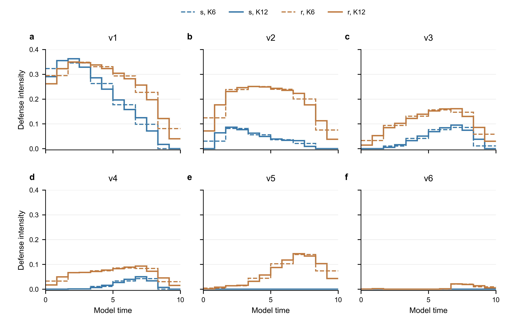
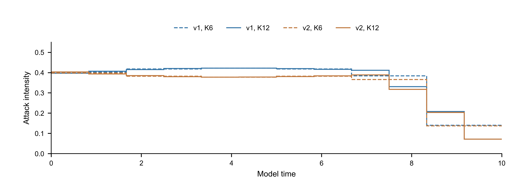
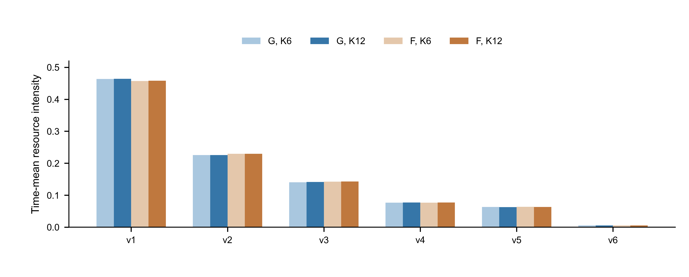
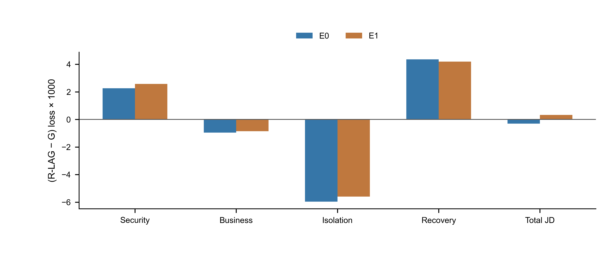
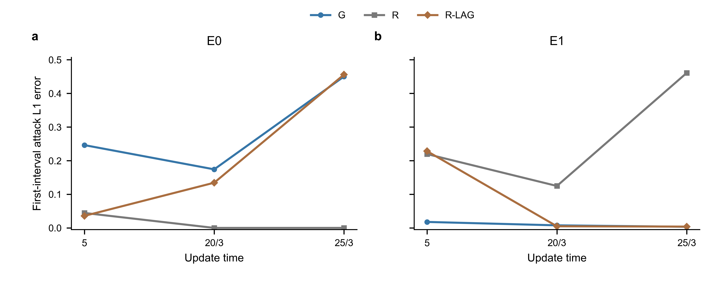

# Work D8-2 补充仿真实验报告

日期：2026-11-15，Asia/Shanghai。状态：实验A/B计算完成，数值审计通过；本报告供人工审阅。只开展本轮授权实验及后处理，没有修改论文第三版。程序节点0–5对应论文v1–v6。

## Material Passport

- 类型：确定性仿真实验结果与作者侧数值审计。
- 数据：D7指定六资产八边合成网络，B=1.2；新增K12及两条R-LAG执行轨迹。
- 核验状态：数值检查PASS；不同积分算法复算固定控制，不是第二台机器重优化、外部审查或全局均衡认证。
- 原始输入：source_and_config_manifest.json中的182个文件及映射；D8-1派生表不作实验输入。

## 1. 直接回答五项验收问题

1. **K6的资产平均资源优先级保持，逐段动作不能称完全稳定。** G/F的时间平均总资源均保持 v1>v2>v3>v4>v5>v6。K12相邻两段平均映射回K6后，G的a/s/r最大差分别为0.0131623、0.00861277、0.00280266；子段内仍存在0.136390、0.0648215、0.105487的最大变化。总目标接近与动作分辨率的影响同时存在。
2. **G/F的比较方向在K12保持。** 同一a0下F损失略低，同一aG或aBR,F下G略低；没有统一支配关系。G自身响应协议的总损失降低约0.099655%，F固定a0下约0.152871%。G的攻击也随K改变，该行不是只改变防御的因果效果。
3. **每次更新攻击响应带来可观测但很小的执行差异。** E0下G的事件后损失比R-LAG高0.000297971（约0.004305%，分母为G）；E1下G比R-LAG低0.000325850（约0.004729%，分母为G）。差异高于积分误差，未证明具有实际云运维意义。
4. **方向在E0/E1不一致。** E0排序R<R-LAG<G<P，E1排序G<R-LAG<R<P，均以损失越低越好。
5. **新增证据支持指定网络中平均配置和比较方向对一次K精化保持，以及预测更新的条件性小幅差异。** 不支持博弈重规划普遍优越、预测误差独立因果贡献、连续控制收敛、全局Nash或真实部署有效。

## 2. 执行、参数与来源

原参数全量见source_and_config_manifest.json和D7原model.json。T10/B1.2/A0.8、入口v1/v2、q5=4、八条有向传播边、成本、容量系数、初始状态均不改变。当前核心、D5编排及D7脚本与D7实际source_snapshot哈希一致。182个登记来源在收尾复查；全部D7/D8-1来源未改。项目根DECISIONS.md与APPROVAL_LOG.md只追加本轮明确执行授权，前缀字节哈希另行核验，不冒充结果批准。

阶段记录位于checkpoints/gate0..4.json。Gate0来源登记通过；Gate1的K12及K3/2/1全分量梯度、目标、容量映射、嵌入等价和小规模响应检查通过；Gate2的K12正式求解/交叉完成，用时164.62 s；Gate3比较完成；Gate4六次R-LAG更新及执行完成，用时47.50 s。Gate5在图件和交付核验完成后由finalize.json登记。

首次启动A在创建结果目录时发生一次基础设施错误，尚未调用优化器，记录launch01_preoptimization_failure.json。修复独立适配器的父目录创建并公开说明后，按原登记设置启动，未丢弃任何数值结果、未改参数或更换初始化。早期图件自动检查曾未找到已有本地PDF检查依赖，且静态扫描未识别循环导出；保留首轮日志，补充依赖路径和显式导出后复核。这些不是实验数值失败或重优化。

正式优化尝试149次（K12 95次、R-LAG 54次），另有Gate1小规模6次，全部正常退出。交替过程早期偏离量允许较大，验收针对各路径最终候选及固定候选复核，不用全过程早期残差充当最终Nash诊断。所有起点、控制、退出码、实际种子及耗时保存在optimizer_calls.jsonl、optimizer_attempts.csv、trace.jsonl。

## 3. 实验A：控制精化

### 3.1 相同物理积分步长

K6/H48与K12/H24都为10/288；H再加倍两次分别形成10/576、10/1152。没有重新优化K6，只复算固定策略。复制K6每段两次嵌入K12，在相同物理步长下状态与目标差均为0。K12主解始终取Uniform，三路径最终控制差为0.000111374，未按收益选路径。

下表采用各方法自身训练/响应攻击：G为aG、F为a0。因此G/F两行之间不能直接当同攻击方法比较。K6与K12自身G攻击不同，双边目标的改变可能同时反映攻防策略变化。

| method | K | H | J_D | J_A | security | business | isolation | recovery |
|---|---|---|---|---|---|---|---|---|
| G | 6 | 48 | 9.3266467 | 5.81971101 | 8.17698957 | 0.145233265 | 0.303665493 | 0.700758377 |
| G | 12 | 24 | 9.31735223 | 5.81191368 | 8.1557303 | 0.146959947 | 0.307853263 | 0.706808716 |
| F | 6 | 48 | 9.46679638 | 5.70663517 | 8.32911829 | 0.145134189 | 0.296437485 | 0.696106414 |
| F | 12 | 24 | 9.45232441 | 5.68710022 | 8.30194062 | 0.146965696 | 0.301010103 | 0.702407998 |

| method | K6 | K12 | difference | change_percent |
|---|---|---|---|---|
| G | 9.3266467 | 9.31735223 | -0.00929447472 | -0.099655053 |
| F | 9.46679638 | 9.45232441 | -0.0144719632 | -0.152870756 |

完整三层匹配积分结果见K12_vs_K6_objective_comparison.csv；分项绝对/相对变化见results/K12/objective_changes.csv。G安全损失降低0.0212593，但业务、隔离和恢复成本分别增加0.00172668、0.00418777、0.00605034。F的对手a0跨K相同，因此其损失变化可直接解释为此固定攻击下新增时间分辨率的数值改善，仍不是全局最优证明。

### 3.2 动作差异与资产优先级

node=-1表示全部六资产合并；Linf/RMSE比较的是K12两段均值减K6；within_parent比较同一原区间内第二子段减第一子段。攻击合并RMSE含四个非入口数值零，入口各自RMSE另保留在完整CSV，不能把合并RMSE当入口专属误差。

| method | control | Linf | RMSE | within_parent_Linf | within_parent_RMSE |
|---|---|---|---|---|---|
| G | a | 0.013162318 | 0.00310343579 | 0.136390434 | 0.0364819256 |
| G | s | 0.00861277479 | 0.00209731969 | 0.064821528 | 0.0236562696 |
| G | r | 0.00280266298 | 0.00069517133 | 0.105487317 | 0.0364740131 |
| F | a | 0 | 0 | 0 | 0 |
| F | s | 0.0100075336 | 0.00220155066 | 0.0638053736 | 0.023534559 |
| F | r | 0.00211709303 | 0.000637886374 | 0.104308425 | 0.0361742292 |

| method | node | K6_mean | K12_mean | change |
|---|---|---|---|---|
| F | 0 | 0.457045907 | 0.458080712 | 0.00103480516 |
| F | 1 | 0.229653571 | 0.229529294 | -0.000124276469 |
| F | 2 | 0.142230387 | 0.142947221 | 0.000716833899 |
| F | 3 | 0.0766694967 | 0.0772016698 | 0.000532173046 |
| F | 4 | 0.0634427411 | 0.0633134806 | -0.000129260452 |
| F | 5 | 0.00514562273 | 0.00534748663 | 0.000201863901 |
| G | 0 | 0.46373819 | 0.464316773 | 0.000578582841 |
| G | 1 | 0.225360419 | 0.225408215 | 4.77955344e-05 |
| G | 2 | 0.140468716 | 0.141291794 | 0.000823078204 |
| G | 3 | 0.0767863505 | 0.0772848542 | 0.000498503624 |
| G | 4 | 0.0629604838 | 0.0628305031 | -0.000129980678 |
| G | 5 | 0.00519012649 | 0.00523110854 | 4.09820527e-05 |

平均总资源顺位全部保持。隔离方面，G非零资产顺序v1>v3>v2>v4，F为v1>v2>v3>v4；v5/v6均为数值零（1e-8排序容差下并列，不把舍入噪声解释为排名反转）。恢复顺序两方法均为v1>v2>v3>v5>v4>v6。具体逐资产、逐区间变化与映射值在asset_rankings.csv、asset_means.csv、subinterval_changes.csv中。只有两个K值，不能据此宣称控制离散已收敛。

图1：G六资产隔离s和恢复r的阶梯控制，K6虚线/K12实线，无平滑，全部六资产显示。相同颜色代表相同行动。全量数据为两组原始控制JSON。

图2：两个入口的G攻击强度也随精化调整，不把G目标差全部归于防御精化。

图3：G/F在两个K值下的逐资产时间平均s+r；固定确定性实例，没有误差条或统计重复含义。

### 3.3 K12完整交叉评价

| method | attack | J_D | J_A | security | business | isolation | recovery |
|---|---|---|---|---|---|---|---|
| G | a0 | 9.45278158 | 5.67726909 | 8.29115965 | 0.146959947 | 0.307853263 | 0.706808716 |
| G | aG | 9.31735223 | 5.81191368 | 8.1557303 | 0.146959947 | 0.307853263 | 0.706808716 |
| G | aBR_F | 9.31754359 | 5.81187898 | 8.15592166 | 0.146959947 | 0.307853263 | 0.706808716 |
| F | a0 | 9.45232441 | 5.68710022 | 8.30194062 | 0.146965696 | 0.301010103 | 0.702407998 |
| F | aG | 9.31781361 | 5.82253523 | 8.16742981 | 0.146965696 | 0.301010103 | 0.702407998 |
| F | aBR_F | 9.3180911 | 5.82256993 | 8.1677073 | 0.146965696 | 0.301010103 | 0.702407998 |

| K | attack | G | F | F_minus_G | percent_F_to_G |
|---|---|---|---|---|---|
| 6 | a0 | 9.46722849 | 9.46679638 | -0.000432111292 | -0.00456449336 |
| 6 | aG | 9.3266467 | 9.3270807 | 0.00043399912 | 0.0046531078 |
| 6 | aBR_F | 9.32686 | 9.32737606 | 0.000516065734 | 0.00553280719 |
| 12 | a0 | 9.45278158 | 9.45232441 | -0.000457163727 | -0.00483652176 |
| 12 | aG | 9.31735223 | 9.31781361 | 0.000461379241 | 0.00495158263 |
| 12 | aBR_F | 9.31754359 | 9.3180911 | 0.000547510334 | 0.00587577786 |

同一列内才是同一攻击条件；跨K的aG/aBR,F分别重新生成，标签相同不表示数值相同。攻击最佳响应最大化JA，不能解释为对JD的最坏攻击。K12的G与F在各自响应协议下差异依然很小。完整H24/48/96成本分项、状态和每段容量见K12_cross_evaluation.csv、results/K12/cross_states.csv、cross_resource.csv。

## 4. 实验B：R-LAG

R-LAG首次使用离线G的攻击[3:6]，后两次严格使用同一E0/E1分支上一次G选定warm计划的攻击[1:]，分别为3、2、1段。所有六次输入来源哈希、切片、自身初态和自身防御暖启动都有记录，provenance_checks.csv逐项完全一致。实际攻击与D7 P/G/R逐分量完全相同，前三段防御也完全相同；只执行当前计划首段，不把整个预测计划视为执行结果。第一次状态为共同x(5)，之后来自R-LAG自身上一执行段终态。未重新求解D7的G/P/R或重新生成冻结攻击。

### 4.1 主要结果：[5,10]事件后累计损失

| evaluation | method | security | business | isolation | recovery | J_D |
|---|---|---|---|---|---|---|
| E0 | R | 6.4960297 | 0.0568779993 | 0.0698618373 | 0.298037538 | 6.92080707 |
| E0 | R-LAG | 6.48773749 | 0.0563280653 | 0.0698005844 | 0.307149491 | 6.92101563 |
| E0 | G | 6.48547913 | 0.0572829004 | 0.0757633361 | 0.302788232 | 6.9213136 |
| E0 | P | 6.53782273 | 0.0483951672 | 0.0491220945 | 0.289984175 | 6.92532417 |
| E1 | G | 6.44354663 | 0.0586743614 | 0.0795372988 | 0.308449402 | 6.89020769 |
| E1 | R-LAG | 6.44612155 | 0.0578271347 | 0.0739405616 | 0.312644292 | 6.89053354 |
| E1 | R | 6.45559335 | 0.0589909834 | 0.076402691 | 0.299825856 | 6.89081288 |
| E1 | P | 6.51412379 | 0.0483951672 | 0.0491220945 | 0.289984175 | 6.90162522 |

下表正值表示R-LAG优于比较方法，百分比分母为对应比较方法。

| evaluation | comparator | comparator_minus_R_LAG | percent_comparator_to_R_LAG |
|---|---|---|---|
| E0 | P | 0.00430854088 | 0.0622142845 |
| E0 | G | 0.000297970556 | 0.00430511566 |
| E0 | R | -0.000208552749 | -0.0030134166 |
| E1 | P | 0.0110916799 | 0.16071113 |
| E1 | G | -0.000325849667 | -0.00472917046 |
| E1 | R | 0.000279333948 | 0.00405371547 |

R-LAG相对P在两种条件下改善约0.062214%和0.160711%，但相对G的方向反转。对“重新求当前攻击响应”的增量，采用R-LAG−G：E0为−0.000297971，E1为+0.000325850。正值才表示G较好。它们是两条算法执行轨迹的差异，包含后续自身状态及防御暖启动的累积反馈，不是将状态逐次完全匹配后识别出的纯攻击更新因果效应。

图4：R-LAG−G各分项及总JD，放大1000倍；正值为R-LAG成本较高。相反方向的分项抵消造成很小的净差异，不以安全损失单项代替综合损失。

### 4.2 攻击预测与防御变化

下表仅取每次更新实际执行的首区间，三个等长区间的时间平均。L1/Linf只对两个攻击入口计算。

| evaluation | method | L1 | Linf |
|---|---|---|---|
| E0 | G | 0.290253583 | 0.158408282 |
| E0 | R | 0.014834717 | 0.00741735852 |
| E0 | R-LAG | 0.208752557 | 0.115496986 |
| E1 | G | 0.00960331143 | 0.00525500258 |
| E1 | R | 0.268425452 | 0.148175971 |
| E1 | R-LAG | 0.0789922999 | 0.0399830205 |

E0中R的预测最贴近实际，R-LAG居中，G最远；E1中G最贴近，R-LAG居中，R最远，方向与总损失排序一致。这是指定冻结攻击下的一致解释，不能推出真实攻击预测能力、误差与损失的单调定理或独立因果机制。所有剩余预测段误差另存R_LAG_prediction_errors.csv；不把这些尚未执行的段当作实际行动。

图5：三次更新首区间的L1偏差，无平滑和统计推断。

各次防御行动最大改动如下：replanning_change是相对自身上一计划同一待执行段，temporal_change是相对上一实际执行段，minus_G是相对D7 G在同一绝对时段。三种口径不同。

| evaluation | update | control | replanning_change | temporal_change | minus_G |
|---|---|---|---|---|---|
| E0 | 0 | r | 0.00968314252 | 0.0556142557 | 0.00509694062 |
| E0 | 0 | s | 0.0315987995 | 0.0540302287 | 0.0164056053 |
| E0 | 1 | r | 0.0045396251 | 0.042016048 | 0.000502327925 |
| E0 | 1 | s | 0.00380394122 | 0.0623860271 | 0.0017576903 |
| E0 | 2 | r | 0.00460105759 | 0.15993827 | 0.000135888545 |
| E0 | 2 | s | 0.00240852613 | 0.13657817 | 0.00021301208 |
| E1 | 0 | r | 0.0096824387 | 0.0556141429 | 0.0050960833 |
| E1 | 0 | s | 0.031599026 | 0.0540300022 | 0.0164053787 |
| E1 | 1 | r | 0.015485348 | 0.0515080069 | 0.000589759927 |
| E1 | 1 | s | 0.0187563585 | 0.0474328737 | 0.000665688808 |
| E1 | 2 | r | 0.00015040444 | 0.17022621 | 0.000131475791 |
| E1 | 2 | s | 7.73975218e-05 | 0.146850753 | 5.92791006e-05 |

逐资产变化见results/R_LAG/action_changes.csv，实际容量见R_LAG_E0/E1_controls.csv及results/resource_usage.csv，状态三精度轨迹见results/R_LAG/E0/E1_states.csv。全时域辅助结果保存在各objectives.csv中；共同历史完全相同，事件后和全时域绝对配对差一致，但百分比分母不同。

### 4.3 计算耗时

| source | method | count | median | min | max |
|---|---|---|---|---|---|
| D7_saved | G | 6 | 15.1012627 | 3.9396502 | 28.6215485 |
| D7_saved | R | 6 | 3.56532725 | 0.9233413 | 5.8061135 |
| D8_2_current | R-LAG | 6 | 3.9775522 | 1.3951016 | 6.328964 |

单位为实际墙钟秒。replanning_total包括本方法初始三起点与H48最终响应审计，H96额外审计单列；嵌套单方调用不重复累加。G/R是D7历史保存时间，R-LAG为本次时间，不是同时重测的性能基准。R-LAG表中仅包含新增防御优化成本，**仍依赖已有G历史攻击计划的生成成本**，不能据此说R-LAG可以独立替代G或更便宜地部署。模型时间未实测标定，也未模拟计算期间系统继续演化，不能宣称实时能力。

## 5. 数值质量与来源审计

下表报告各检查的最大值及出现位置。完整每条诊断见K12_numerical_quality.csv与R_LAG_numerical_quality.csv；原始退出码和完整控制见两个实验目录的日志。缺失位置表示该检查适用于整条执行轨迹；source_row保存在完整表，可追溯。

| check | value | threshold | experiment | evaluation | method | update | path | audit | player | H | count | all_passed |
|---|---|---|---|---|---|---|---|---|---|---|---|---|
| K6_fixed_control_integration | 1.99484873e-11 | 1e-06 | — | K6_reference | F | — | — | — | — | — | 2 | True |
| audit_exit_failures | 0 | 0 | K12 | offline | G | -1 | uniform_validation | H24_multistart | D | 24 | 20 | True |
| common_attack_and_prefix | 0 | 0 | R_LAG | E0 | R-LAG | — | — | — | — | — | 2 | True |
| continuity | 0 | 1e-12 | R_LAG | E0 | R-LAG | — | — | — | — | — | 2 | True |
| control_violation | 1.66533454e-15 | 1e-10 | K12 | aG | G | — | — | — | — | — | 8 | True |
| fixed_control_integration | 2.08535411e-11 | 1e-06 | K12 | a0 | G | — | — | — | — | — | 6 | True |
| fixed_execution_integration | 5.76945158e-11 | 1e-06 | R_LAG | E1 | R-LAG | — | — | — | — | — | 2 | True |
| incumbent_residual | 7.40881211e-05 | 0.0001 | K12 | offline | G | -1 | random | strict_path_final | D | 24 | 27 | True |
| optimizer_control_violation | 2.66453526e-15 | 1e-10 | K12 | offline | G | -1 | uniform | — | A | 24 | 149 | True |
| optimizer_exit_failure | 0 | 0 | K12 | offline | G | -1 | uniform | — | D | 24 | 149 | True |
| relative_improvement | 2.7870519e-09 | 1e-07 | K12 | offline | G | -1 | random | strict_path_final | D | 24 | 27 | True |
| response_distance | 8.56517255e-05 | 0.001 | K12 | offline | G | -1 | random | strict_path_final | D | 24 | 27 | True |
| response_residual | 3.04345622e-06 | 0.0001 | R_LAG | E1 | R-LAG | 0 | multistart | H96_fixed_candidate | D | 96 | 20 | True |
| state_domain | 0 | 1e-10 | K12 | a0 | G | — | — | — | — | — | 8 | True |
| three_path_control_spread | 0.000111374242 | 0.001 | K12 | offline | G | -1 | uniform_validation | — | — | — | 1 | True |
| three_start_control_spread | 5.65243837e-06 | 0.001 | R_LAG | E1 | R-LAG | 2 | multistart | — | — | — | 8 | True |
| violation | 8.8817842e-16 | 1e-10 | K12 | offline | G | -1 | uniform | H48_fixed_candidate | A | 48 | 20 | True |

Gate1最大梯度误差4.17755e-9（K12防御向量分量22）；三路径最大差0.000111374；归一化已发现改善最大2.78705e-9、当前点投影残差最大7.40881e-5，均在K12 G Random路径最终候选；响应距离最大8.56517e-5也在该候选。原始迭代过程不等同于最终验收集合。小规模响应的6次尝试全部正常退出，独立保存在gate1_small_response_raw.json。状态范围原始极值与位置另存results/state_extrema.csv，容量逐段记录另存results/resource_usage.csv。

采用独立实现的增广ODE右端及DOP853，对本次6条K12交叉轨迹和2条R-LAG完整轨迹重新积分，状态/成本最大差5.7904348e-11，低于1e-6。该程序不调用优化器；这是同一执行者使用另一积分算法的数值审计，不是外部独立复现。结果见results/independent_fixed_control_audit.csv。全部478条展开数值检查通过，源码及原数据哈希保持。

上述工程检查不是未知全局Nash gap上界，不证明连续控制全局最优、均衡存在唯一或求解器全局收敛；K12只是新增的受限分段常值策略类。没有新参数扫描、其他预算重跑、真实云部署或新理论证明。新增图件均直接读取本次保存的控制、目标和比较表，来源哈希见figures/figure_sources.json。

## 6. 结果解释与交付边界

本轮关闭了“指定D7网络尚无K12控制精化”和“缺少历史博弈预测消融”两个有限证据缺口。平均资产配置与G/F同列比较方向保持，但子时段动作变化可见；当前G攻击更新在E1稍有收益、在E0稍有代价。证据不支持扩大为稳定博弈优势，论文若后续修订，应继续保留小收益、方向反转、合成参数及局部数值边界。

论文第三版、D7原始数据与D8-1文件均未修改。全部新增结果交用户进行下一轮审核；没有将本轮计算通过登记为G2或结果人工批准。复现方式见README_REPRODUCE.md，完整文件与SHA256见data_manifest.csv及SHA256SUMS。
