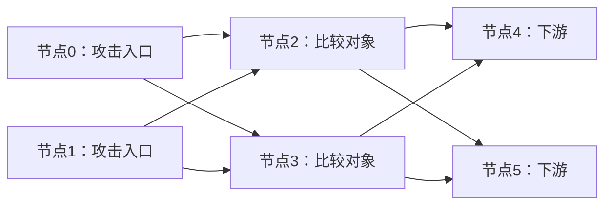

# 匹配网络实验说明：项目问题、实验过程与结果之间的关系

2026-10-28修订。本文是面向项目负责人的研究说明，不是最终论文。模型、数据和实验范围没有改变；旧版保存在history/MATCHED_MECHANISM_FINDINGS_before_explanation_20261028.md。完整数值仍见[MATCHED_MECHANISM_RESULTS.md](MATCHED_MECHANISM_RESULTS.md)。

## 1. 从项目主题出发：我们究竟想解决什么问题

项目研究“面向异质网络的攻防微分博弈与动态防御资源分配”。这里的异质性具体指：一个节点自身受损造成的损失，与它把攻击传播给其他节点的能力，不一定一致。

例如，节点甲本身价值高，受损后直接损失大；节点乙本身价值较低，却能把攻击传到下游。防御者既要减少当前受损，也要避免后续传播。资源不足时，不能把每个节点的所有防御都开到最大，因此必须决定：在哪个节点投入、投入隔离还是恢复、每个时段投入多少。

项目只保留两种防御动作。隔离s_i抑制节点i向外的传播，不直接清除它已有的受损实例；恢复r_i降低节点i的受损比例。恢复也会间接减少向外传播，因为能够参与传播的受损实例变少了。因此，不能先验地规定“高价值只对应恢复，高传播只对应隔离”。两种动作的效果有重叠，分配需要结合整个网络计算。

防御还会产生业务中断和行动成本。所以，即使资源有余量，也不一定值得继续投入。本项目的预算B是每个时刻可同时使用的防御容量，不是整个研究期可花完的一笔钱。B=0.6不是现实货币，也不是“60%的服务器”。模型时间和资源均未标定为现实单位。

项目最终想回答：当直接价值和传播强度不重合时，隔离与恢复应该怎样随时间分配，什么条件下防御侧重点会改变？

本次实验先回答其中一个更小的问题：**改变高价值所在位置时，防御配置的变化是否取决于节点的出传播强度？**如果连这个关系都没有可复核的证据，就不宜直接讨论价值—传播关系引起的优先级变化。但回答这个小问题，也不等于已经找到了动态切换条件。

### 本报告的术语含义

|名称|具体含义|不应混同的概念|
|---|---|---|
|直接价值q_i|本节点每单位受损比例在防御损失中的权重，高值为4、普通值为1|不是攻击成功概率，也不是已标定的现实价格|
|出传播强度|一个节点所有出边传播率之和，是固定网络参数|不是实际传播损失；实际后果还取决于受损状态、控制和下游状态|
|受损比例x_i(t)|工作负载实例组中受损实例所占比例|不是单台服务器被攻击的概率|
|隔离s_i、恢复r_i|0至1之间的控制强度|不是节点价值或受损比例|
|容量绑定|某一槽总资源使用达到B，增加一项投入需减少其他投入|不代表每个节点都在同时隔离和恢复|
|四格差值|两种传播条件下，移动高价值造成的控制变化之差|不是损失降低百分比，也不是时间上的切换次数|
|局部响应候选|交替调整双方计划并通过当前局部优化检查后保存的策略对|不是已经证明的全局Nash均衡|

## 2. 为什么原来的实验不足以回答这个问题

原正式实验比较了资产价值分配、业务代价、预算及联合控制与若干基线。它能够给出成本与控制轨迹，但在解释资源为什么分给某个节点时存在混杂：原图的高、低出传播强度节点，同时具有不同的入口身份、初始受损、入边和距入口距离。

假设移动高价值后，某个节点获得更多恢复投入。这个变化可能与传播强度有关，也可能因为这个节点离入口更近或一开始已经受损。仅比较原图的两种价值位置，不能把这些解释分开。提高优化精度只能排查求解误差，不能消除这种网络位置差异。

所以，G1-C1批准的新实验构造了一张小型合成网络，让两个被比较节点具有相同的入口暴露、初始受损和路径距离，再改变它们的出传播强度与直接价值。原实验及负结果保留，新实验独立保存，不将新旧配置混算。

## 3. 新网络具体是什么

网络包含编号0至5的六个节点，代表六个工作负载实例组，不是已经部署和测量的六台真实云服务器。

图中只有这八条有向边。攻击者只能直接攻击0和1；2和3通过入口节点传播受到影响，再可能把攻击传给4和5。初始时节点0受损比例为0.10，其他节点均为0。

节点2和3都不是入口，初始受损都为0，都直接接收来自0和1的传播，都只向4和5传播。来自同一个入口的两条边权相等：0→2与0→3相等，1→2与1→3相等。因此，它们面对相同的入口暴露和路径距离。

三个网络种子只改变上述两组入口边的数值。同一个种子下的四格和三个预算共用同一组入口边。

|网络种子|0→2与0→3的共同边权|1→2与1→3的共同边权|
|---:|---:|---:|
|11|0.050286|0.079942|
|22|0.069308|0.055944|
|33|0.075491|0.085479|

种子在这里不是攻击者类型，也不是三次真实云观测，而是三组可复现的合成网络参数。求解时使用的随机初始控制，是另一项数值检查，不能与网络种子混淆。

## 4. 四格实验具体改变了什么

实验考察两个因素：节点2、3的出传播强度是否相等，以及高直接价值位于2还是3。每个因素有两种条件，因此共有四种配置。

|配置|节点2到每个下游的边权|节点3到每个下游的边权|节点2价值|节点3价值|比较目的|
|---|---:|---:|---:|---:|---|
|A：传播相等，高价值在2|0.08|0.08|4|1|记录传播对称时的一种价值位置|
|B：传播相等，高价值在3|0.08|0.08|1|4|与A比较，观察移动价值的影响|
|C：传播不等，高价值在2|0.12|0.04|4|1|高价值与较强出传播位于同一节点|
|D：传播不等，高价值在3|0.12|0.04|1|4|高价值与较强出传播位于不同节点|

A、B中，两节点出传播强度均为0.16；C、D中，分别为0.24和0.08。两节点出强度之和始终为0.32。其他节点价值均为1，全网络总价值始终为9。这样不会把总价值增加或总传播权重增加误当成价值与传播位置关系的效果。

“移动高价值”是比较两次独立仿真，不是在一次仿真中途把价值搬走。每次仿真内部的图和价值参数都固定，随时间槽变化的是攻击与防御控制。

防御者可以在全部六个节点安排隔离和恢复，并非只控制2和3。攻击收益权重g_i始终为1；交换的是防御者损失中的q_i，没有同时改变攻击者的价值权重。每一格都会重新求解双方控制，因此四格差值反映双方调整后的配置差异，不能直接当作保持攻击不变时防御者的单独反应。

## 5. 每一格如何计算，36个配置如何得到

### 5.1 把研究时域划分为六个决策槽

总时域T=10，划为六个等长槽，每槽长度10/6。时间尚未对应现实的秒、小时或天。一个槽内控制保持常数，槽与槽之间可以不同。

攻击者在每槽为两个入口选择攻击强度，总容量A=0.8。防御者在每槽为六个节点各选择隔离和恢复强度，共12个防御控制。此次所有资源容量系数为1，因此每槽全部隔离与恢复强度之和不能超过B。

这些控制计划在仿真开始前一起求解。它们是时间依赖的开环安排，不是运行中收到新告警后即时调整的状态反馈策略。连续变化的是受损状态，控制用六段常值近似。

### 5.2 给定控制，计算受损如何传播与恢复

模型计算入口直接攻击、上游传播和恢复三个过程。入口攻击和未被隔离的上游传播增加受损；基础恢复和主动恢复减少受损。传播还乘以目标节点剩余未受损比例，不能简单无限累加。

保持不变的参数包括：入口直接攻击系数0.25、基础恢复率0.10、主动恢复效率0.30、隔离有效性1、隔离业务代价系数0.05，各行动二次成本系数为1。完整方程见[模型规范](../02_MODEL_SPEC.md)，每格完整参数保存在model.json和config.yaml。

根据计算出的受损轨迹，防御者希望降低累计的价值加权受损损失、隔离业务损失与行动成本；攻击者希望提高累计受损收益并减少攻击成本。两方目标不是互为相反数，因此攻击者收益提高不保证防御损失同幅增加。

### 5.3 让双方交替改进整段计划

计算从一组可行计划开始。先固定攻击计划，优化防御者六个槽的隔离与恢复；再固定更新后的防御计划，优化攻击者六个槽的攻击；这样反复进行。一次优化调整的是整段计划，不是仅选择当前时刻的一个动作。

每轮另对同一个未改变的策略对分别检查：防御者单独改计划还能降低多少目标值，攻击者单独改计划还能提高多少目标值。不能把先后更新过程中针对不同对手计算的改善，冒充同一策略对的检查。

每格从均分资源、全零控制、可行随机控制三种初始计划分别求解。“零初值”只是数值优化的起点，不是将整个场景设为无攻击。多种起点用来排查结果是否只是算法从某个初值停下来的产物。

### 5.4 停止后再检查，而不是停下就称作均衡

先用每槽12个积分子步求解。随后从当前控制、零控制、随机控制以及将资源集中在单个通道的控制等多个起点，再搜索单方改进，并用每槽48个子步重新优化和核验。

预设要求是：已搜索到的最大相对单方改善不超过1e-7，当前控制投影残差不超过1e-4，三种初始计划所得控制最大差不超过1e-3。投影残差检查的是：沿局部改善方向移动并重新满足约束后，控制还能变化多少。它越小，越接近该检查下的局部驻点。

这些检查没有穷尽全部控制计划，所以不能证明全局最佳响应或全局Nash均衡。48个积分子步也不等于48个决策槽：它只是更精细地计算同一六槽控制下的状态变化。

### 5.5 扩展到三个预算和三个网络种子

四格分别在B=0.6、1.2、1.8下求解，再对三个网络种子重复，总计4×3×3=36个模型配置。每格的多初值和优化器调用不是新增现实样本。

实际先完成seed11、B=1.2四格，通过数值门槛后才扩展。36配置已全部完成，主批次累计计算约39.5分钟。28配置后按时间分段保存，再核验输入继续8配置。另在同环境独立复跑首组四格，三初值与细积分版本共16组控制与首次完全一致。

## 6. 四格怎样比较，结果数字是什么意思

仅比较C与D，能看到高价值与较强传播重合或分离时控制不同，但还不能说明变化与传播差异有关。即使两节点传播相等，只移动价值，恢复投入也可能跟着移动。

因此，先算B−A，即传播相等时移动高价值造成的控制变化；再算D−C，即传播不等时同样移动高价值造成的变化。最后计算：

**四格差值 =（D−C）−（B−A）。**

若差值为零，表示在这组参数和这个指标上，传播强度分配没有改变价值移动造成的控制变化；不表示价值移动没有影响，也不表示原控制为零。若差值不为零，则表示价值对控制配置的作用依赖传播条件。这里是模型干预的四格对比，不是使用观测数据估计政策前后效果的双重差分。

以seed11、B=0.6的节点2全时域平均恢复投入为例：

|配置|平均恢复投入|
|---|---:|
|A：传播相等，高价值在2|0.0992004|
|B：传播相等，高价值在3|0.0071547|
|C：传播不等，高价值在2|0.1043737|
|D：传播不等，高价值在3|0.0079246|

传播相等时，移动高价值使节点2恢复减少约0.0920457；传播不等时减少约0.0964491。后者比前者多减少约0.0044034。这就是旧报告中“r2交互差为−0.0044034”的含义：价值从节点2移走后，它的恢复下降幅度随传播条件改变。负号不是损失恶化，也不是防御收益下降0.44%。

同样的计算分别用于节点2、3的隔离与恢复。既保存逐槽差值，也比较全六槽、前四槽、末两槽的平均差；积分投入则是各槽控制乘槽长度再相加，另行保存。

前四槽覆盖0至约6.67，末两槽覆盖约6.67至10。分开报告是因为项目关心时间变化，而模型终点没有额外损失惩罚：接近终点时，预防传播能够影响的未来时间变短。仅在末期出现的现象不能直接推广为脱离当前时域设定的规律。没有为制造效果而改变终端权重。

预设绝对平均差超过0.001才作为可分辨的效应。它是控制量尺度上的工程阈值，不是统计显著性、损失改善门槛或实际部署价值。三个种子逐个展示，不用于总体概率推断。

## 7. 实验结果怎样对应项目问题

### 7.1 低预算：传播条件影响恢复分配，但比较节点几乎不使用隔离

B=0.6时，三个种子前四槽节点2恢复的四格差值分别约−0.006428、−0.007356、−0.006017；节点3分别为−0.004761、−0.005602、−0.006030。方向一致，均超过0.001，并在不同初值和积分精化后保持。因此，在这些配置中，价值移动引起的恢复分配变化确实依赖传播条件。

这12个配置的前四槽均用满容量，说明容量限制在这些时段实际发挥作用。但节点2、3隔离投入近零，因此不能把它写成“两个节点在隔离和恢复之间来回切换”。这里主要观察到的是恢复投入怎样重新分配。

比较节点不隔离，不等于整个网络不隔离。例如seed11、B=0.6、配置D，入口0和1的全时域平均隔离投入分别约0.020277和0.107613。全部资源是在六个节点之间分配，包含入口隔离、入口恢复与其他节点恢复。旧报告只突出2、3的指标，漏掉了这一必要背景。

低预算末期也并非所有效应同向：节点2恢复四格差值在三个种子中分别约−0.000354、+0.001425、−0.002335。因此较一致的恢复方向只能限定在前四槽，不能扩成整个时域的统一规律。

### 7.2 中预算：网络参数改变后，效应的方向和出现时段不一致

B=1.2时，seed11、22前四槽没有超过阈值的四格平均差，末两槽才出现节点2隔离以及节点2、3恢复效应。seed33则在前四槽出现负的恢复四格差值，节点2、3分别约−0.002084、−0.005087，末两槽无超过阈值的差值。

因此不能概括为“中预算出现统一的切换”。实际观察对入口边参数敏感，前期和末期也不同。只展示seed11/22的末期现象会遗漏改变结论的重要结果。

### 7.3 高预算：隔离和恢复均出现差异，但多数时段资源有余量

B=1.8时，三个种子前四槽节点2隔离四格差值分别约+0.001761、+0.001745、+0.001798；节点3恢复分别约+0.001480、+0.001467、+0.001457，均超过阈值。这里可以说，价值与出传播强度的组合同时改变了隔离和恢复配置。

例如seed11在传播不等的网络中，把高价值从2移至3后，节点2平均隔离由0.0012819增至0.0027851，平均恢复由0.1818423降至0.0691734。这个现象与“本地恢复减少后，需要更多出站传播抑制”的解释相容。但本实验没有单独固定恢复轨迹或攻击计划来拆解这条路径，因此它是可能解释，不是被独立证实的因果机制。

更重要的是，12个高预算配置中，11个前四槽没有用满容量，余下一个仅1槽用满。因此不能将这里的配置差异普遍解释为“资源不够，隔离和恢复必须争抢”。即使容量松弛，受损损失、传播后果和行动成本也会影响控制选择。

还要保留几个限制：seed33前四槽节点2恢复差值约0.000924，低于阈值；节点3隔离四格差值在所有预算和时间窗都近零；高预算末期节点2隔离效应只有seed33超过阈值。

## 8. 数值通过说明了什么，没说明什么

36/36通过指的是数值可靠性：当前局部搜索没有找到超过门槛的单方改善，不同初始化得到相近控制，细积分下结果稳定。它不是36格都出现预期机制。

实际最大相对观测改善为1.54022e-9；当前控制最大投影残差为9.970996e-5，接近但未超过1e-4；三初值最大控制差为8.87604e-5；四格差值跨初值和精化最大跨度为1.87452e-6。4209次记录的局部优化调用报告成功，144组保存控制重新积分目标差为0。16项测试及完整诊断见数值报告和数据目录。

还检查了1098个可行微小资源转移方向：固定对手和当前计划，稍减一项控制，把等量容量转给另一项控制，比较目标值实际变化与梯度预测。最大误差为1.87519e-5。这用于核对局部边际计算，不证明整段计划全局最优；最小可行方向导数仍约−7.72e-6，不能宣称所有方向严格非负。

本次实验没有直接定义和检验“优先级何时切换”的统一判据。某项投入更大、两条投入曲线相交、四格差值不为零，是不同的事情。如果优先级指最值得增加一单位资源的动作，就应比较可行的边际收益，而不能直接比较投入量。在局部最优配置中，多个正在使用的动作的边际收益还可能近似相等。

因此，旧报告笼统写“完整强主张未通过”不够准确，容易让人以为已经完成直接的切换检验。准确说法是：**我们识别了价值位置与传播条件对配置的部分影响，但尚未完成从这些影响到动态优先级切换条件的证据链。**已经观察到的不一致限制推广；尚未直接检验的命题应写“未验证”，不能写“已被否定”。

## 9. 这次工作把项目推进到了哪一步

目前可以回答：在该匹配合成网络内，不能仅根据节点直接价值理解防御配置；出传播强度的分配会改变价值移动造成的控制变化。但影响发生在哪种动作、哪个时段、朝哪个方向变化，受预算和入口边参数影响。

目前不能回答：是否存在可推广的隔离/恢复优先级切换条件，何时应该从保护高价值节点转向抑制传播节点，以及这类策略在真实云环境是否有效。四格实验也没有新增强基线比较，不能据此宣称联合控制始终优于仅恢复，原负增益反例保留。

这些结果来自六槽开环控制和局部响应搜索，没有全局gap上界、全局Nash证书、连续时间Markov反馈策略或控制槽K精化。现实参数标定、全新环境全量复现及论文增量价值判断也没有完成。pytest实际版本7.4.0低于原requirements要求>=8的环境差异仍保留。

本次只重写研究说明并纠正结论表述，没有擅自设定新的切换判据、改变研究路线或启动新实验。G2仍待审；在研究过程与结论尚未充分解释和讨论时，不应催促批准论文结论。

## 10. 数据与上述问题如何对应

|需要核查的内容|对应文件|
|---|---|
|每格网络、价值、初始状态、成本和容量|results/matched_mechanism/run01/各配置/model.json、config.yaml、edges.csv|
|每槽把资源投入哪个节点、哪种动作|各配置/fine_evaluation/controls.csv，覆盖全部六个节点|
|预算是否用满，受损怎样变化|各配置/fine_evaluation/budgets.csv、trajectories.csv|
|四格原始差值和时间窗平均|run01/slotwise_effects.csv、paired_effects.csv、robust_effects.csv|
|比较节点平均与积分投入|run01/source_allocations.csv|
|数值稳定与复现证据|run01/audit.json、optimizer_audit.csv、reintegration_audit.csv、pilot_reproduction.json|
|固定攻击与响应攻击如何比较|各配置/attack_evaluation.json：同一最终防御分别接受两类攻击，并非在固定攻击下重新优化防御|

全部命令见[运行说明](../README_RUN.md)，审批范围见[G1-C1方案](../reviews/G1_C1_mechanism_identification.md)。完整数字保留在[数值报告](MATCHED_MECHANISM_RESULTS.md)，用于核查，不代替研究问题和实验逻辑的解释。
